# Wooden A-Frame Stepladder (6 ft class)

*A folding wooden stepladder with five steps, steel spreaders that pin locked, and a top cap. You build it with a handsaw and a drill. It's built to the rules for commercial stepladders, but it's not a certified ladder.*

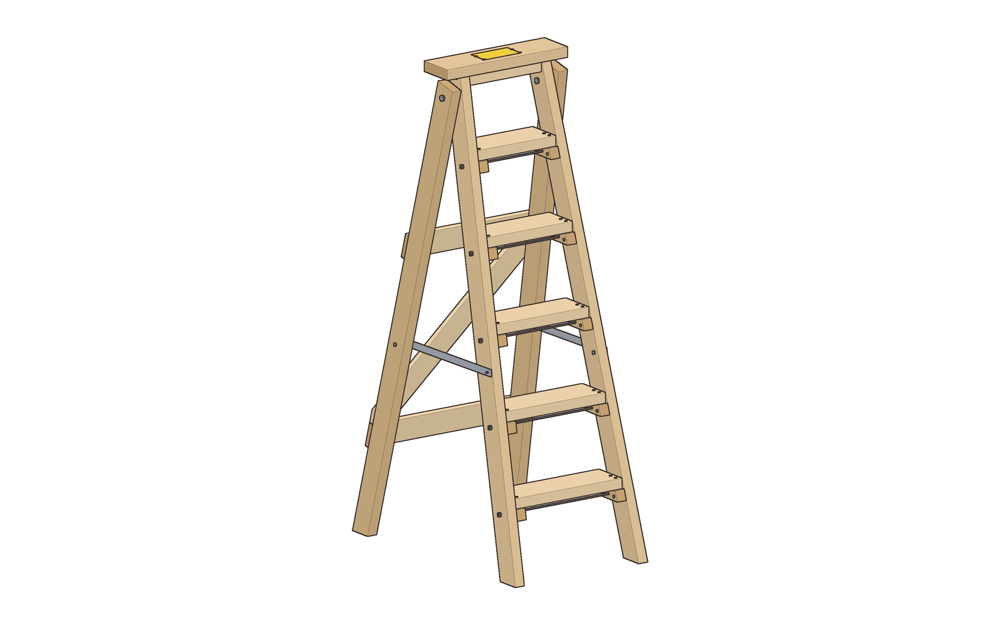

| | |
|---|---|
| **Section** | Home & Prep |
| **Ages** | Adults |
| **Time to build** | About 7 hours, plus finish drying time |
| **Difficulty** | 4 / 5 |
| **Skills taught** | Laying out angled level cuts, drilling straight through-holes, bolting a pivot, cutting and drilling flat steel |
| **Works without power** | Yes, with a handsaw, a hacksaw, a hand drill or brace, a file, a screwdriver and two wrenches |

The top cap is 69 in off the floor. It stands 26 in wide at the feet and 35-13/16 in deep, and folds to 23-1/16 in deep. The five steps are 11-1/2 in apart, from 11-1/2 in to 57-1/2 in. **The highest step you stand on is step 4, at 46 in.** Step 5 and the cap are not steps. Each 2x6 step sits on a pair of 2x2 cleats, and a 1/4-20 steel rod under it clamps the two front rails together. The rear frame swings on two 3/8 in bolts. Two flat steel bars, pinned at the back, hold it open. The ladder weighs about 45 lb.

**What this is, honestly:** a home-built ladder laid out to the same geometry rules as commercial stepladders. It's sized by calculation for a 250 lb user, ANSI's Type I duty rating. It has not been load-tested and no one has certified it. Treat it as a shop ladder for one careful adult. It's not for a jobsite where OSHA applies, and it doesn't replace a rated ladder.

## The rules it follows

| Rule | What it says | This ladder |
|---|---|---|
| [OSHA 1926.1053](https://www.osha.gov/laws-regs/regulations/standardnumber/1926/1926.1053)(a)(3)(i) | Steps 10 to 14 in apart, center to center | 11-1/2 in, every rise (floor to step 1 and step 5 to the cap too) |
| 1926.1053(a)(2) | Steps parallel, level and evenly spaced | Level cleat lines, marked from one layout |
| 1926.1053(a)(4)(ii) | Rails at least 11-1/2 in apart | 12 in inside at the top, 19 in at the floor |
| Former [29 CFR 1910.25](https://www.govinfo.gov/content/pkg/CFR-2012-title29-vol5/pdf/CFR-2012-title29-vol5-sec1910-25.pdf) (2012 wood-ladder rule) | Steps no more than 12 in apart; rails spread at least 1 in per foot of length | 11-1/2 in; 7 in of spread on a 6 ft rail |
| 1926.1053(a)(8) | A metal spreader or locking device on each stepladder | Steel bars with clevis pins and hitch clips |
| 1926.1053(a)(1)(i) and (iii) | Carry 4 × the intended load; each step carries 250 lb at mid-step | Checked by calculation at 1,000 lb on every step (see Checks) |
| 1926.1053(a)(11), (a)(12) | No splinters or snags; no opaque coating on wood ladders except labels on one face of a side rail | Sanded edges, clear finish, two labels |
| 1926.1053(b)(13) | Don't stand on the top or the top step of a stepladder | Labels on the cap and rail; step 4 is the highest standing step |
| 1926.1053(b)(14) | Don't climb the rear cross-bracing | Rear braces are on the back edges; label says so |
| 1926.1053(b)(15), (b)(16) | Inspect; tag defective ladders "Do Not Use" | Inspection list below |
| ANSI A14.1-2017 (wood ladders) | Duty ratings: IA 300 lb, I 250 lb, II 225 lb, III 200 lb | Designed for 250 lb (Type I), **not tested or rated** |

## Safety

This ladder needs its own rules, on top of the usual shop ones:

- **Never stand or sit on the cap or on step 5.** Step 4 (46 in) is the highest. If you need to reach higher, get a taller ladder.
- **Open it all the way, and put both spreader pins and their clips in before you climb.** No pins, no climbing.
- **Set it on firm, level ground**, with all four feet down. Face it, keep your belly between the rails and don't lean out sideways. About 44 lb of sideways push at the top tips a 250 lb person and the ladder over.
- **Don't climb the back**, and don't use it folded and leaned against a wall.
- **Inspect it before each use:** look for cracked rails or steps, loose rods, bolts or screws, bent bars, missing clips. If anything is wrong, tag it DO NOT USE and fix it before anyone climbs.
- Use clear finish only. Paint hides cracks.
- In the shop: wear safety glasses for every cut and hole, and file the sawn steel edges smooth.

## Parts

**Lumber.** Pick the straightest boards you can find. Look for grain running the full length, no knots on the edges, and no knot wider than about 1/2 in anywhere on the rails. Douglas fir or southern yellow pine is stiffer than spruce-pine-fir. The checks assume SPF.
- 4 × 2x4, 8 ft (rails and the top block)
- 1 × 2x6, 10 ft (steps and cap)
- 1 × 2x2, 8 ft (cleats)
- 1 × 1x4, 8 ft (rear braces)

**Steel and hardware**
- 1 × flat steel bar, 1/8 × 1 in, 48 in long (two spreaders)
- 5 × 1/4-20 threaded rod, 24 in (cut to length)
- 10 × 1/4-20 nylon-insert lock nuts and 10 × 1/4 in flat washers (rods)
- 2 × 3/8 × 4-1/2 in hex bolts, 2 × 3/8 in nylon-insert lock nuts, 4 × 3/8 in flat washers (pivots)
- 2 × 1/2 in long spacers for 3/8 in bolts (or 3/8 in washers stacked to 1/2 in)
- 2 × 1/4-20 × 2-1/4 in hex bolts, 2 × 1/4-20 nylon-insert lock nuts, 4 × 1/4 in washers (front end of each spreader)
- 2 × 1/4 × 2-1/2 in clevis pins with 2 hitch-pin clips, and two 1/4 in ID spacers 3/8 in long (or washers). A short cord ties each pin to its rail so it can't get lost.
- 50 × #10 × 2-1/2 in wood screws (44 used)
- 4 × #10 × 3 in wood screws
- 10 × #8 × 1-1/2 in wood screws
- Wood glue
- Clear finish: boiled linseed oil or clear varnish
- 2 self-adhesive vinyl labels, or a printed label under clear tape
- Optional: four rubber anti-slip pads for the feet

## Cut list

All sizes are actual dimensions.

| Part | Qty | Material | Size | Ends |
|---|---|---|---|---|
| Front rail | 2 | 2x4 | 71 in, long point to long point | 15° level cuts, parallel |
| Rear rail | 2 | 2x4 | 68-9/16 in, long point | 13° level cut at the foot, square at the top |
| Step 1 (bottom) | 1 | 2x6 | 17-13/16 in | Square |
| Step 2 | 1 | 2x6 | 16-5/8 in | Square |
| Step 3 | 1 | 2x6 | 15-7/16 in | Square |
| Step 4 | 1 | 2x6 | 14-1/4 in | Square |
| Step 5 (top step, not for standing) | 1 | 2x6 | 13-1/16 in | Square |
| Top cap | 1 | 2x6 | 20 in | Square |
| Top block | 1 | 2x4 | 12 in | Square |
| Cleat | 10 | 2x2 | 4-1/16 in, long point | 15°, parallel |
| Low rear brace | 1 | 1x4 | 24-3/4 in | Square |
| High rear brace | 1 | 1x4 | 21-13/16 in | Square |
| Diagonal brace | 1 | 1x4 | about 34-3/16 in | Marked in place |
| Spreader bar | 2 | 1/8 × 1 in steel | 20-9/16 in, holes 19-1/16 in apart | Rounded corners |
| Truss rod | 5 | 1/4-20 rod | 21-13/16, 20-5/8, 19-7/16, 18-1/4, 17-1/16 in | Filed |

The rail end cuts also lean about 3° across the board's thickness. That's 1/16 in, so cut them square through the thickness and sand the feet flat if a corner rocks.

**Leftovers:** 2x4 pieces of 12-3/4, 24-7/8, 27-5/16 and 27-5/16 in; 22-1/8 in of 2x6; 54-5/16 in of 2x2; 14-7/8 in of 1x4; about 6-7/8 in of steel bar; and 2 to 7 in from each rod.

## Tools

- Handsaw (crosscut) and a hacksaw with a fine blade for the steel and rods
- Bevel gauge, or a speed square, set to 15° and 13°
- Hand drill or brace, with bits: 13/32 in, 5/16 in, 9/32 in, and pilot bits for #10 and #8 screws; a center punch for the steel
- Two 7/16 in wrenches and two 9/16 in wrenches (or adjustables)
- Screwdriver or driver bit, measuring tape, square, pencil
- Metal file and sandpaper (80 and 120 grit)
- 2 clamps, safety glasses

## Assembly

### 1. Cut the parts
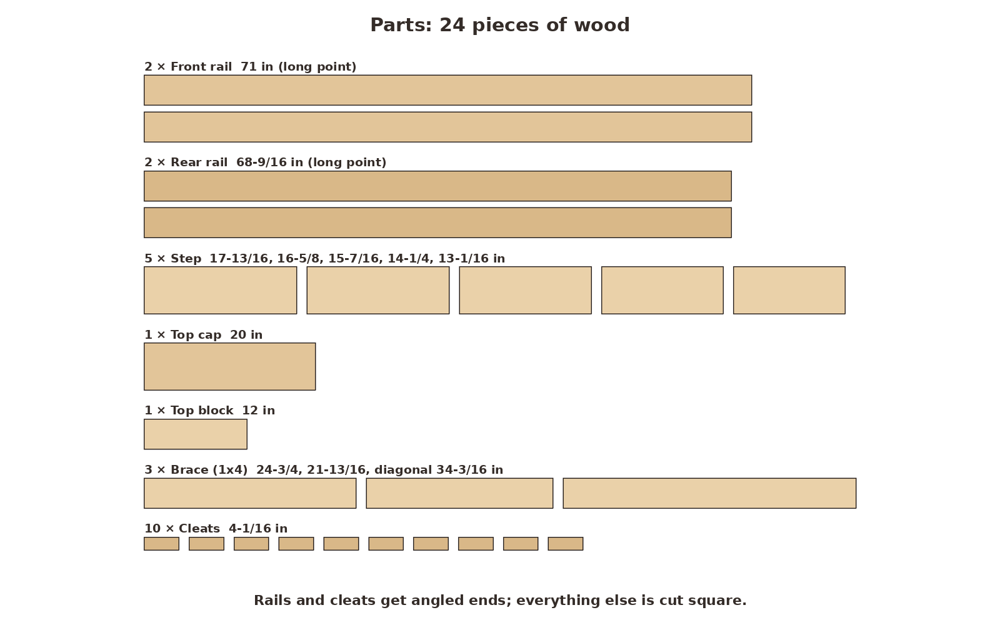 `01-parts.png`
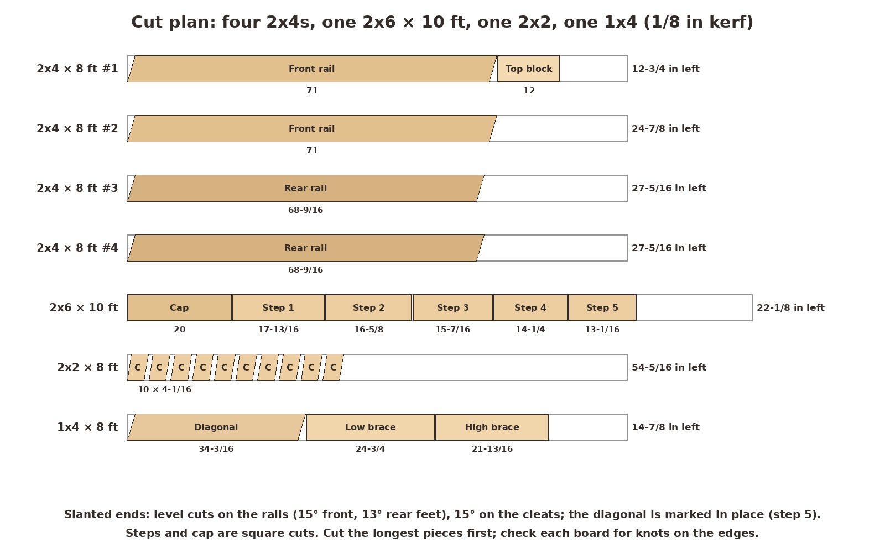 `01-cut-lumber.png`

Cut the rails first, following the cut plan. Mark each end with the bevel gauge: 15° for the front rails at both ends, so the ends are parallel. For the rear rails, 13° at the foot and square at the top. Cut the steps, cap and top block square. Cut the ten cleats from the 2x2 with both ends at 15°, parallel. Leave the diagonal brace long for now. Sand every edge round enough that it can't snag a hand.

**Look for:** two mirror-image pairs of rails, five steps that each get shorter by about 1-3/16 in, and ten matching cleats.

### 2. Mark and drill the rails
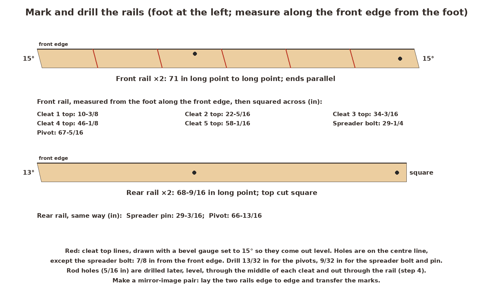 `02-mark-rails.png`

Lay the front rails edge to edge with their feet together, so you mark a mirror-image pair. Measure along the front edge from the foot to each mark, then square across. Draw the five cleat-top lines with the bevel gauge at 15°, so they come out level when the ladder stands: 10-3/8, 22-5/16, 34-3/16, 46-1/8 and 58-1/16 in. Mark the pivot hole on the center line at 67-5/16 in. Mark the spreader bolt hole at 29-1/4 in, 7/8 in in from the front edge. On the rear rails, the pivot hole is at 66-13/16 in and the spreader pin hole at 29-3/16 in, both on the center line.

Drill the pivots 13/32 in, and the spreader bolt and pin holes 9/32 in. Keep the drill square to the face.

**Look for:** level lines that match on both rails, and holes that come out the far side where you expect them.

### 3. Fit the cleats
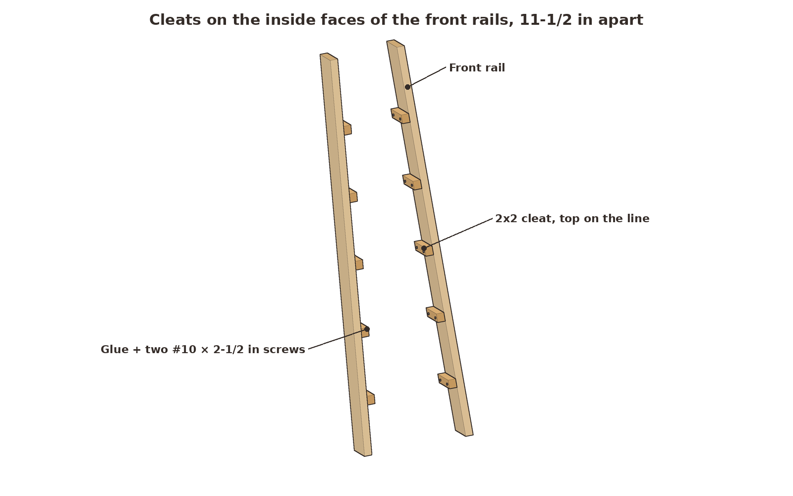 `03-cleats.png`

On the inside face of each front rail, glue a cleat with its top edge on each line and its ends flush with the rail's front and back edges. Drill pilot holes and drive two #10 × 2-1/2 in screws through each cleat into the rail, 1-1/4 in either side of the middle.

**Look for:** ten cleats with level tops, all 11-1/2 in apart measured straight up.

### 4. Add the steps, top block and rods
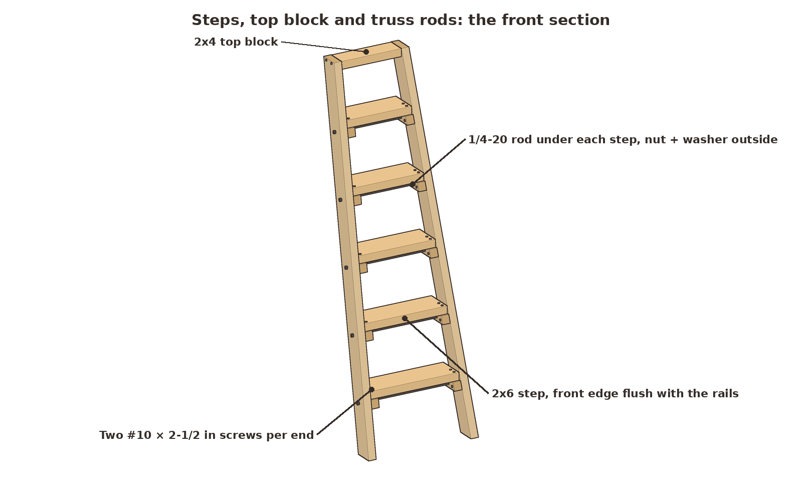 `04-front-section.png`

Stand the front rails up, or clamp them on the bench, with the 12 in top block between their tops, flush with the rail tops and front edges. Drive two #10 × 3 in screws through each rail into the block's ends. Set each step on its cleats with the front edge flush with the rails' front edges. Drill pilot holes and drive two #10 × 2-1/2 in screws down through each step end into the cleat, 5/8 in either side of the middle.

Under each step, drill a level 5/16 in hole through the middle of each cleat and on out through the rail. Push a rod through, add a washer and a lock nut on each end, and snug the nuts until the rails pull tight against the step ends. Don't crush the wood. Cut the rod ends 3/8 in past the nuts and file them.

**Look for:** a front section that stays square when you twist it, and nuts that stick out no more than about 5/16 in.

### 5. Build the rear frame
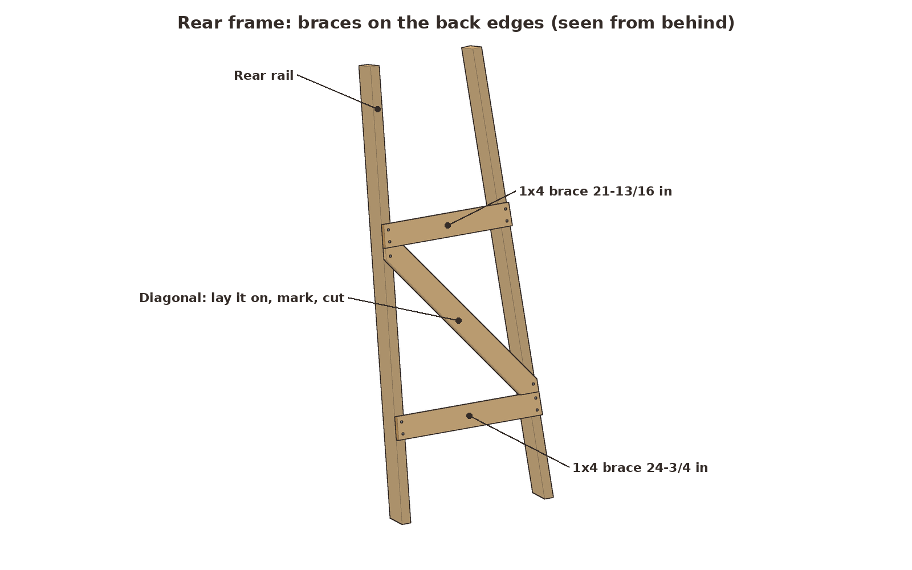 `05-rear-frame.png`

Lay the rear rails on the bench, front edges down, and spread them so they're 26 in apart outside to outside at the feet. Their pivot holes should be 17-13/16 in apart, center to center. Screw the 24-3/4 in low brace across their back edges, centered 14-3/8 in up the rails from the feet. Screw the 21-13/16 in high brace on centered 43-3/16 in up. Use two #8 × 1-1/2 in screws into each rail, with the brace ends flush with the rails' outside faces. Lay the diagonal across from the top of the low brace to the bottom of the high brace, mark both ends where they meet the braces and the rail edges, cut it, and screw it on.

**Look for:** a rear frame with the same spread as the front, braces flush with the rails' outside faces, and nothing sticking out on the front edges.

### 6. Bolt on the rear frame and cap
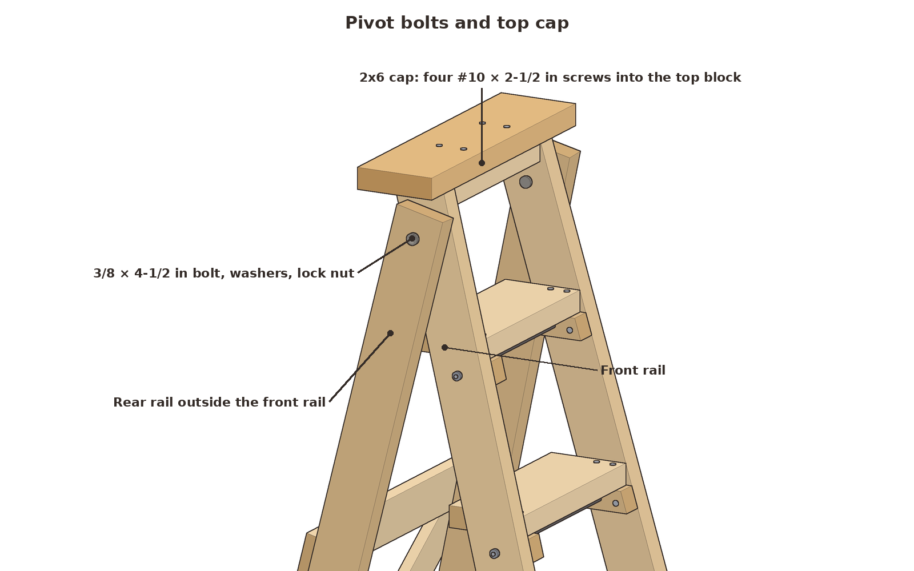 `06-pivot-cap.png`

Set the rear frame outside the front rails. Line up the pivot holes with a 1/2 in spacer in each gap. Push a 3/8 × 4-1/2 in bolt through from the inside with a washer under the head and another under the lock nut. Tighten until the frame swings with a firm drag and doesn't wobble. Screw the 20 in cap onto the top block with four #10 × 2-1/2 in screws. It overhangs the rails by 1/2 in. The rear rail tops stop 1-3/4 in above the pivot, so they swing under the cap.

**Look for:** a rear frame that swings freely, with both pivot bolts on one line.

### 7. Fit the spreaders
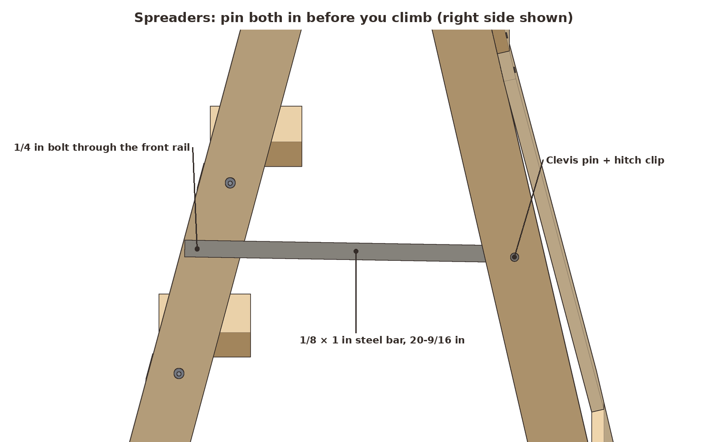 `07-spreaders.png`

Cut two 20-9/16 in bars from the flat steel, file the corners round and drill a 1/4 in hole 3/4 in from each end, which puts the holes 19-1/16 in apart. Open the ladder until the bar's back hole lines up with the rear rail's pin hole. Bolt the front of each bar to the outside of the front rail with a 1/4 × 2-1/4 in bolt, head inside, with a washer, the bar, a washer and a lock nut in the gap. Put the spacer and clevis pin through from outside the rear rail, through the bar, and fit the hitch clip. Tie each pin on with a cord.

**Look for:** feet 35-13/16 in apart front to back, both pins in, and bars that lie flat in the 1/2 in gap without rubbing the rod nuts.

### 8. Finish, label and check it
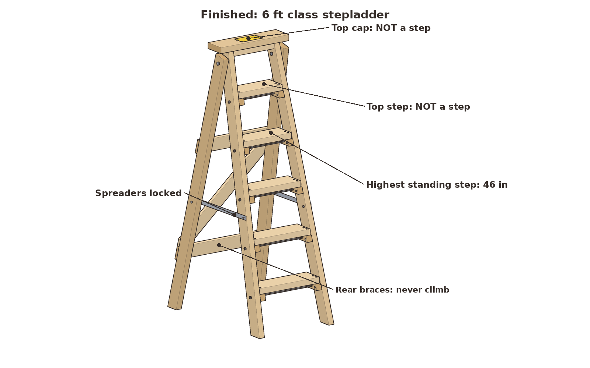 `08-finished-3q.png`
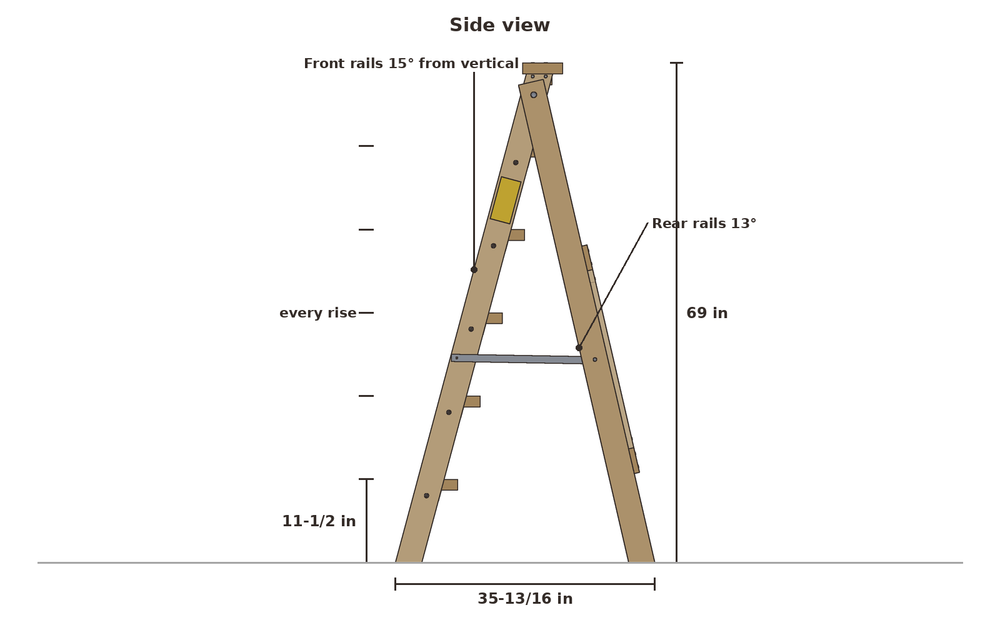 `08-side.png`
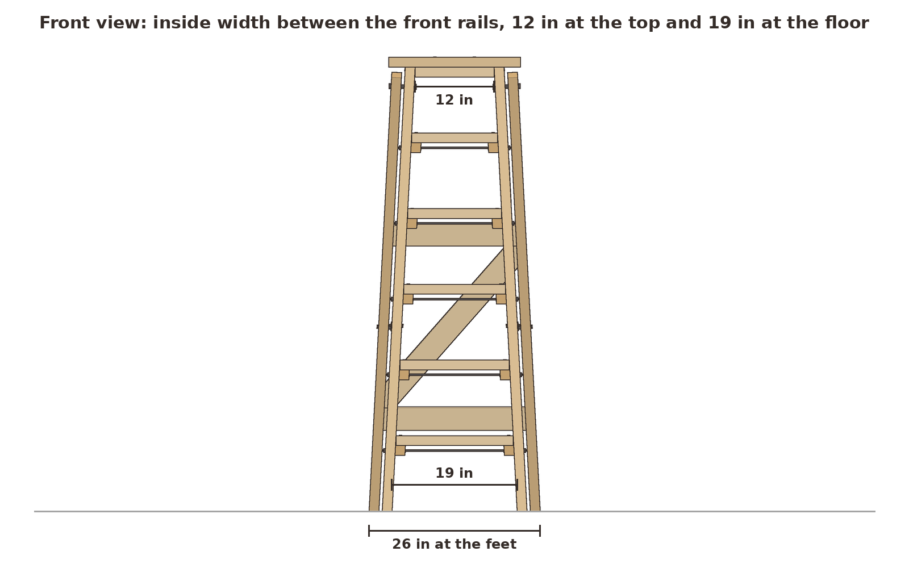 `08-front.png`
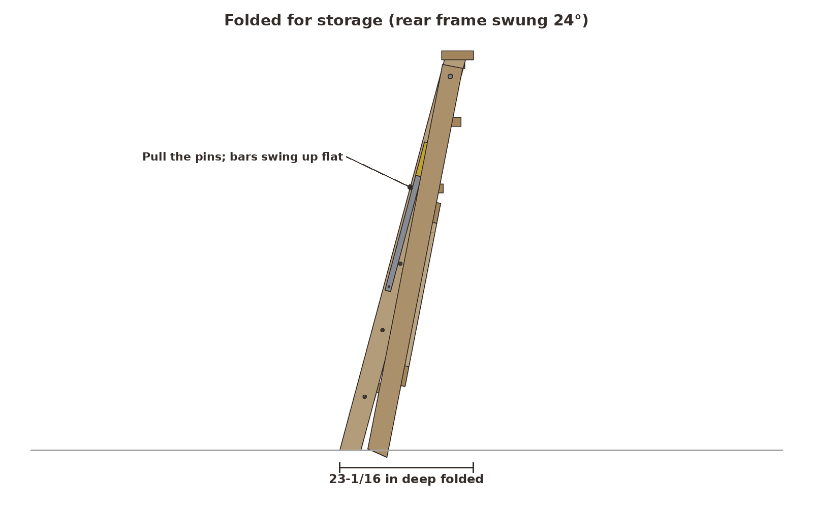 `08-folded.png`
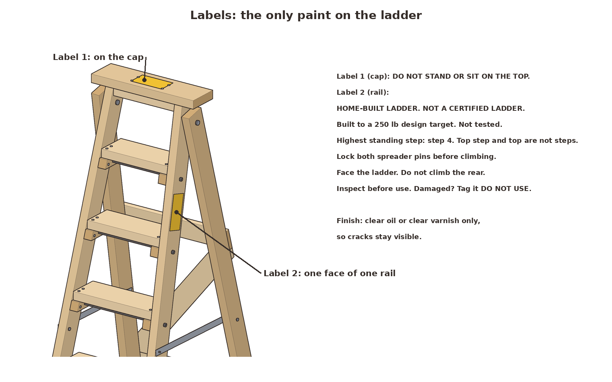 `08-labels.png`

Sand everything. Finish with boiled linseed oil or clear varnish, never paint. Put label 1 on the cap: DO NOT STAND OR SIT ON THE TOP. Put label 2 on the outside face of one front rail, at about chest height: HOME-BUILT LADDER. NOT A CERTIFIED LADDER. Built to a 250 lb design target, not tested. Step 4 is the highest standing step. Lock both spreader pins before climbing. Face the ladder; do not climb the rear. Inspect before use; tag it DO NOT USE if damaged.

Before anyone climbs, open it on a flat floor and check that all four feet touch. Stand on step 1 and bounce gently. Then work up to step 4 with someone watching the joints. To fold it, pull both pins, swing the bars up against the front rails, and fold the rear frame in. It folds 24° to 23-1/16 in deep.

**Look for:** no creaks, no rocking, and no movement at the rod nuts or the pivots.

## Checks

The numbers come from the model in `ladder_model.py`. `report.json` has all of them.

- **Fit:** no parts overlap. All 33 glued or screwed contacts touch. All 58 screws stay in wood, with at least 0.36 in to an edge. Both pivot bolts are on one line, which the rear frame needs to fold. The rear frame folds 24° before anything touches.
- **Steps at 4 × 250 = 1,000 lb at mid-span:** step 1 (the longest) reaches 2,158 psi. Its approximate short-term strength is 2,747 psi (No. 2 SPF, flat use), for a margin of 1.27. The other steps have margins of 1.36 to 1.74.
- **Cleat screws:** 500 lb per step end, against roughly 900 lb ultimate for two #10 screws (margin 1.8). That ignores the rod clamp.
- **Spreaders at 1,000 lb on step 4:** 88 lb per bar. The bar has a margin of 37, the pin 20, and the wood around the pin 14.
- **Pivot bolts:** 229 lb each, margin 8.3, limited by wood bearing.
- **Front rails as columns:** 315 lb each, against 2,778 lb for weak-axis buckling (margin 8.8).
- **Stability with a 250 lb person on step 4:** their weight sits 13-1/4 in behind the front feet and 18-15/16 in ahead of the rear feet. Sideways it's the weak direction: about 44 lb of push at the cap tips it.

These are calculations with textbook wood values. They are not a load test, and lumber varies from board to board.

## Why it works

**The steps hang on cleats, not screws.** Each step sits on a 2x2 cleat under each end, so your weight bears on wood. The screws only keep the step in place. The rod under the step pulls the rails tight against the step ends, so the front section can't spread or rack.

**The steps get shorter toward the top.** The rails lean in 7 in over their height, and that spread at the feet makes the ladder hard to tip sideways. A shorter step also bends less, so the top steps are the strongest. The longest step, at the bottom, is the one the check is sized for.

**The spreaders take the push.** Weight on the steps tries to push the front and rear feet apart. The two steel bars carry that as tension. Steel in tension is very strong, and the pins make the lock something you can see.

**Everything is on view.** A clear finish shows every crack, and the inspection list tells you what to look for. With a wood ladder, that's most of the safety.
