# Knock-Down Camp Table

*A 24 × 48 in camp table that comes apart with eight wing nuts and packs into a stack 5 in thick. Built from one plywood project panel, five boards and a bag of bolts, with a handsaw and a hand drill.*

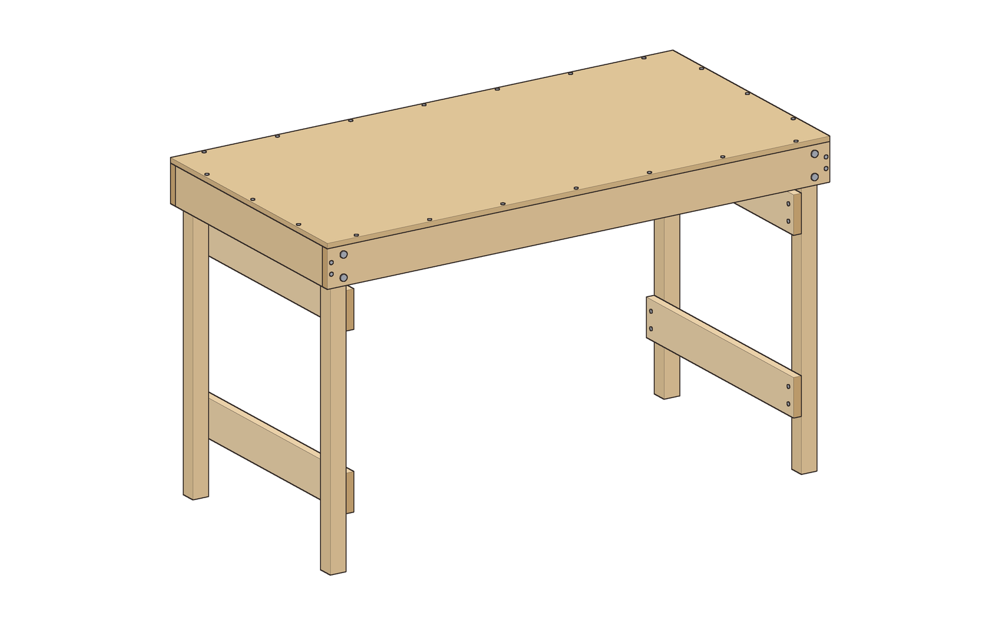

| | |
|---|---|
| **Section** | Home & Prep |
| **Ages** | Adults and families |
| **Time to build** | About 3 hours, plus finish drying time |
| **Difficulty** | 2 / 5 |
| **Skills taught** | Building a square box, pilot holes and countersinking, drilling straight through two parts at once, knock-down bolted joints |
| **Works without power** | Yes, with a handsaw, a hand drill or brace, and a screwdriver |

The top is a whole 24 × 48 in plywood panel, so it needs no cut. It's glued and screwed to a box of 1x4 aprons. Two end frames, each two 2x2 legs joined by two 1x4 rails, drop into the corners of the box. Two 1/4-20 carriage bolts with wing nuts hold each leg. The top is 29 in off the ground, a normal table height, with 25 in of knee room under the aprons and 43-1/2 in between the legs. Set up, it weighs about 25 lb.

To pack it, take out the bolts and lift out the end frames. Then turn the top face down: one end frame fits inside the aprons and the other lies on top of it. The stack is 48 × 24 × 5 in.

## Safety

- It's a table, not a step or a seat. The checks below allow for someone sitting on an edge by accident, but don't stand on it.
- The empty table is light. A sideways push of about 10 lb at the top edge tips it across its width. With 50 lb of gear on it, the push has to be about 29 lb. Keep a camp stove in the middle of the top, not at an edge.
- Check the wing nuts each time you set it up. A loose leg makes the table wobble before anything breaks.
- On soft or sloping ground, set the legs on flat stones or wood offcuts so all four bear evenly.
- In the shop: wear safety glasses while you saw and drill, and keep your hand clear of the bit when drilling through.

## Parts

**Wood**
- 1 × plywood project panel, 2 × 4 ft, "1/2 in" (15/32 in actual), sanded on at least one face. Exterior-glue plywood (rated Exposure 1 or exterior) holds up better outdoors.
- 2 × 1x4, 8 ft, and 1 × 1x4, 6 ft. Choose straight boards; the two long aprons should be the best.
- 2 × 2x2, 8 ft (1-1/2 × 1-1/2 in actual)

**Hardware**
- 8 × 1/4-20 × 3 in carriage bolts
- 8 × 1/4 in flat washers
- 8 × 1/4-20 wing nuts
- 24 × #8 × 2 in flat-head wood screws (apron corners and end frames)
- 20 × #8 × 1-1/4 in flat-head wood screws (top)
- Exterior wood glue
- Exterior finish: spar varnish, exterior polyurethane or paint
- A small zip bag for the bolts, and two cam straps for packing

## Cut list

All sizes are actual dimensions. Every cut is square.

| Part | Qty | Material | Size |
|---|---|---|---|
| Top | 1 | 15/32 in plywood | 24 × 48 in (the whole panel, no cut) |
| Long apron | 2 | 1x4 | 48 in |
| End apron | 2 | 1x4 | 22-1/2 in |
| Frame rail | 4 | 1x4 | 22-1/2 in |
| Leg | 4 | 2x2 | 28-1/2 in |

**Leftovers:** 2-5/8 in from each 8 ft 1x4, 26-3/4 in from the 6 ft 1x4, and 10-1/8 in and 67-3/8 in of 2x2. Use the long 2x2 offcut for spare legs or the next project.

## Tools

- Handsaw (crosscut) and a speed square
- Measuring tape and pencil
- Hand drill or brace, with 1/8 in and 9/32 in bits and a countersink
- Screwdriver to fit the screws
- Two clamps
- Hammer, to seat the carriage bolts
- Sandpaper, 120 grit
- Safety glasses

## Assembly

### 1. Cut the parts
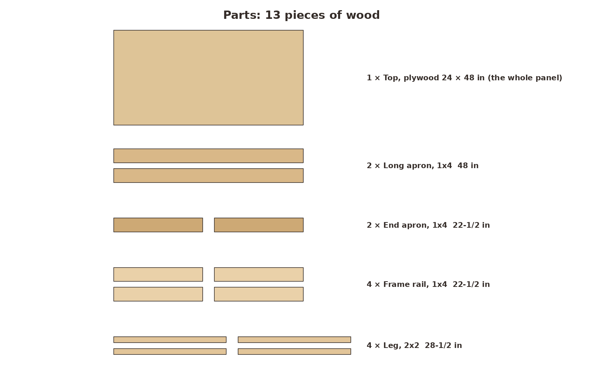 `01-parts.png`
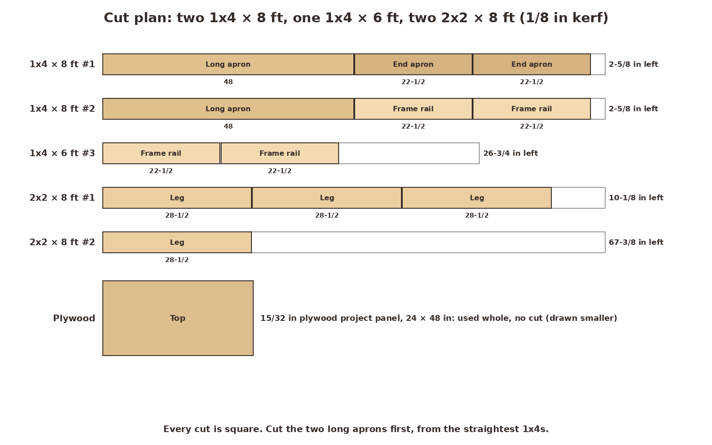 `01-cut-lumber.png`

Cut the two 48 in long aprons first, one from each 8 ft 1x4. Then cut the six 22-1/2 in pieces: two end aprons and four frame rails. Cut the four legs at 28-1/2 in from the 2x2s. Measure the plywood panel. If it isn't exactly 24 × 48 in, cut the long aprons to the panel's length, and the end aprons and frame rails to its width less 1-1/2 in.

**Look for:** two long aprons, six short 1x4s, all the same length, and four matching legs.

### 2. Build the apron box
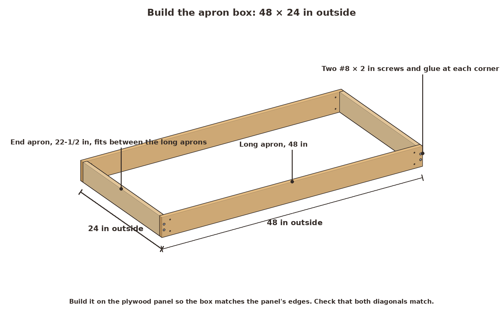 `02-apron-box.png`

Lay the plywood panel good face down on a flat floor and build the box on it so the box matches the panel's edges. The end aprons fit between the long aprons. At each corner, glue the end of the end apron, then drill two 1/8 in pilot holes through the long apron into it and drive two #8 × 2 in screws. Measure both diagonals; they should match within 1/8 in.

**Look for:** a box 48 × 24 in outside, with the top edges of all four aprons flush.

### 3. Screw on the top
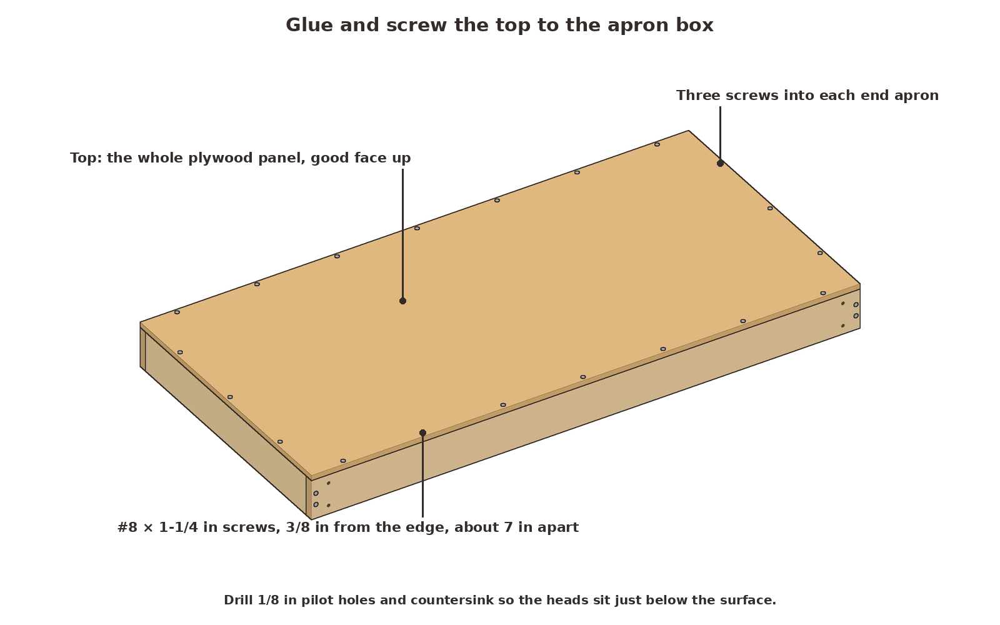 `03-top-on.png`

Run glue along the top edges of the aprons and set the panel on them, good face up, flush all round. Mark a line 3/8 in in from each edge: that's the middle of the apron below. Drill and countersink pilot holes along the lines, seven along each long side, about 7 in apart, and three along each end. Drive the #8 × 1-1/4 in screws just below the surface.

**Look for:** no screw points breaking through the faces of the aprons, and the panel edges flush with the box.

### 4. Build the end frames
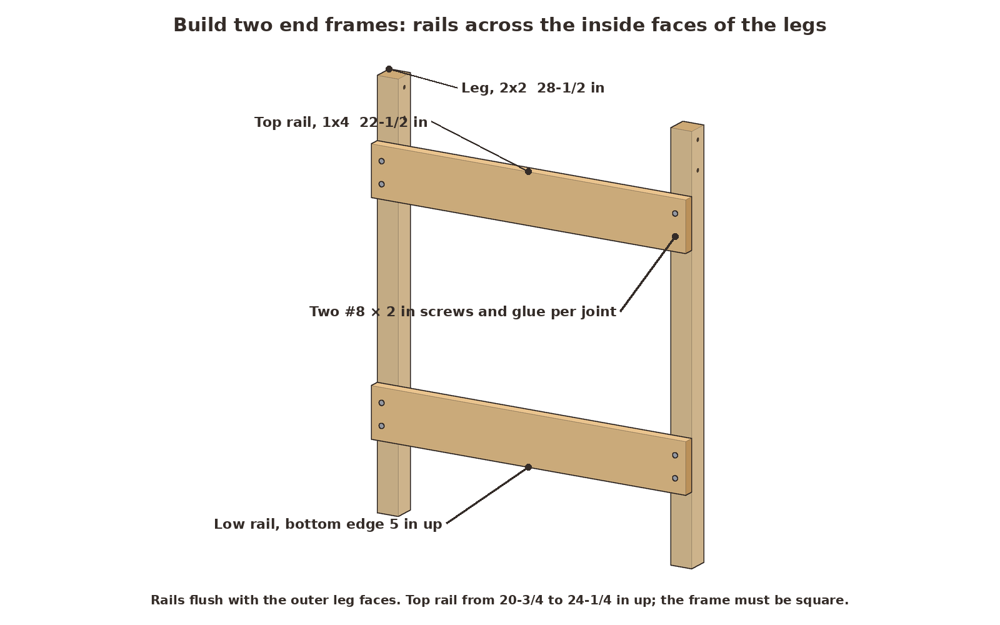 `04-end-frame.png`

Lay two legs on the floor, 19-1/2 in apart inside, so the frame is 22-1/2 in wide. Glue and screw a frame rail across them with its bottom edge 5 in up from the bottom of the legs, and a second rail from 20-3/4 in to 24-1/4 in up. Each rail end is flush with the outside of the leg and gets two #8 × 2 in screws in pilot holes. Check that the frame is square before the glue sets. Build the second frame the same way.

**Look for:** two frames that match, each 22-1/2 in wide and square.

### 5. Fit the frames and drill
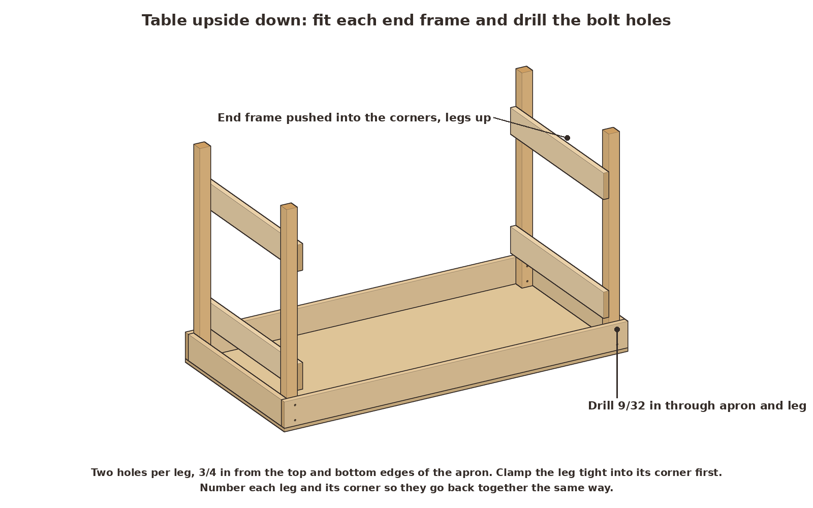 `05-fit-drill.png`

Turn the top face down on a blanket. Stand an end frame in one end of the box, legs up, rails toward the middle. Push it into the corners: the end of each leg rests on the plywood, and its sides touch the long apron and the end apron. Clamp each leg tight to the long apron. Drill two 9/32 in holes straight through the long apron and the leg, at the middle of the leg, 3/4 in from the top and bottom edges of the apron. Do the other frame. Mark each leg and its corner (1 to 4) so they always go back together the same way.

**Look for:** holes square to the apron, coming out in the middle of the leg's inside face.

### 6. Bolt it up
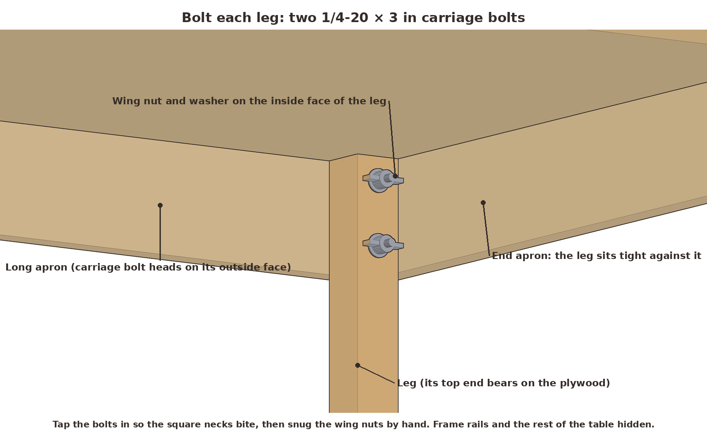 `06-bolt-detail.png`

Push a carriage bolt through each hole from the outside and tap the head so the square neck bites into the apron. Put a washer and a wing nut on the inside and tighten them by hand. Take the frames out again and finish all the wood: sand the edges, then two coats of exterior finish, with extra on the leg ends and the plywood edges.

**Look for:** bolt heads flush and snug, with about 3/4 in of thread past the leg for the washer and wing nut.

### 7. Set it up
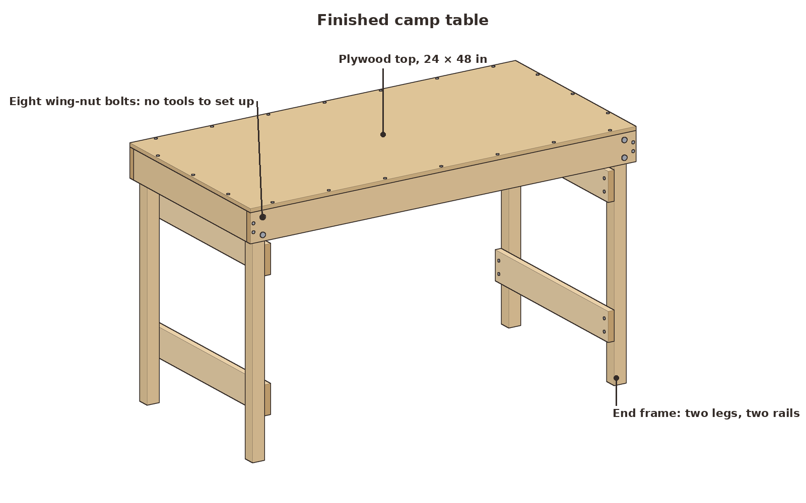 `07-finished-3q.png`
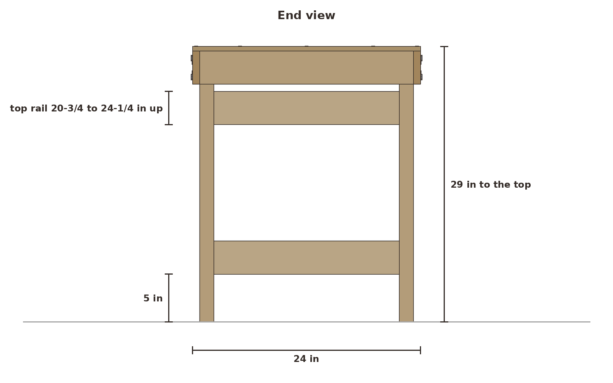 `07-finished-end.png`
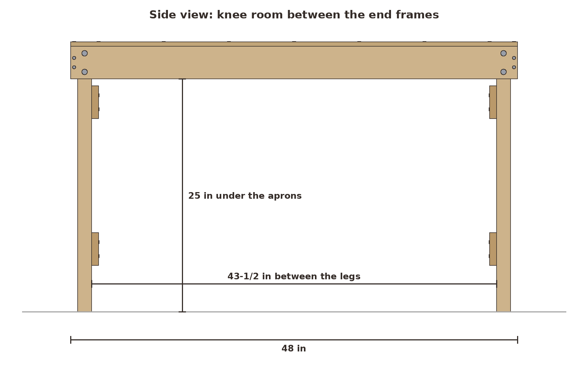 `07-finished-side.png`

Lay the top face down on a clean surface, drop the end frames into their corners, push the bolts through and spin on the washers and wing nuts. Turn it over onto its legs. It takes about five minutes and no tools.

**Look for:** all four legs on the ground and a top that doesn't rock or rack when you push it along its length.

### 8. Pack it flat
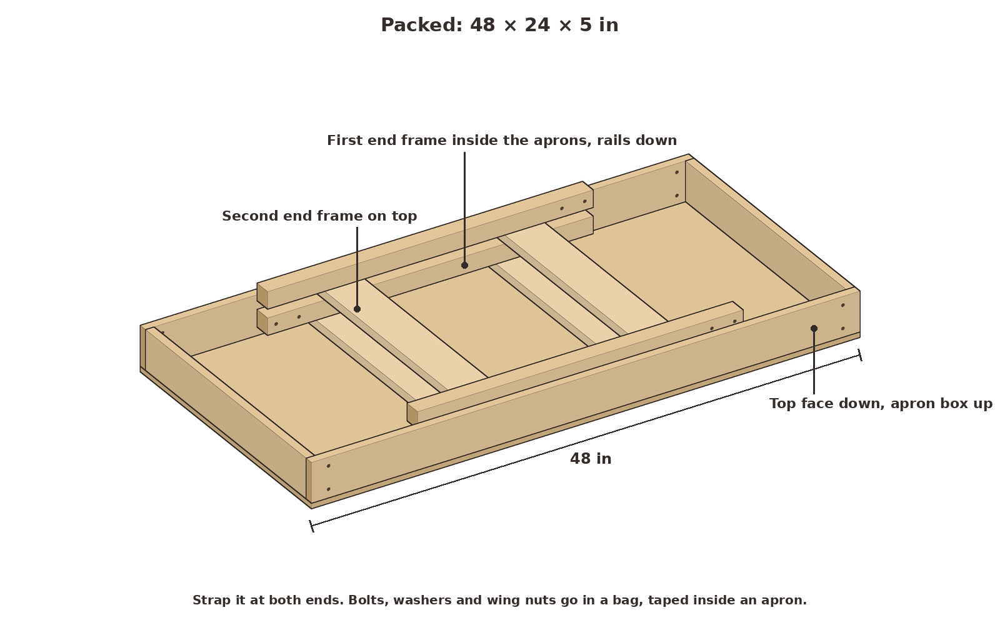 `08-packed.png`

Take out the bolts, put them in their bag with the washers and wing nuts, and tape the bag inside an apron. With the top face down, lay one end frame inside the aprons, rails down, and the second frame on top of it. Strap the stack at both ends.

**Look for:** a 48 × 24 × 5 in stack that slides flat under a seat or into a truck bed.

## Checks

The numbers come from the model in `camp_model.py`. `report.json` has all of them.

- **Fit:** no parts overlap, set up or packed. All 28 glued, screwed and bearing contacts touch: every leg touches its long apron, its end apron, the plywood and both frame rails. All 44 screws stay in wood, at least 3/8 in from any edge. All 8 bolts pass through matching holes in the apron and the leg, at least 3/4 in from any edge, with 3/4 in of thread for the washer and wing nut.
- **Top, 150 lb on a 4 in circle in the middle:** about 1,147 psi in the plywood, against roughly 2,500 psi (margin 2.18). It sags about 0.17 in. The figures use rough textbook plywood values.
- **Long apron, someone sits on the middle of an edge (200 lb):** with the whole load on one 1x4 apron spanning 45 in between the legs, it's 1,469 psi against an approximate short-term strength of 2,756 psi (No. 2 spruce-pine-fir): margin 1.88, and it sags 0.10 in.
- **Bolts:** each 1/4 in bolt, through 3/4 in of apron into 1-1/2 in of leg, is good for about 136 lb by the standard wood-bolt design rule, and yields at roughly 298 lb. A 20 lb push along the length at the top edge (about as hard as you can push before the empty table tips that way) puts about 75 lb on a bolt (margin 3.98). A 300 lb load spread over the top puts about 38 lb on each bolt.
- **Legs:** 300 lb on the table is 75 lb per leg, against about 7,177 lb to buckle a 28-1/2 in 2x2.
- **Stability:** the legs stand 3/4 in in from the edges of the top, so leaning on an edge can't tip it. Pushing sideways at the top edge tips the empty table at about 10 lb across the width and 20 lb along the length.

These are calculations with textbook wood values, not a load test.

## Why it works

**The box does the work.** Plywood is strong but floppy on its own. Screwed and glued to four aprons on edge, it becomes a stiff, flat box. The aprons carry the load to the corners, and the plywood keeps the box from twisting out of square.

**The corners locate the legs.** Each leg sits in a corner, touching two aprons, with its top end against the plywood. Weight on the table pushes the plywood straight down onto the leg ends, so the bolts aren't what holds the table up. They only keep the legs in their corners.

**Two bolts make a stiff joint.** A single bolt is a pivot, and the leg could swing on it. Two bolts 2 in apart clamp the leg to the apron, so the table resists racking along its length. The two rails tie each pair of legs into a frame, which keeps the table from racking across its width.

**Carriage bolts and wing nuts need no tools.** The square neck under the round head grips the wood, so the bolt doesn't turn while you spin the wing nut by hand.

## Try this next

Use the [sawhorse pair](../sawhorse-pair/) as a second base. Leave the end frames off, set the two horses under the box about 36 in apart, and rest the long aprons on the beams. The top is then about 35-7/8 in high, a good standing height for a camp kitchen or a work table. Clamp the aprons to the beams so the top can't slide off.
