# Folding Sawhorse

*A 2x4 sawhorse that opens to 31-3/8 in and folds flat to 6 in thick for storage.*

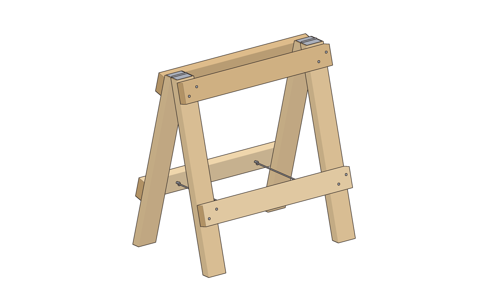

| | |
|---|---|
| **Section** | Home & Prep |
| **Ages** | Adults and families |
| **Time to build** | About 1-1/2 hours per horse |
| **Difficulty** | 2 / 5 |
| **Skills taught** | One simple 15° cut, square cuts, pilot holes, hanging a hinge, setting a chain stop |
| **Works without power** | Yes, with a handsaw and a hand screwdriver |

This is the folding companion to the sawhorse pair. Each horse has two identical leaves: two legs and two rails per leaf. The leaves are joined at the top by two 3 in butt hinges and held open by two short chains, so the horse folds flat against a wall or into a truck bed. Build two if you want a folding pair.

**What this version is:** a hinged A-frame. Only the legs have angled ends, a simple 15° cut. The rails are square-cut and screwed to the outside faces of the legs, so the screws work in shear. Opened, each leaf leans 15° and the chains stop it. Not for standing on.

## Safety

- Wear safety glasses for every cut and every hole.
- Keep your fingers out of the hinge line and away from the leaves when you open or fold the horse.
- Open the horse fully, until the chains are tight, before you load it.
- Set it on firm, level ground. Don't stand on it.

## Parts

**Lumber (one horse)**
- 3 × 2x4, 8 ft. For a pair, use 6 boards.

**Hardware (one horse)**
- 2 × 3 in butt hinge, with the screws that come with them
- 20 × #10 × 2-1/2 in construction screws (16 used, plus spares)
- 4 × screw eyes, about 1/4 in × 2 in (1 in of thread)
- 2 lengths of light chain, each 13-11/16 in eye to eye, plus 4 quick links. A 1/4 in rope tied off at the same length also works.

## Cut list (one horse)

| Part | Qty | Material | Size |
|---|---|---|---|
| Leg | 4 | 2x4 | 32-1/2 in long point to long point, 15° at both ends, same slant, cut across the 1-1/2 in edge |
| Top rail | 2 | 2x4 | 30 in, square ends |
| Bottom rail | 2 | 2x4 | 30 in, square ends |

## Tools

- Handsaw
- Drill/driver, or a hand screwdriver and an awl
- 1/8 in pilot bit; a small bit for the hinge screws and screw eyes
- Tape, speed square, pencil, 2 clamps
- Safety glasses

## Assembly

### 1. Cut the parts
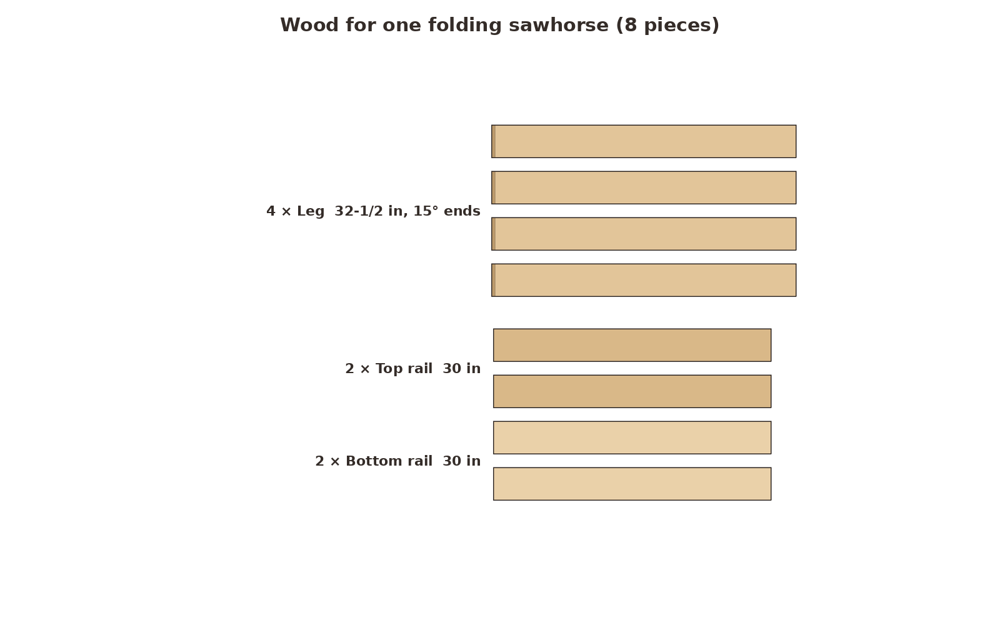 `01-parts.png`
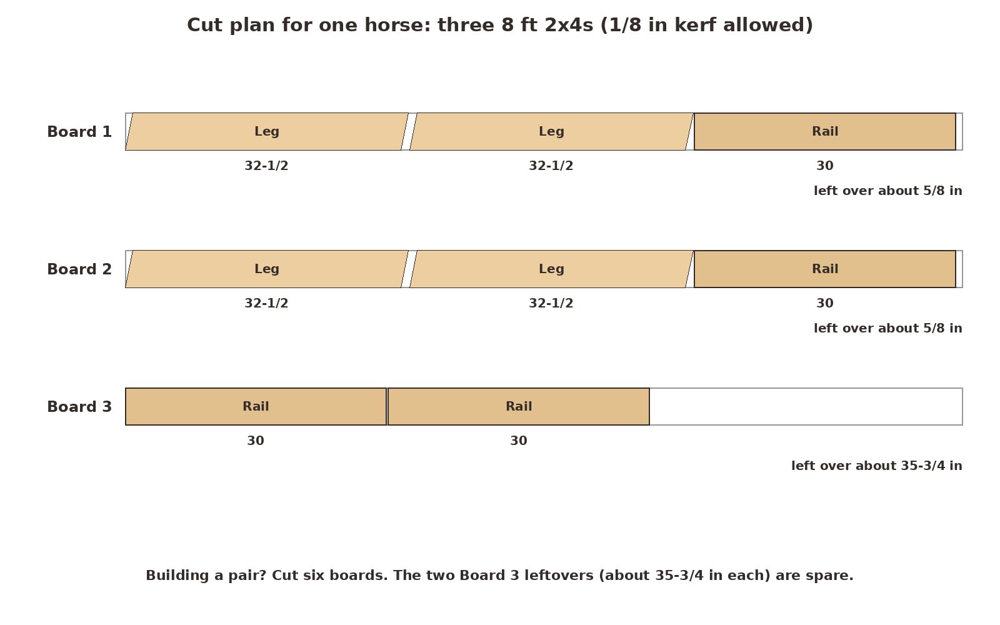 `01-cut-diagram.png`

Cut two legs and a rail from each of boards 1 and 2, and two rails from board 3. Boards 1 and 2 have only about 5/8 in to spare, so square the end first and measure carefully.

**Look for:** 4 legs and 4 rails.

### 2. Mark and cut the 15-degree leg ends
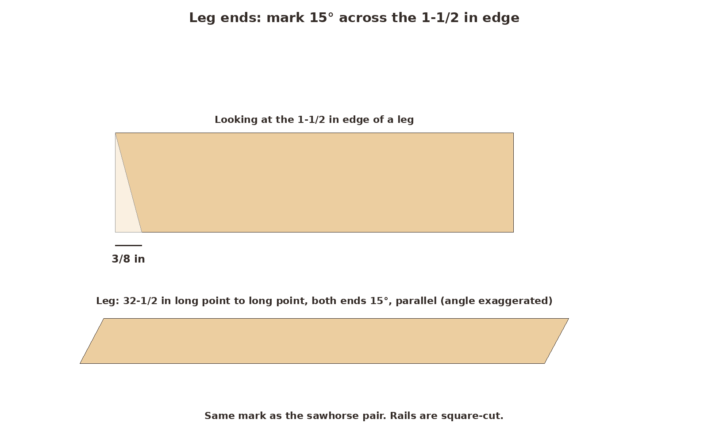 `02-mark-angle.png`

This is the same mark as on the sawhorse pair. On the 1-1/2 in edge, measure 3/8 in back from a squared end and draw a line to the opposite corner, or use a speed square set to 15°. Carry the cut straight across the face. Cut both ends of each leg with the same slant, 32-1/2 in long point to long point.

**Look for:** four matching legs.

### 3. Build two leaves
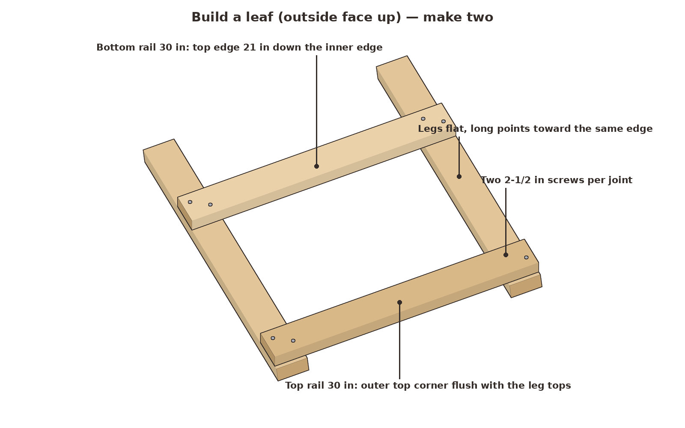 `03-leaf.png`

Lay two legs flat, 30 in outside to outside, with their long points on the same edge, which becomes the inside of the leaf. Lay a top rail across them, with its upper edge's outer corner flush with the slanted leg tops. Lay a bottom rail across them with its top edge 21 in down the inner edge from the top. Screw each rail to each leg with two #10 × 2-1/2 in screws. The screws go 1 in into the 1-1/2 in leg and stay 7/8 in or more from every edge. Build a second leaf the same way.

**Look for:** two leaves that match when you stack them.

### 4. Hinge the leaves together
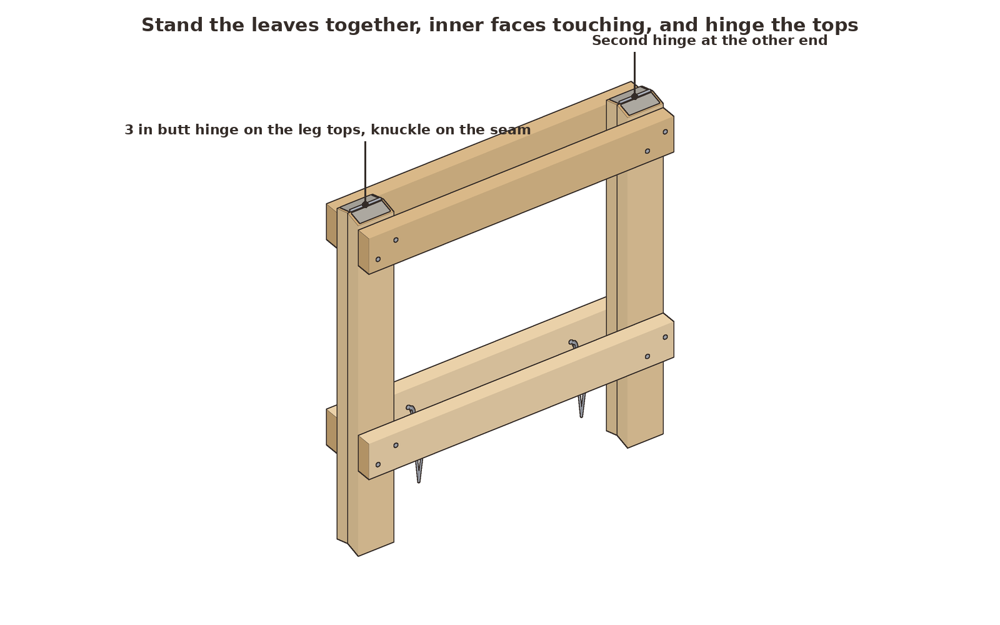 `04-hinges.png`

Stand the leaves up with their rails facing out, inner faces touching and leg tops lined up. Lay a 3 in butt hinge across each pair of leg tops, with the knuckle right on the seam. Drill small pilot holes and drive the hinge screws.

**Look for:** the leaves swing apart smoothly, and the leg tops come level when you open them.

### 5. Add the chains
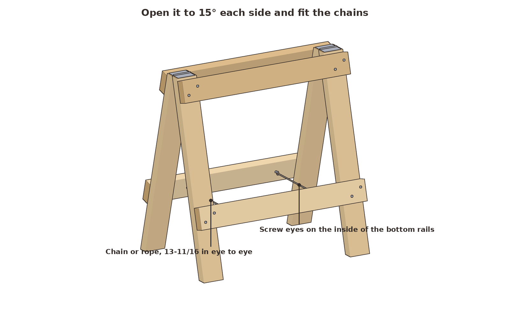 `05-chains.png`

Open the horse until its feet are 19-15/16 in apart outside to outside. Twist two screw eyes into the inner face of each bottom rail, 7 in in from each end and centered on the rail's height. Link each pair of facing eyes with chain, 13-11/16 in eye to eye.

**Look for:** with the chains tight, both leaves lean the same and all four feet sit flat.

### 6. Open it and check it
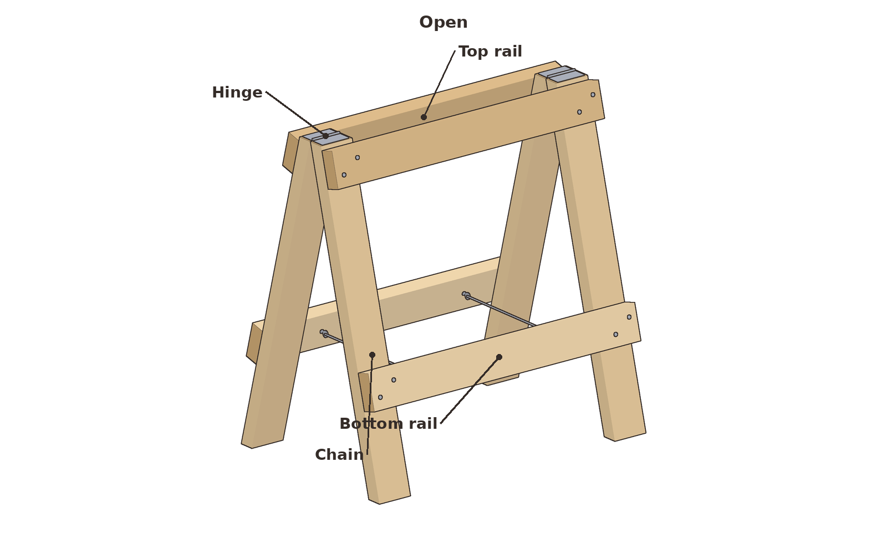 `06-open-3q.png`
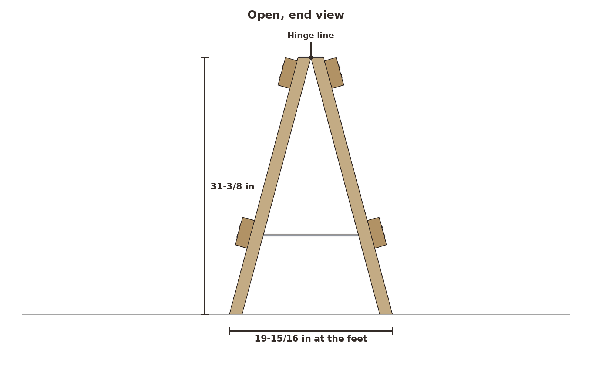 `06-open-end.png`
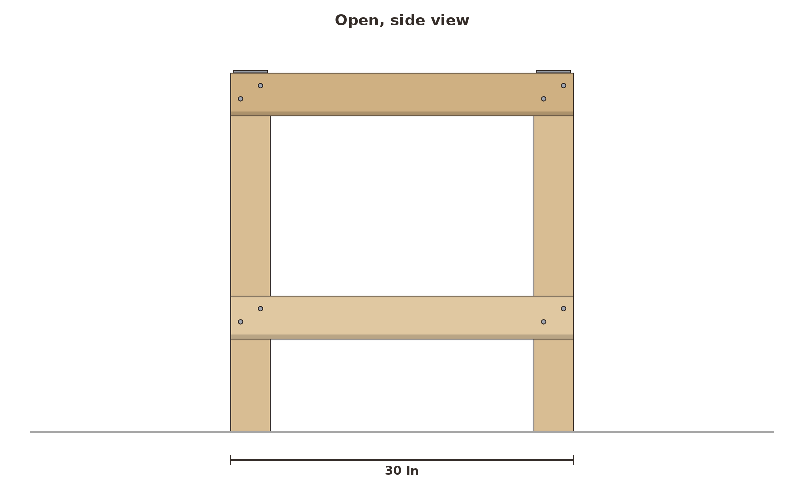 `06-open-side.png`

**Look for:** the top 31-3/8 in off the floor, the feet 19-15/16 in apart, and no rocking.

### 7. Fold it to store
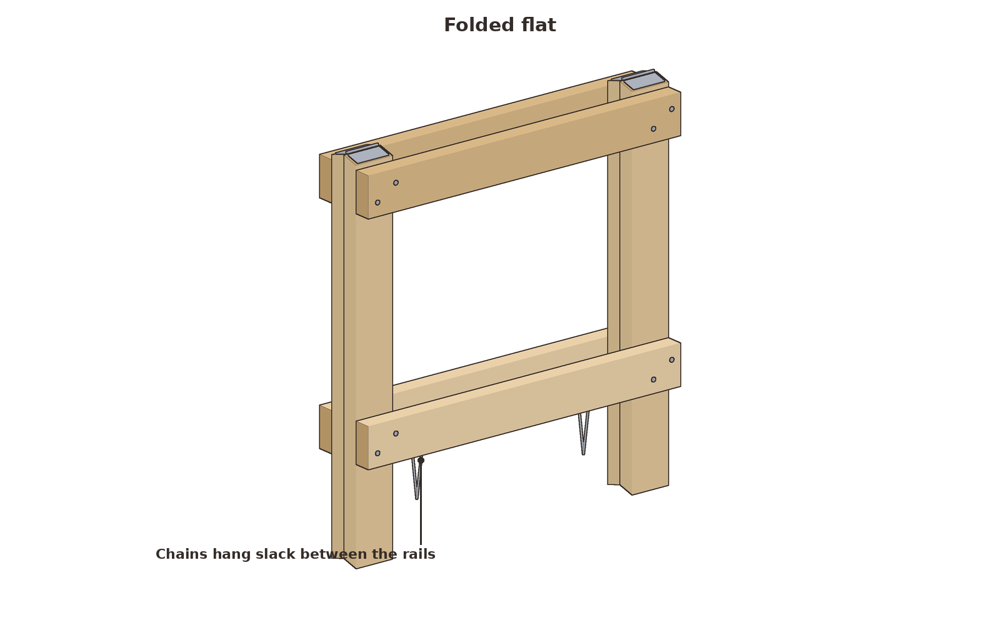 `07-folded.png`
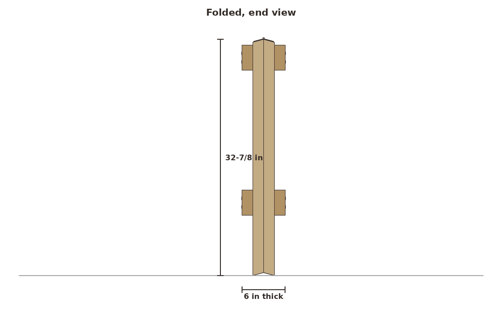 `07-folded-end.png`

Lift the horse by the top and let the feet swing together. Folded, it is 30 in long, 6 in thick, and 32-7/8 in tall.

**Untested estimate:** one horse should take a couple hundred pounds spread along the top, with the chains tight and the feet on firm ground. That figure comes from the part sizes, not from a load test.

## Why it works

**The chains carry the spread.** A load on top tries to push the feet apart. The chains hold that pull in tension, and the hinges only line the leaves up.

**Screws in shear.** The rails lie flat against the outside of the legs, so a sideways load slides one board across the other, and the screws resist that across their shanks.

**Tradeoffs.** The work surface is the four leg tops and the top edges of the rails. The rail edges slope about 3/8 in toward the inside, and the hinge knuckles stand about 3/16 in proud. For a flat top, lay a scrap 2x4 across a pair of horses.
