# Backyard Haul Cart

*A four-wheel pull wagon with a steering front axle, sized for leaves, tools, and the harvest.*

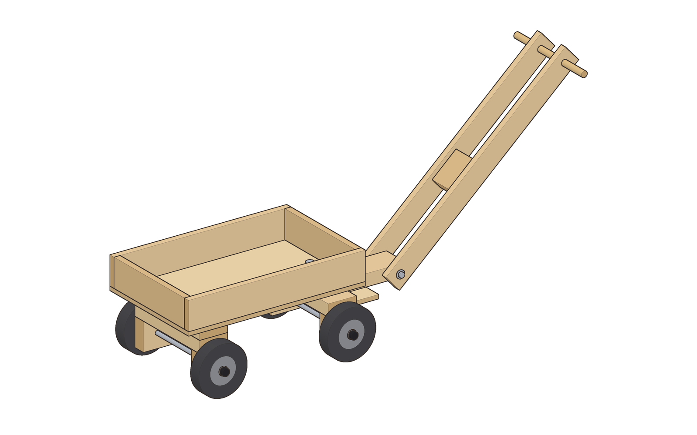

| | |
|---|---|
| **Ages** | 8+ (the cuts are short and straight, and every hole is drilled with the work clamped. The hard part is patience: holes have to line up.) |
| **Time to build** | About 5 hours, plus drying time if you paint it |
| **Difficulty** | 3 / 5 |
| **Skills taught** | Measuring and square cuts, pilot holes and screws, drilling holes that line up, cutting and filing steel rod, how axles and a steering pivot work |

Wagons are among the oldest machines people use, and one big upgrade came early: a front axle that swivels on a single pin, so the front wheels can follow the puller around a corner instead of being dragged sideways. Leonardo da Vinci sketched carts and other vehicles in his notebooks too, but this project is not one of his designs. It is a plain modern wagon built from hardware-store parts.

**What this version is:** a small haul cart with a 22 × 14 in bed and 3-1/2 in sides, riding on four 6 in wheels. The front axle swivels on one bolt. A short 2x4 tongue sticks forward from the front axle, under the bed, and a single T-handle hinges on its tip, so the same handle pulls and steers and never touches the bed when you turn. It is built to carry about 40 lb, such as a heap of leaves, a bag of potting soil, or garden tools. **It is not a ride-on and is not built to carry a person.**

## Safety

- Wear safety glasses for every cut and every hole, and especially when you hacksaw and file the steel rod.
- Clamp parts before you saw or drill them. Don't hold a small block in your hand while drilling it.
- Drill pilot holes before every screw. A split hanger block is a weak hanger block.
- File the cut ends of the rod smooth. Sand every edge, and round over the handle rails and the ends of the bar so there are no splinters.
- Sand plywood outdoors or wear a dust mask.
- Use it for hauling only. Don't sit, stand, or ride in it. Keep it off steep slopes and streets, because a loaded cart can run away downhill.

## Parts

**Lumber**
- 1 × 1/2 in plywood, 2 × 2 ft project panel (for the floor)
- 1 × 1x4 pine board, 8 ft (6 ft is just enough at 69-1/2 in, but leaves nothing for squaring up a rough end)
- 1 × 2x4, 8 ft (the parts use about 68 in, so a 6 ft board is too short)
- 1 × 1x3 pine board, 6 ft
- 1 × 3/4 in hardwood dowel, 36 in

**Wheels and axles**
- 4 × wheels, 6 in diameter, about 1-1/2 in wide, **1/2 in bore**, hub about 1-1/2 in long (the plastic lawn-cart and mower replacement wheels most hardware and farm stores carry, typically rated 35–50 lb each)
- 1 × 1/2 in **smooth** steel rod, 36 in (not threaded rod, which chews up wheel bores)
- 4 × push-on axle caps for 1/2 in rod
- 12 × 1/2 in SAE flat washers

> **Check your wheels first.** The rod lengths below assume the wheel hub (the length of the bore) is 1-1/2 in. If yours is longer, add the extra hub length × 2 to each rod. If the hub sticks out more on one side (an "offset hub"), face that side in, toward the hanger.

**Pivot and handle hardware**
- 1 × 3/8 × 4-1/2 in carriage bolt (the pivot)
- 1 × 3/8 × 6 in hex bolt (the handle hinge)
- 3 × 3/8 in flat washers
- 2 × 3/8 in nylon-insert lock nuts

**Fasteners and supplies**
- About 34 × #8 × 1-1/2 in wood screws (29 used, plus spares)
- 16 × #8 × 2-1/2 in wood screws
- 10 × #8 × 1-1/4 in wood screws (9 used, plus a spare)
- Exterior wood glue
- Sandpaper, 80 and 120 grit
- A candle stub or bar of soap (to wax the pivot)
- Optional: exterior paint or sealer

## Cut list

All sizes are actual dimensions. A 2x4 really measures 1-1/2 × 3-1/2 in, a 1x4 measures 3/4 × 3-1/2 in, and a 1x3 measures 3/4 × 2-1/2 in.

| Part | Qty | Material | Size |
|---|---|---|---|
| Floor | 1 | 1/2 in plywood | 22 × 14 in |
| Side | 2 | 1x4 | 22 in |
| End | 2 | 1x4 | 12-1/2 in |
| Rear spacer | 1 | 2x4 | 11-1/2 in |
| Bolster | 2 | 2x4 | 11-1/2 in |
| Pivot block | 1 | 2x4 | 5-1/2 in |
| Hanger | 4 | 2x4 | 3-1/2 in (makes a 3-1/2 × 3-1/2 in block) |
| Tongue | 1 | 2x4 | 9 in |
| Handle spacer | 1 | 2x4 | 4 in |
| Gusset | 1 | 1/2 in plywood (offcut from the floor panel) | 8 × 5 in |
| Handle rail | 2 | 1x3 | 30 in |
| Handle bar | 1 | 3/4 in dowel | 12 in |
| Axle | 2 | 1/2 in steel rod | 15-5/8 in (front and rear are the same) |

The rear spacer and both bolsters are the same size, so cut all three at once. The end boards are the floor width minus the two sides (14 − 3/4 − 3/4 = 12-1/2 in). The tongue and the handle spacer come from the same 2x4, so the spacer is exactly as wide as the tongue. The gusset comes from the 10 in strip left over after cutting the floor.

## Tools

- Handsaw and miter box
- Hacksaw with a metal-cutting blade, and a metal file
- Drill, with bits: 1/8 in (pilot holes), 3/8 in, 7/16 in, 9/16 in, a 3/4 in spade bit, and a countersink
- Screwdriver or driver bit
- 2 clamps
- Measuring tape, combination square, pencil
- Hammer (to seat the axle caps and the carriage bolt)
- Two 9/16 in wrenches, or one wrench and a 9/16 in socket (for the two 3/8 in lock nuts; the hinge needs one on the bolt head and one on the nut)
- Sandpaper
- Safety glasses

## Assembly

### 1. Cut and sand the parts
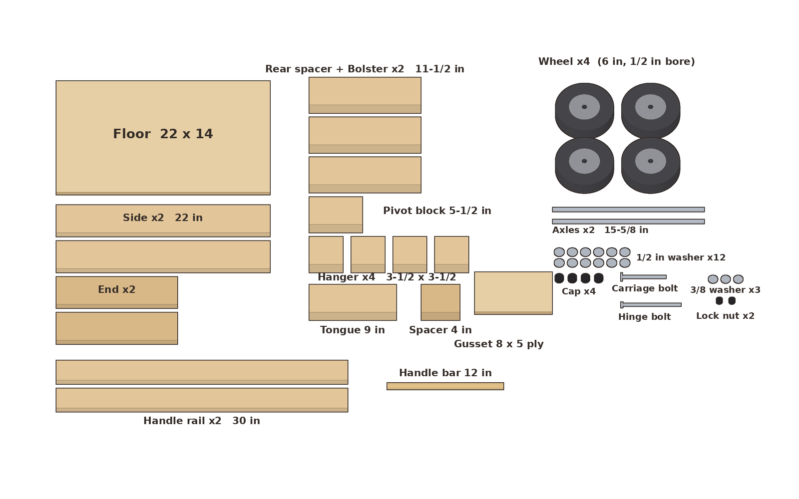 `01-parts.png`

Cut every piece on the cut list. Saw the plywood panel down to 22 × 14 in (or have the store cut it). Clamp the steel rod and hacksaw two 15-5/8 in pieces from it, then file each end smooth with a small bevel so the caps can start. Sand all the wood, and round the corners of the handle rails and the ends of the dowel.

**Look for:** 19 wood pieces, 2 rods, and a pile of hardware matching the picture. Stand each end board between the sides on the floor before you go on. It should fit snugly, flush with the floor's edges. A common mistake is cutting the end boards 14 in long, the full floor width.

### 2. Drill the hanger holes
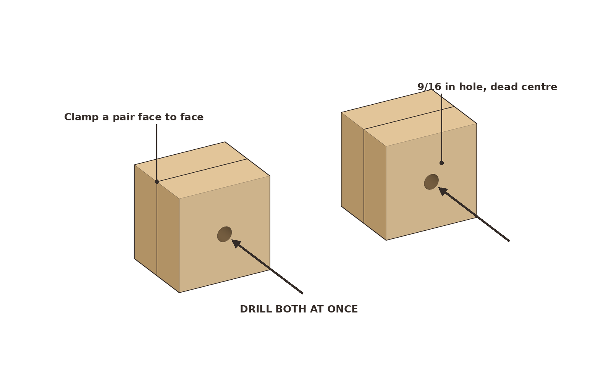 `02-drill-hangers.png`

On one face of each hanger, draw corner-to-corner diagonals. Where they cross is the center. Clamp two hangers face to face with their edges flush, and drill a 9/16 in hole straight through both at that center mark. Stand your square beside the bit to keep it upright. Repeat with the other two hangers. Keep each pair together: one pair becomes the rear axle, the other the front.

**Look for:** the steel rod slides through both blocks of a pair in one push while they sit flat side by side. If the rod binds, the hole wandered. Open it up with the drill rather than forcing the rod.

### 3. Fix the rear spacer and pivot block under the floor
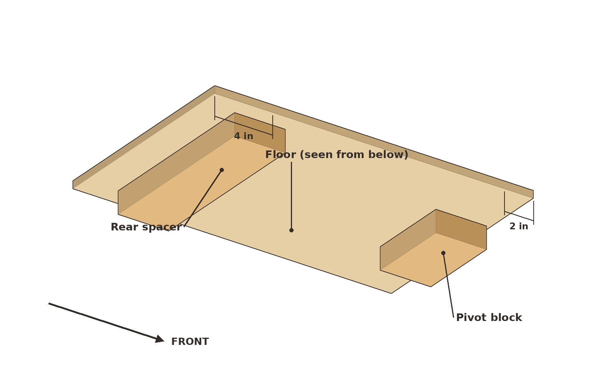 `03-floor-blocks.png`

On the good face of the floor, draw a line across the floor 4 in from the back edge (the rear spacer's center line) and a mark 2 in from the front edge, centered side to side (the pivot block's center). Set the rear spacer on the bench, spread glue on top, and lower the floor onto it, centered on your line with the spacer 1-1/4 in in from each side edge. Drive three #8 × 1-1/2 in screws down through the floor into the spacer. Do the same with the pivot block, centered on its mark. Put its two screws near the block's ends so they stay clear of the pivot hole.

**Look for:** both blocks centered side to side and parallel to the ends, with screw heads flush and no tips poking through. In the drawing, the floor is seen from underneath.

### 4. Drill the pivot hole
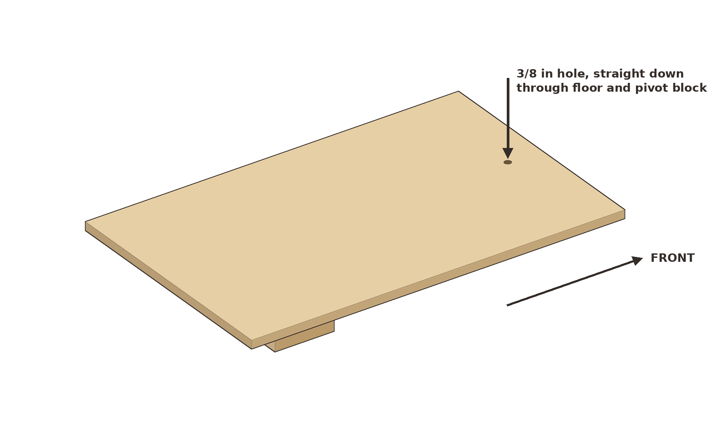 `04-pivot-hole.png`

With the floor good face up, drill a 3/8 in hole straight down through the floor and the pivot block at the pivot mark.

**Look for:** the carriage bolt slides through both layers and stands straight up. A tilted hole makes the front axle lean.

### 5. Screw on the sides
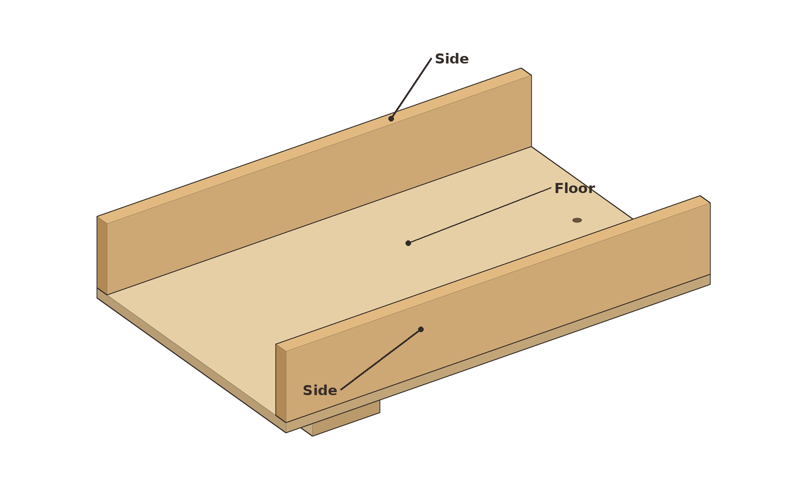 `05-sides.png`

Stand both sides on edge on the bench. Lay the floor upside down across them (blocks up), with the sides lined up flush with the floor's long edges and ends. Glue them, then drill pilot holes and drive five #8 × 1-1/2 in screws down through the floor into each side.

**Look for:** the sides standing square to the floor, with outside faces flush with the floor edges and nothing overhanging at the ends.

### 6. Fit the end boards
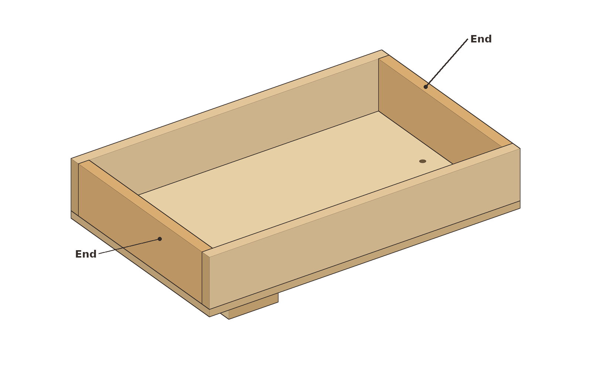 `06-ends.png`

Glue an end board between the sides at each end, sitting on the floor. Drive two #8 × 1-1/2 in screws through each side into the end board. Then turn the box over and drive three more down through the floor into each end board's edge.

**Look for:** a tight box with no gaps at the corners. Measure the two diagonals of the box. They should match within about 1/8 in. If an end board bows the sides outward, it's a little long, so trim it.

### 7. Build the two axle units
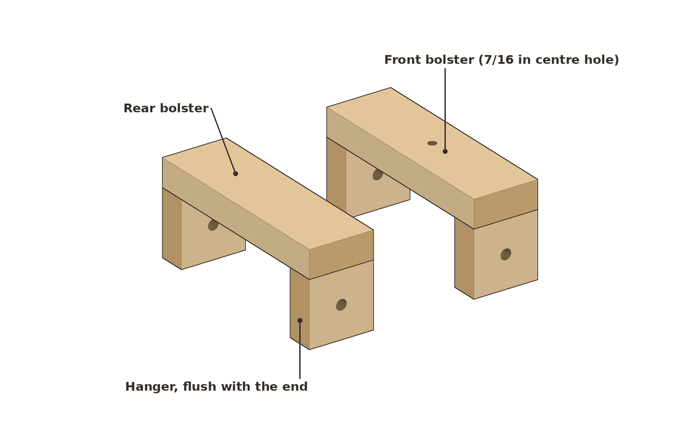 `07-axle-units.png`

Stand one drilled pair of hangers on the bench and slide a rod through both holes. Spread them until their outer faces are 11-1/2 in apart. Set a bolster on top, ends flush with the hangers' outer faces. Glue it, then drill pilot holes and drive two #8 × 2-1/2 in screws down through the bolster into each hanger, keeping the screws centered on the hanger's 1-1/2 in edge. Pull out the rod and build the second unit the same way. Then drill a 7/16 in hole through the center of one bolster. That one is the front unit.

**Look for:** in each unit, the rod slides through both hangers without binding. The two units should be identical except for the center hole in the front bolster. The 7/16 in hole is a little bigger than the bolt on purpose, so the front bolster can turn.

### 8. Add the tongue to the front unit
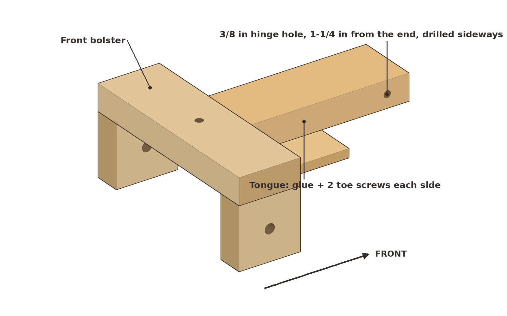 `08-tongue.png`
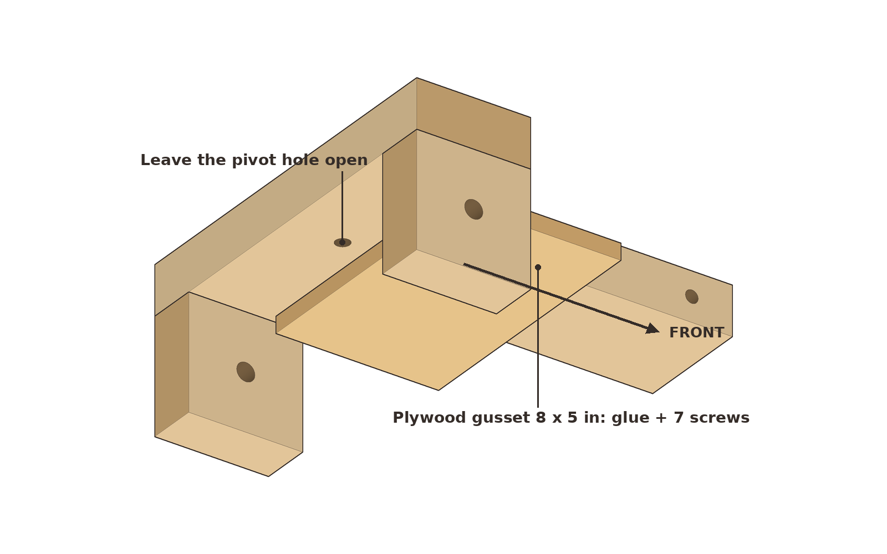 `08-tongue-below.png`

First drill the hinge hole while the tongue is still loose. Mark a point 1-1/4 in from its front end, centered on one 1-1/2 in edge, clamp the tongue upright, and drill a 3/8 in hole straight through the 3-1/2 in width. Then stand the front axle unit on the bench, hangers down. Butt the other end of the tongue against the middle of the bolster's front face, flat side up, with its top flush with the bolster top and centered side to side. Glue it, then drive two #8 × 2-1/2 in screws at an angle through each 1-1/2 in edge of the tongue into the bolster (toe screws). Countersink them so the heads sit below the wood. Turn the unit over. Glue the plywood gusset across the bottom of the bolster and tongue, centered, with its back edge 3/4 in in front of the pivot hole. Drive three #8 × 1-1/4 in screws through it into the bolster and four into the tongue.

**Look for:** the tongue square to the bolster when you check with your square, with nothing standing above the bolster top (the top slides under the pivot block). The pivot hole stays fully open behind the gusset, with room for a socket on the lock nut. The hinge hole runs straight across, parallel to the bolster.

### 9. Mount the rear axle unit
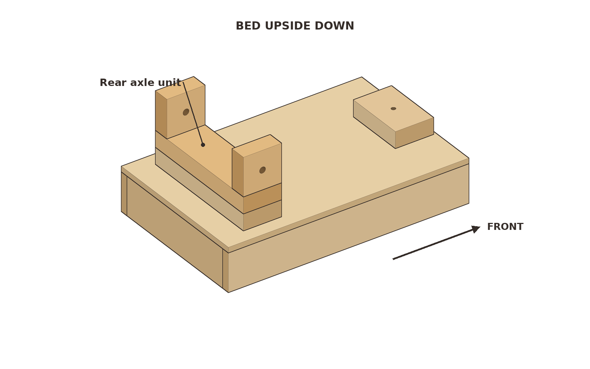 `09-rear-unit.png`

Turn the bed upside down on a blanket. Set the rear unit (no center hole) on the rear spacer, hangers pointing up, with its ends flush with the spacer's ends. Drive four #8 × 2-1/2 in screws through the bolster into the spacer, placed between the hangers.

**Look for:** the rear unit square to the bed sides, flush with the spacer at both ends. Sight along the hanger holes: they should run straight across the bed.

### 10. Fit the rear axle and wheels
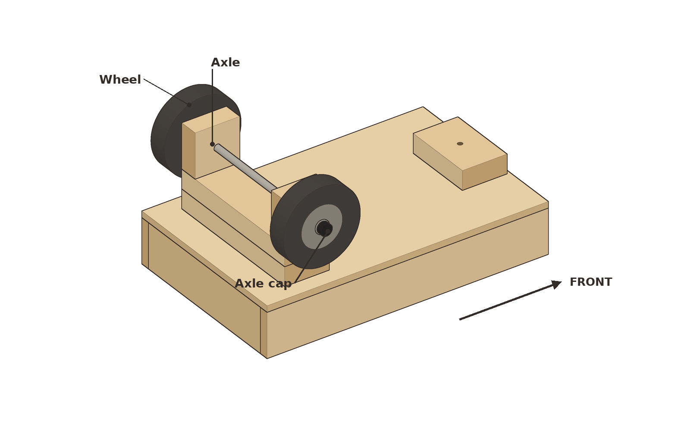 `10-rear-wheels.png`
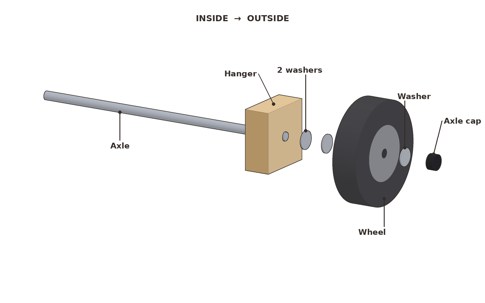 `10-axle-stack.png`

Push one 15-5/8 in rod through both rear hangers until the same length sticks out each side. On each end, slide on two washers, a wheel, and one more washer. Then tap a push-on cap over the rod end with a hammer (a small socket over the cap protects it) until it seats against the washer.

**Look for:** about 5/16 in of rod sticking past the outer washer before the cap goes on. Afterward each wheel should spin freely with a hair of side-to-side play and be unable to slide off. If a wheel rubs the hanger, a washer is missing on the inside.

### 11. Bolt on the front axle unit
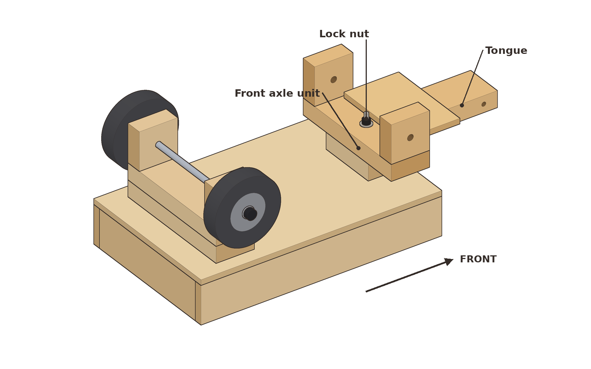 `11-front-pivot.png`
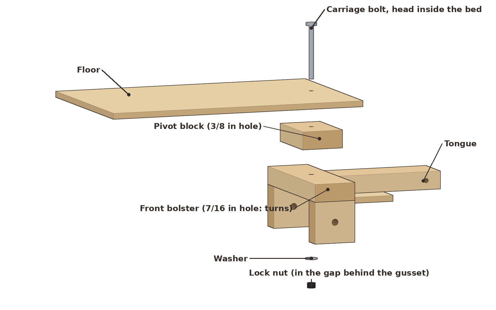 `11-pivot-stack.png`

Rub candle wax or soap on the bottom of the pivot block and on the tops of the front bolster and tongue. Tip the bed on its side for a moment and push the carriage bolt through the pivot hole from inside the bed. Tap the head so its square neck bites into the plywood. Lay the bed upside down again and drop the front unit over the bolt, hangers up, with the tongue pointing out past the front end. Add a washer and a lock nut. Tighten the nut with a socket until the bolster is snug, then back it off about a quarter turn.

**Look for:** the front unit swings smoothly by hand with no rocking, and the tongue swings freely under the front edge of the floor. If it won't turn, back the nut off a little more. If it rocks, snug it up. The nylon insert holds the nut wherever you leave it.

### 12. Fit the front axle and wheels
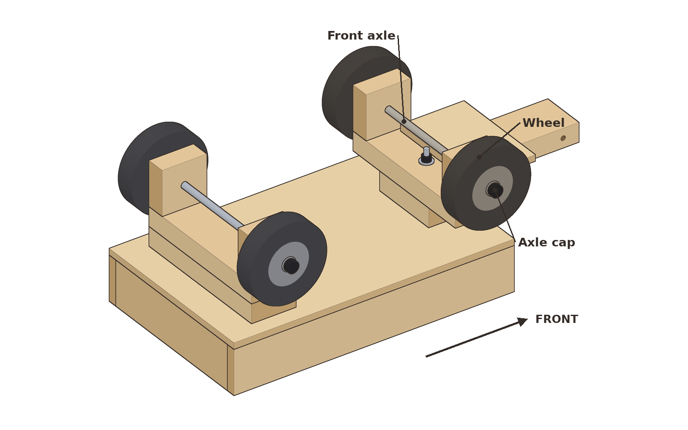 `12-front-wheels.png`

Push the second 15-5/8 in rod through both front hangers, centered. Build each end exactly like the rear: two washers, a wheel, one washer, then tap on a push-on cap.

**Look for:** about 5/16 in of rod past the outer washer before the cap goes on, and each front wheel spinning freely. The front and rear axle ends should look identical (see `10-axle-stack.png`).

### 13. Build the handle
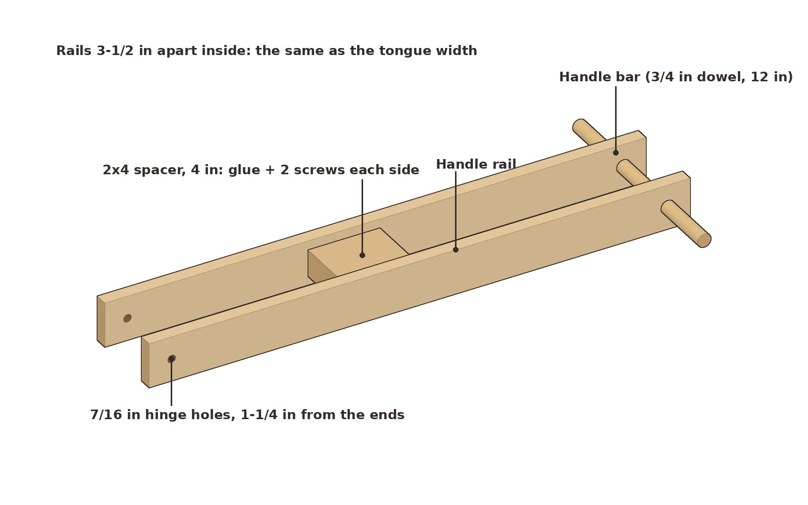 `13-handle-frame.png`

On each rail, mark a hole center 1-1/4 in from each end, centered across the wide face. Clamp the two rails together, edges flush. Drill a 7/16 in hole through both at one end (the hinge holes). At the other end, drill a 3/4 in hole through both with the spade bit, with scrap wood clamped underneath so the back doesn't splinter. Unclamp them and stand them on edge with the 4 in handle spacer between them, centered 12 in up from the hinge holes. Glue the spacer and drive two #8 × 1-1/2 in screws through each rail into it. Push the 12 in dowel through the 3/4 in holes so the same length sticks out each side. Glue it, then drive a #8 × 1-1/4 in screw down through the end of each rail into the dowel. Drill a pilot hole first.

**Look for:** a flat ladder that doesn't rock on the floor, rails exactly 3-1/2 in apart inside (the same as the tongue width), and hinge holes that line up when you sight through them.

### 14. Hang the handle on the tongue
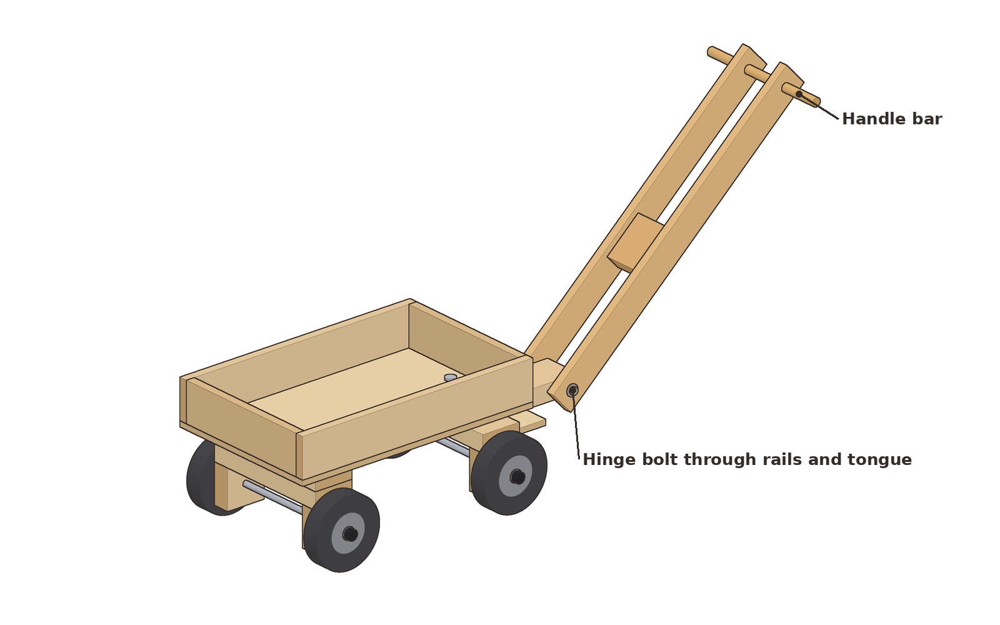 `14-handle-on.png`
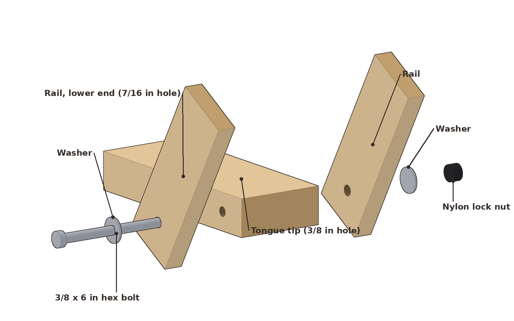 `14-hinge-stack.png`

Turn the cart right side up. Rub wax on the sides of the tongue tip. Slide the rails' hinge ends over the tongue tip, one on each side, and line up the holes. Push the 3/8 × 6 in hex bolt through, with a washer under the head: washer, rail, tongue, rail. Add a washer and a lock nut on the far side. Hold the bolt head with one wrench and tighten the nut with the other until the rails just pinch the tongue, then back it off about a quarter turn.

**Look for:** the handle tips up and down on its own weight without flopping sideways, and about 7/16 in of bolt past the nut. When you push the bar sideways, the whole front axle turns with it.

### 15. Test roll and steer
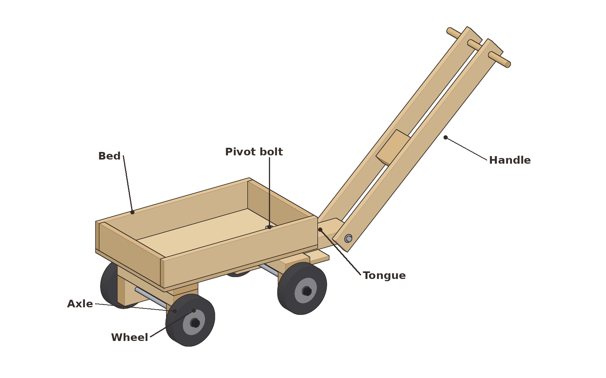 `15-finished-3q.png`
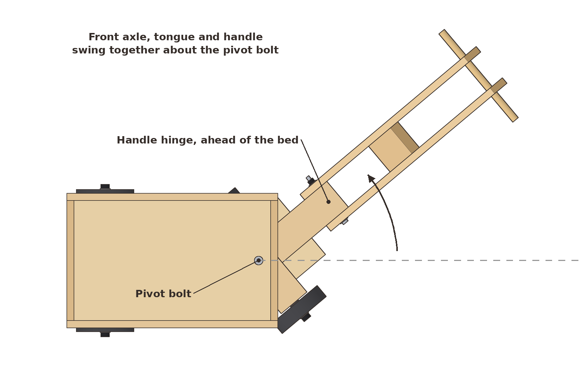 `15-steer-top.png`
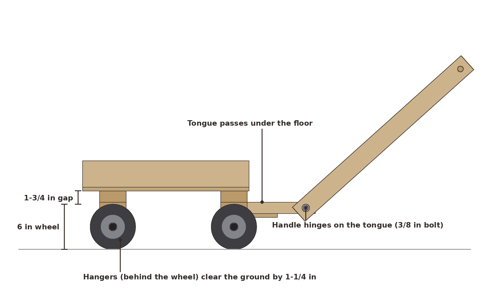 `15-side.png`

Lift the handle bar to about hip height and pull the cart in a straight line, then in slow circles both ways.

**Look for:** all four wheels on the ground and the cart tracking straight when you walk straight. When you swing the handle, the whole front axle turns with it while the rear axle stays put. The wheels clear the floor by 1-3/4 in, so they never rub. The tongue and handle sit on the cart's center line, under and ahead of the bed, so nothing touches the bed even with the front wheels turned to a right angle, at any handle height. Turns that sharp make a loaded cart tippy, though, so take tight corners slowly. Load it up with leaves and pull. After the first few loads, check that both lock nuts and all four caps are still snug.

## Why it works

**Axles.** Drag a loaded box across the lawn and its whole bottom scrapes along the ground. On wheels, the only thing that slides is the inside of each wheel turning on the smooth 1/2 in rod. That rubbing happens at a radius of 1/4 in, while the ground pushes at the wheel's 3 in radius. The big wheel gives you 12-to-1 leverage over that friction, which is why the same load suddenly feels light.

**Rolling resistance.** Wheels still lose a bit of energy as the tire squashes and rolls over bumps. Big, hard wheels roll most easily on a path. On soft lawn they sink in a little, so a loaded cart takes more of a tug on grass than on pavement.

**The front pivot.** If both axles were fixed to the bed, turning would force the wheels to skid sideways. Here the front axle hangs from one bolt. When you pull the handle to one side, the front wheels swing to point where you're walking, and the rear wheels follow along a curve, rolling the whole way instead of scraping. The handle hinges on a tongue that is fixed to the front axle, so it steers like a lever: pull sideways at the bar and the tongue turns the axle about the bolt. The hinge sits 9-1/2 in ahead of the pivot, and that lever arm is what makes steering easy under load. Because the hinge only lets the handle tip up and down, you can hold it at any height without lifting the front wheels.

**Why a tongue.** If the handle hooks onto the ends of the front axle, its arms sweep around the outside of the wheels and hit the bed's front corners on a turn, and the higher you hold the handle the sooner they hit. A tongue keeps everything that moves on the center line. It runs under the floor with 1-1/2 in to spare, and the hinge sits 7-1/2 in ahead of the bed, so nothing has anything to hit until the front unit has turned past a right angle. That works the same at any handle height.

**Why a gusset.** The joint between the tongue and the bolster gets bent every time you steer and pried every time you lift the handle. Glue on end grain is weak, and screws driven into end grain pull out. The plywood plate underneath is glued to long grain on both parts and spreads the load over 40 square inches, so the tongue can't work loose.

## Try this next

- Tie a loop of rope to the handle bar so the cart can be towed or hung on a hook.
- Paint or seal it with exterior finish (easiest with the wheels off) and stencil a name on the side.
- Haul a load of leaves to the compost pile, or carry pots and tools out to the garden.
- Add removable slatted sides for bulky leaf loads.
- Screw two small blocks under the floor, one each side of the tongue, as steering stops so the front can't turn much past 60° and tip a heavy load.

However you dress it up, it's still a haul cart, not a ride-on.
