# Stacking Gear Crate

*A plywood crate sized for the Cybertruck bed: three fit across between the wheel wells, and they lock together when stacked.*

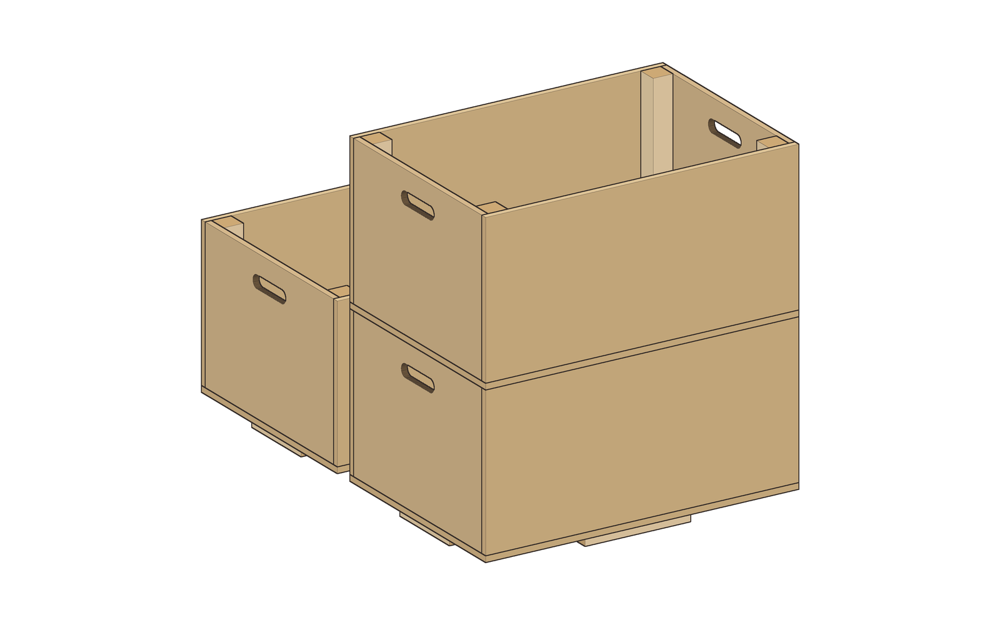

| | |
|---|---|
| **Section** | Home & Prep |
| **Ages** | Adults and families |
| **Time to build** | About 3 hours for a set of three, plus finish drying time |
| **Difficulty** | 2 / 5 |
| **Skills taught** | Laying out a plywood sheet, long straight saw cuts, drilling a slot, pilot holes and glued screw joints |
| **Works without power** | Yes, with a handsaw, a jab saw, a hand drill or brace, and a screwdriver |

Each crate is 23-3/4 in long, 16-1/2 in wide and 12-3/4 in tall, and holds about 17 gallons. One 4 × 8 ft sheet of 1/2 in plywood makes three. The walls stand on a plywood bottom, and a 1x2 rail inside the bottom edge and a 2x2 post in each corner hold them. Four short 1x2 blocks under the bottom drop inside the walls of the crate below, so a stack can't slide apart. They also hold the bottom 3/4 in off a wet truck bed, and five 3/4 in holes let water out.

**What this version is:** an open crate with no lid. The crate on top serves as the lid. Every joint is glued and screwed, and every screw goes into solid 1x2 or 2x2, never into the edge of the plywood.

## Sizing it to the Cybertruck bed

These are the published bed sizes. The crate size comes from them.

| Measurement | Size | Source |
|---|---|---|
| Floor length, tailgate closed | 72.92 in | Tesla owner's manual figure, as quoted by [TopSpeed](https://www.topspeed.com/tesla-cybertruck-bed-features-functionality/) and [CoPilot](https://www.copilotsearch.com/posts/tesla-cybertruck-bed/) |
| Width between the wheel wells | 51 in | [Car and Driver specs](https://www.caranddriver.com/tesla/cybertruck/specs/2025/tesla_pickup-truck_cybertruck_2025) (51.00 in in the manual figures) |
| Height at the cab end | 28.66 in | Tesla manual figure (TopSpeed, CoPilot) |
| Height at the tailgate | 19.89 in | Tesla manual figure (TopSpeed, CoPilot) |
| Usable length for tall boxes | about 66 in | An owner's tape measurement on the [Cybertruck Owners Club forum](https://www.cybertruckownersclub.com/forum/threads/cybertruck-bed-measured-with-a-measuring-tape.10901/) |

- **Across:** three crates turned lengthwise take 49-1/2 in of the 51 in between the wheel wells, leaving about 3/8 in at each side and between crates.
- **Fore and aft:** two rows take 47-1/2 in, well inside the 66 in tall-box length.
- **Height:** the bed walls drop from 28.66 in at the cab to 19.89 in at the tailgate, so the closed tonneau gets lower toward the back. A single crate is 12-3/4 in tall, and two stacked are 24-11/16 in. If the top line runs straight between the two published heights, it is about 25.8 in high at the back of the front row. That leaves about 1-1/8 in over a two-high front row.
- **Fit:** nine crates fit under the closed tonneau: six in the front row (three across, two high) and three in the second row. With the tonneau open, the second row can stack too.

**Check this on your truck:** the straight top line is an assumption. Measure the height under your closed tonneau 24 in back from the cab wall before you build a second layer for it.

## Safety

- Wear safety glasses for every cut and every hole.
- Clamp the plywood before you saw or drill it. Support both sides of a long cut so the piece doesn't snap off at the end.
- Strap or wedge the crates in the bed so they can't slide under braking. The locator blocks hold a stack together, but they don't hold it to the truck.

## Parts

**Lumber (for three crates)**
- 1 × 1/2 in plywood, 4 × 8 ft sheet (actually 15/32 in thick). Sanded pine or another exterior-glue grade.
- 4 × 1x2, 8 ft (actually 3/4 × 1-1/2 in)
- 2 × 2x2, 8 ft (actually 1-1/2 × 1-1/2 in)

**Fasteners and supplies (for three crates)**
- 60 × #8 × 1 in wood screws (54 used: 18 per crate)
- 90 × #8 × 1-1/4 in wood screws (84 used: 28 per crate)
- Exterior wood glue (Titebond III or similar)
- Sandpaper, 80 and 120 grit
- Optional: exterior paint or spar varnish, since the crates live in a truck bed

## Cut list

All sizes are actual dimensions. Every cut is square.

**Per crate** (multiply by three for a set):

| Part | Qty | Material | Size |
|---|---|---|---|
| Bottom | 1 | 1/2 in plywood | 23-3/4 × 16-1/2 in |
| Side wall | 2 | 1/2 in plywood | 23-3/4 × 11-1/2 in |
| End wall | 2 | 1/2 in plywood | 15-9/16 × 11-1/2 in |
| Bottom rail, side | 2 | 1x2 | 22-13/16 in |
| Bottom rail, end | 2 | 1x2 | 14-1/16 in |
| Corner post | 4 | 2x2 | 10 in |
| Locator block, side | 2 | 1x2 | 8 in |
| Locator block, end | 2 | 1x2 | 6 in |

**Leftovers for a set of three:**
- Plywood: a spare 23-3/4 × 16-1/2 in piece (enough for a fourth bottom or a lid) and a 4-5/8 × 48 in strip.
- 1x2: 4-1/4, 1-7/16 and 4-11/16 in offcuts, and 65-3/8 in left on the fourth board.
- 2x2: a 4-7/8 in offcut, and 65-5/8 in left on the second board.

The end walls are 15-9/16 in because they fit between the side walls: 16-1/2 in minus two thicknesses of 15/32 in plywood. If your plywood is a full 1/2 in, cut them 15-1/2 in. Measure your sheet first.

## Tools

- Handsaw. A fine-tooth panel saw is easiest on plywood.
- Jab saw or coping saw for the hand slots
- Drill or brace, with a 1 in spade or auger bit, a 3/4 in bit, a 1/8 in pilot bit and a countersink
- Screwdriver or driver bit for #8 screws
- Measuring tape, a straightedge at least 4 ft long, a square and a pencil
- 2 clamps
- Sandpaper
- Safety glasses

## Assembly

### 1. Cut the parts
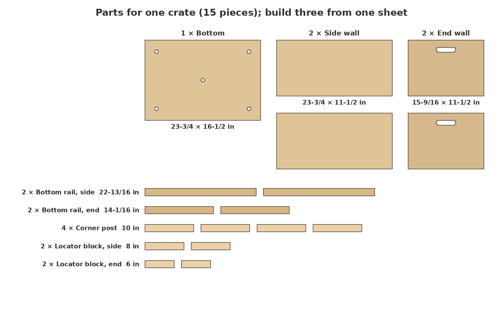 `01-parts.png`
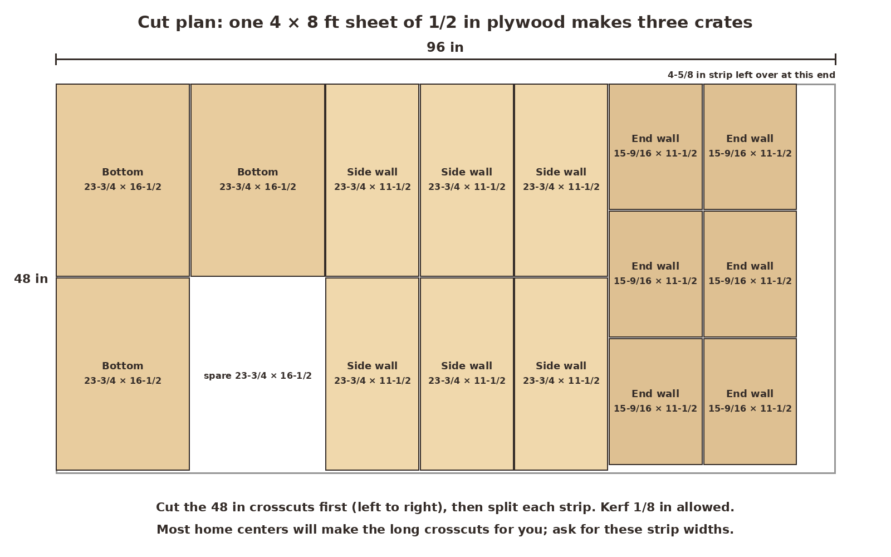 `01-cut-sheet.png`
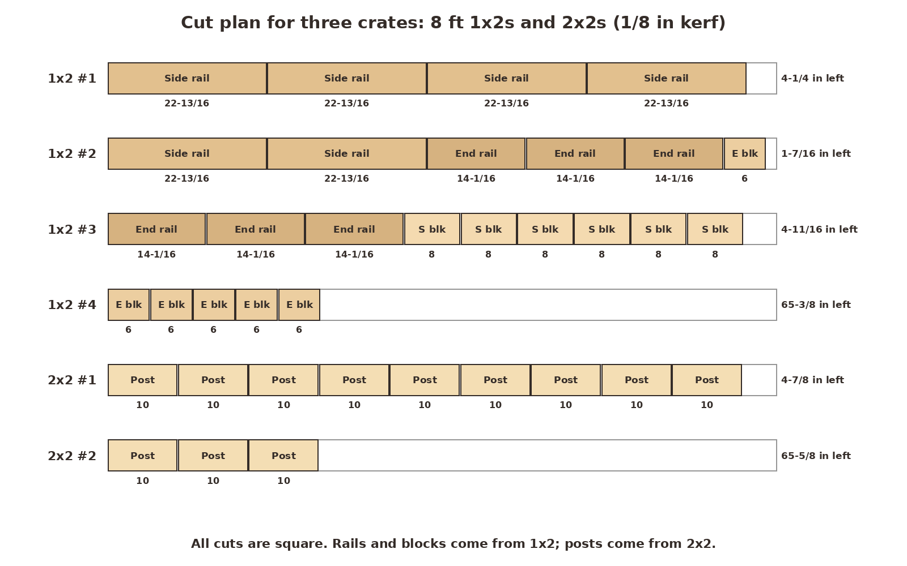 `01-cut-lumber.png`

Mark the sheet following the plywood plan. First make the crosscuts across the 48 in width, which gives you seven strips: two 16-1/2 in strips and five 11-1/2 in strips. Then cut each strip into pieces. Most home centers will make the long crosscuts for you if you ask for those strip widths. Cut the 1x2s and 2x2s following the lumber plan. Sand every edge.

**Look for:** for each crate, 1 bottom, 2 side walls, 2 end walls, 4 rails, 4 posts and 4 blocks.

### 2. Drill the drain holes and hand slots
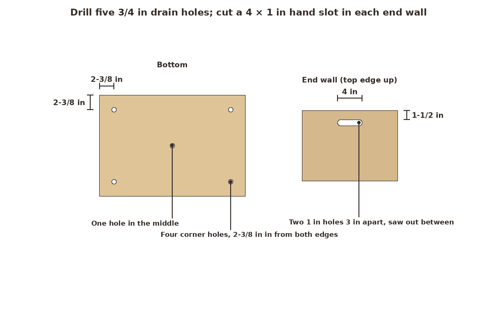 `02-holes.png`

In each bottom, drill a 3/4 in hole in the middle, plus one 2-3/8 in in from both edges at each corner. In each end wall, mark a 4 × 1 in slot centered side to side, with its top edge 1-1/2 in below the top edge of the wall. Drill a 1 in hole at each end of the slot, 3 in apart center to center, and saw out the wood between them with a jab saw. Sand the slot smooth, because this is where your fingers go.

**Look for:** five clean holes in each bottom and a smooth slot in each end wall.

### 3. Screw the bottom rails to the bottom
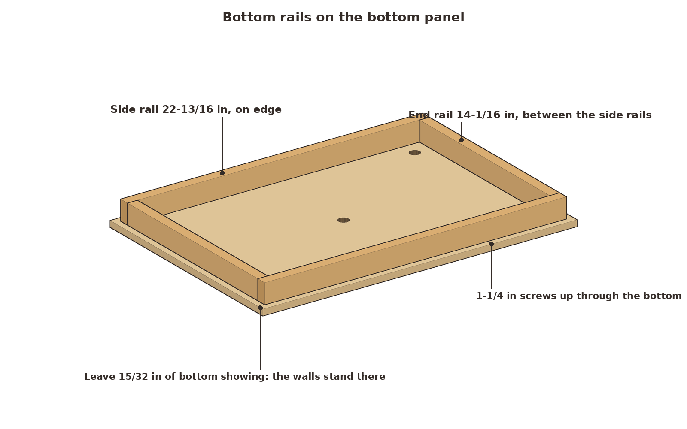 `03-bottom-rails.png`

Stand the two 22-13/16 in side rails on edge along the long sides of the bottom, with their outer faces 15/32 in in from the edge (one plywood thickness; the walls stand on that strip). Fit the two 14-1/16 in end rails between them. Glue them, then drive #8 × 1-1/4 in screws up through the bottom into the rails: four per side rail (at 6 and 10 in each side of center) and two per end rail. That spacing keeps the screws clear of the locator blocks, which go on in step 6.

**Look for:** a 15/32 in ledge of plywood showing all the way around.

### 4. Add the corner posts and side walls
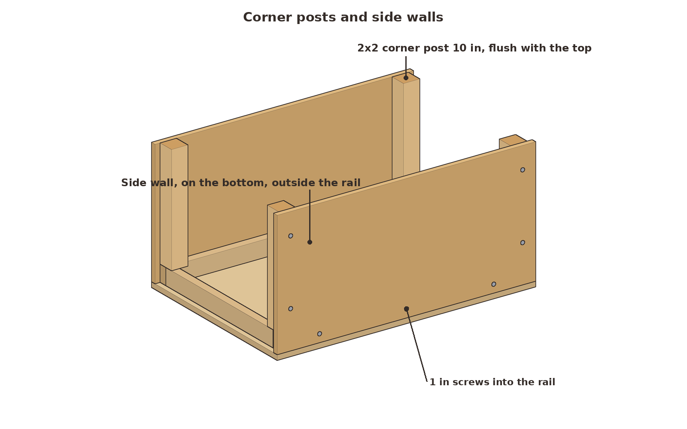 `04-side-walls.png`

Glue and screw a 10 in 2x2 corner post to the inside face of each side wall, flush with the wall's top and its end, using two #8 × 1-1/4 in screws from the outside. Stand each side wall on the ledge outside its rail; the posts' bottoms rest on the rail ends. Glue, then drive three #8 × 1 in screws through the wall into the rail.

**Look for:** posts flush with the top edge and the walls square to the bottom.

### 5. Add the end walls
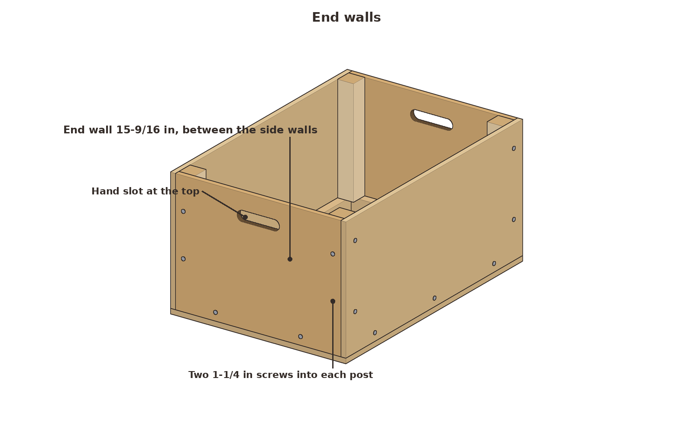 `05-end-walls.png`

Fit each 15-9/16 in end wall between the side walls, slot up, standing on the ledge. Glue it, then drive two #8 × 1-1/4 in screws into each post, placed 1 in off the side-wall screws so the two sets don't meet. Then drive two #8 × 1 in screws into the end rail.

**Look for:** tight corners and a crate that doesn't rack when you push on a top corner.

### 6. Screw on the locator blocks
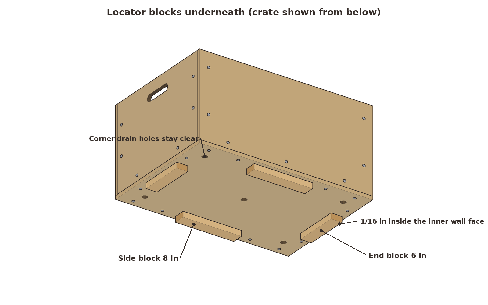 `06-blocks.png`

Turn the crate upside down. Lay the blocks flat: the two 8 in blocks centered on the long sides and the two 6 in blocks centered on the ends. Set each block's outer face 1/16 in inside the line of the walls' inner faces. That's 15/32 + 1/16 = 17/32 in in from the outside edge of the bottom. Glue and clamp each one, turn the crate right side up, and drive two #8 × 1 in screws down through the bottom into it. Keep these screws about 5/8 in in from the block's inner edge, so their heads clear the bottom rails.

**Look for:** the corner drain holes left open, and all four blocks 17/32 in in from the edge.

### 7. Check the crate and the stack
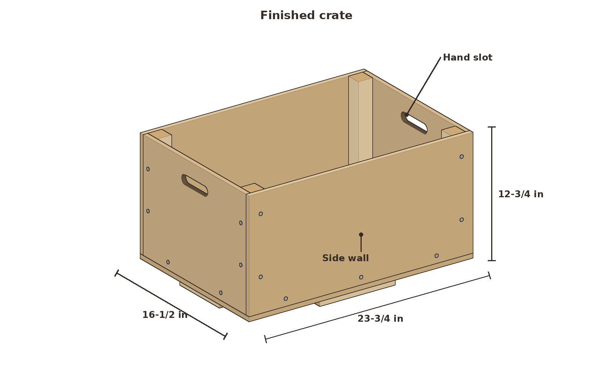 `07-finished-3q.png`
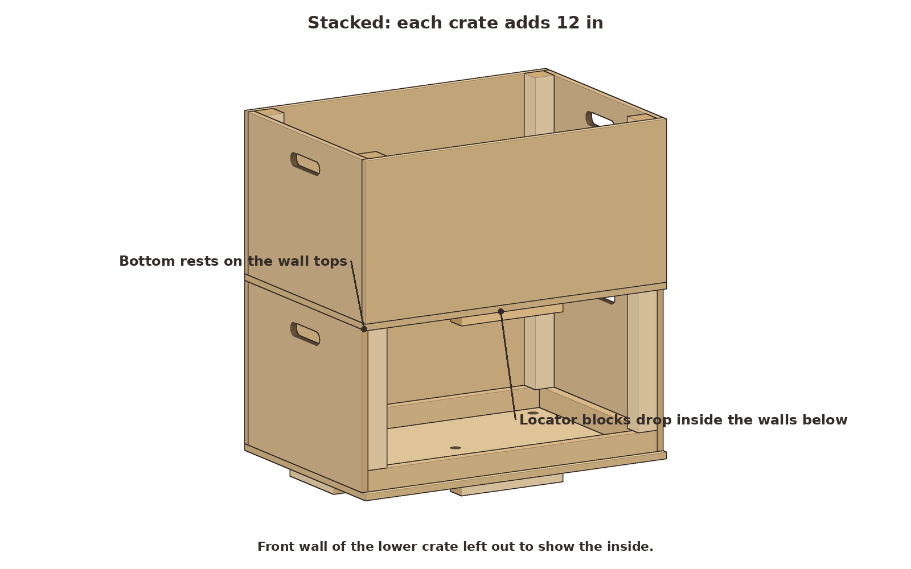 `07-stack.png`

Set one crate on another. The blocks drop into the lower crate's opening with about 1/16 in of play, and the upper crate's bottom rests on the lower crate's wall tops. If a block binds, plane or sand its outer face. Finish all surfaces with exterior paint or spar varnish if you like, and let it dry.

**Look for:** a stack that can't slide in any direction, and each crate adding 11-31/32 in (call it 12 in) of height.

### 8. Load the bed
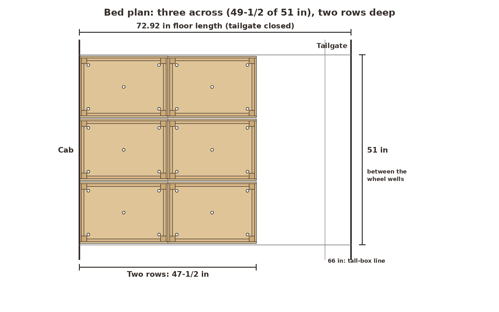 `08-bed-plan.png`
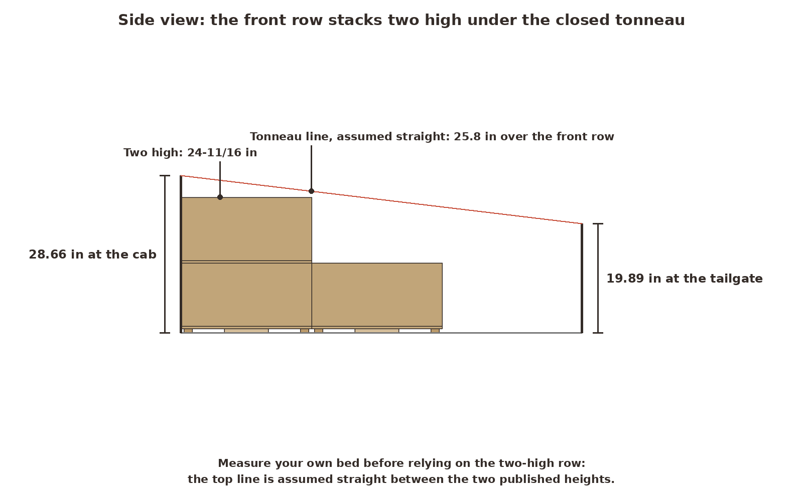 `08-bed-side.png`

Turn the crates so their length runs front to back. Three fit across against the cab wall, and a second row of three fits behind them. The front row can stack two high under the closed tonneau, if your measurement from the sizing section confirms it.

**Look for:** about 3/8 in of play at each side of each crate, and nothing touching the tonneau when it closes.

**Untested estimate:** each crate should carry 75 lb of gear, carried by its hand slots, and a stack of three loaded crates. The model's stress checks show large margins (more than 10 times at the hand slots), but that comes from part sizes, not a load test.

## Why it works

**Screws only go into solid wood.** A screw driven into the edge of 1/2 in plywood splits the layers and pulls out easily. Here every screw passes through the plywood face into a 1x2 rail or a 2x2 post, which holds it across its whole thread length.

**The walls stand on the bottom.** The weight of the gear, and of any crates stacked on top, goes straight down through the wall edges into the bottom. That doesn't depend on the screws.

**Blocks locate, walls carry.** The blocks under each crate fit just inside the walls of the crate below, so they stop it sliding in every direction. The weight is carried by the wall tops, not by the blocks. Because the blocks sit at the middle of each side, they stay clear of the corner posts and drain holes, and they hold the bottom up off a wet bed.
