# Backyard Giant Crossbow

## Conceptual Only — pending testing

> **Conceptual Only.** This design comes from a computer model and has not been built or test-fired yet. Draw weights, ranges and safety margins are estimates. Build it at your own risk, do the first-shot scale test before any full shot, and expect changes once it has been tested.

*A 3-foot stock on wheels, with a stacked fibreglass bow and a winch, that throws a tennis ball.*

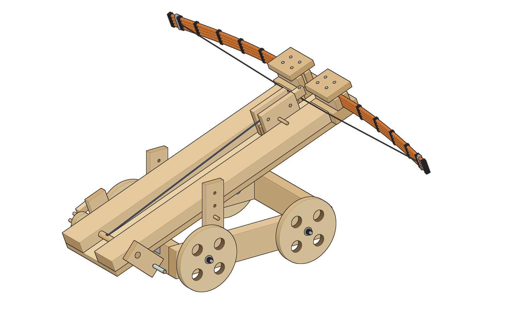

| | |
|---|---|
| **Ages** | Adults, or teens with an adult. Shooting is always supervised. |
| **Time to build** | About 7 hours |
| **Difficulty** | 4 / 5 |
| **Skills taught** | Measuring and square cuts, drilling holes that line up, a sliding trigger, a ratchet winch, a stacked bending bow, and wheels on bolt axles |
| **Works without power** | Yes, with a handsaw and a hand drill. No metal cutting. A jigsaw makes the wheel discs easier. |

Leonardo filled notebooks with giant crossbows: a long bow laid on a carriage, drawn by a screw or a winch, and aimed by tipping the stock. This is a backyard-size machine in that spirit, not a copy of any one drawing. The 36 in stock rides on a four-wheel carriage. It folds flat to roll, and it lifts to about 10, 20, 30 or 40 degrees on a pin through a pair of posts. Each bow arm is a stack of four 5/16 in solid fibreglass rods (cut from driveway markers), each in a vinyl sleeve, held in a wooden channel on a 2x4 block. The string is 2 mm UHMWPE (Dyneema-type) cord. You cock it with a 3/4 in dowel winch and a gravity pawl, and you fire it by pulling a dowel pin out of a sliding latch.

**What this version is.** This is the long-range redesign. It has four rods per arm instead of one, and a 14-1/2 in draw instead of 10 in.

| | |
|---|---|
| Folded for travel | 36 in long, about 52 in wide (the bow), 12-1/4 in high |
| At 40 degrees, loaded | 29 in long, 48 in wide, 28 in high |
| Draw | 14-1/2 in |
| Draw weight at full draw | about 27 to 36 lb (31.6 nominal) |
| Stored energy | about 23 to 30 J (26.5 J, 19.6 ft-lb nominal) |
| Launch speed, tennis ball | about 29 to 67 mph (46 nominal) |
| Expected range, tennis ball | **about 85 to 90 ft at 30 to 40 degrees**, with a band of about 45 to 145 ft (see step 14) |

All of these figures are estimates from the model and published material values. Nothing has been weighed, scaled or shot yet. The first-shot test below checks the draw weight before the first real shot.

It is a yard toy, not a weapon. It throws tennis balls only.

## Safety

- **Wear safety glasses for every cut and every hole.** Clamp the board before you saw or drill it. Drill a pilot hole for every screw.
- **Eye protection for everyone at the firing line**, shooter and watchers, every session. A loaded fibreglass arm or a string can let go. Each arm holds about 13 J at full draw.
- **An adult supervises every session** and does the cocking, or watches it from beside the machine.
- **Lane: at least 220 ft (67 m) long and 30 ft (9 m) wide, empty until the shot lands.** That is the longest throw the model allows (about 145 ft, high case) plus 50 percent. Pick a firing line behind the crossbow; everyone stays behind it whenever the bow is cocked. See `14-firing-zone.png`. After you have measured your own longest throw at 40 degrees, the lane can be 1.5 times that throw, rounded up, but never shorter than 1.5 times the longest throw you have actually seen. Measure again after any change to the bow.
- **Pull the trigger cord from beside and behind the machine**, never from straight behind the stock and never with a hand over the groove.
- **Tennis balls only.** No foam balls: they are so light that the shot is close to a dry-fire. Nothing hard, heavy or pointed: no rocks, marbles, darts, sticks or arrows.
- **Never aim at people, animals, windows or cars.** That includes "just a test."
- **Never dry-fire.** Always have a ball in the groove when you pull the pin. Without one, all the stored energy goes back into the arms and the string.
- **Set the elevation before you cock it.** Never lift or lower a cocked stock. Use the 40 degree hole only on flat ground: the back of the stock is about 1-1/4 in off the ground there.
- **To un-cock without firing,** hold the crank, lift the pawl, and ease the crank backward until the string is at rest. Do not pull the trigger pin to let it down.
- **Stringing is a two-adult job.** At rest the string carries about 57 to 76 lb. Wear gloves and eye protection, and keep faces away from the tips.
- Do the first-shot test before the first real shot, and again after any change to the bow.

## Design limits

The design was sized to these limits. Each number comes from `checks.py` and is in `report.json` under `model_check`.

| Limit | Required | This design (worst case) |
|---|---|---|
| Rod strain | at most break strain / 1.8 | 0.91% against a worst-case break strain of 1.67%: factor 1.84 (up to 2.94 with a typical rod) |
| String strength | at least 10 times the highest tension | 1,000 lb rated against 76 lb: 13.1 times. Counting knots that keep only 40 to 60% of strength: 5.3 to 7.9 times. |
| Drum bending | margin of at least 2 | 7.1 (3/4 in hardwood dowel) |
| Latch, peg, pivot, trigger and tow pins | margin of at least 2 | smallest is the latch peg at 3.6 |
| Ratchet peg | margin of at least 2 | 5.3 |
| Draw weight | at most 40 lb | 36.1 lb (stiffest rod) |
| Crank effort at the handle | manageable by a teen or adult; the ratchet holds between pulls | at most about 6 lb |
| Trigger pull | manageable by hand | about 4 to 8-1/2 lb |
| Projectiles | no pointed ones | tennis balls only |
| Lane length | longest modelled throw + 50% | 145 ft × 1.5, rounded up: 220 ft |

**Why the draw stops at 14-1/2 in.** The bend in each rod is set by the bow's shape, not by how stiff the rod is or how many rods are stacked. With 24 in arms, a 14-3/4 in draw already reaches the strain limit, so 14-1/2 in is as far as this bow can go safely. An 18 to 22 in draw needs longer arms. With 28 in arms the bow would be about 5 ft wide and could draw 22 in (see "A wider bow" near the end).

**Why four rods.** Stacking rods adds stiffness and stored energy without adding strain. Four rods per arm give about 32 lb nominal and stay under 40 lb even with the stiffest rods. Five rods would go over 40 lb.

## Parts

Prices marked "checked" were read on the store page on 2026-11-10 and will change. The other items are ordinary hardware-store stock.

**Lumber**
- 2 × 2x4, 8 ft (construction or #2 spruce/pine/fir, as straight as you can pick)
- 1 × 1x2 pine, 2 ft (four keeper strips and the slider spacer)
- 1 × 1x3 pine, 4 ft (posts, crank arm, pawl post)
- 1 × 1x4 pine, 2 ft (two cheeks and two caps)
- 1 × 3/4 in plywood project panel, 2 × 4 ft (sold as 3/4 in; it is really 23/32 in)
- 2 × 3/8 in hardwood dowel, 36 in
- 1 × 3/4 in hardwood dowel, 36 in, birch or oak (the winch drum; not poplar)

**Bow**
- 5/16 in **solid** fibreglass driveway markers, 48 in. This build uses 4 markers, each cut in half, for 8 rods. A 12-pack leaves 8 spares. Any of these listings described the markers as solid when checked:
  - [Home Depot, orange, 12-pack, SM5164O12](https://www.homedepot.com/p/48-in-Driveway-Reflectors-Snow-Stakes-Driveway-Markers-5-16-in-Dia-Orange-12-Pack-SM5164O12/315015721), $28.99, checked 2026-11-10
  - [Home Depot, green, 20-pack, SM5164G20](https://www.homedepot.com/p/48-in-x-5-16-in-Dia-Green-Solid-Fiberglass-Poles-Snow-Stakes-Reflective-Driveway-Makers-20-Pack-SM5164G20/332420356), $31.31, checked 2026-11-10
  - [Amazon, FiberMarker 20-pack, B01B1FIPK4](https://www.amazon.com/FiberMarker-Reflective-Driveway-Visibility-Diameter/dp/B01B1FIPK4), $37.90, checked 2026-11-10
- **Warning: avoid hollow markers.** Some listings mix them up. For example, the [Home Depot orange 100-pack, W1SM5164O100](https://www.homedepot.com/p/48-in-Orange-Solid-Reflective-Driveway-Markers-for-Easy-Visibility-at-Night-5-16-in-Dia-100-Pack-W1SM5164O100/319444341) has "Solid" in its title, but when checked its description said the markers were hollow and 60 in long. Read the description, not just the title. When the markers arrive, look at a cut end: it must be solid fibreglass all the way through. A hollow tube is much weaker, and none of the numbers here apply to it.
- Clear vinyl tubing, 5/16 in inside diameter × 7/16 in outside, 20 ft (eight 23-7/8 in sleeves and a 2 in grip on the crank handle)
- 2 × hose clamps that close down on a stack of four sleeved rods, 1-3/4 × 7/16 in (check the range printed on the package)
- Electrical tape (tape bands, tip caps, a stop behind each hose clamp, and the knot tails)
- [emma kites 2 mm UHMWPE braided cord, 100 ft, 1,000 lb rated](https://www.amazon.com/dp/B09DCNBVQM), $21.95, checked 2026-11-10. The bowstring needs about 58 in; the rest makes spare strings. The listing itself warns that knots in this cord can slip, so tape every tail.

**Hardware**
- 4 × 3/8 × 3 in carriage bolts
- 8 × flat washers for a 3/8 in bolt
- 4 × 3/8 in nylon-insert lock nuts
- 1 pair of 3 in butt hinges, with their screws
- About 40 × #8 × 1-1/4 in wood screws (31 used, plus spares)
- 20 × #8 × 3 in wood screws (16 used, plus spares)
- 10 × #8 × 2-1/2 in wood screws (8 used, plus spares)
- 1 × #8 round-head screw, about 3/4 in, for the pawl pivot

**Cord, glue, and balls**
- 1/8 in braided nylon or mason line, about 20 ft (the winch cord and a 6 ft pull cord)
- Exterior wood glue
- Sandpaper, 80 and 120 grit
- Tennis balls

**Safety and testing**
- Safety glasses for everyone at the firing line
- A digital hanging (luggage) scale that reads to 50 lb or more, for example the [Etekcity 110 lb luggage scale, B07K6F9B86](https://www.amazon.com/dp/B07K6F9B86), $14.12, checked 2026-11-10

**Cost.** About $175 to $210, roughly $190 in the middle, not counting tools or the scale. That is the two checked prices ($28.99 markers and $21.95 string) plus typical hardware-store prices for everything else, which are estimates, not quotes. The breakdown is in `report.json` under `cost_estimate`.

## Cut list

All sizes are actual dimensions. A 2x4 really measures 1-1/2 × 3-1/2 in, a 1x2 measures 3/4 × 1-1/2 in, a 1x3 measures 3/4 × 2-1/2 in, and a 1x4 measures 3/4 × 3-1/2 in. Plywood sold as 3/4 in is 23/32 in thick. Cut every end square.

| Part | Qty | Material | Size |
|---|---|---|---|
| Deck | 1 | 3/4 in plywood | 36 × 10 in |
| Wheel | 4 | 3/4 in plywood | 8 in disc |
| Pin wheel | 1 | 3/4 in plywood | 2-1/2 in disc (a 2-3/4 in hole-saw plug) |
| Pawl | 1 | 3/4 in plywood | 2-1/2 × 3/4 in |
| Latch | 1 | 3/4 in plywood | 5-1/8 × 1 in |
| Wall | 2 | 2x4 | 32-1/2 in |
| Beam | 2 | 2x4 | 22 in |
| Crossmember | 2 | 2x4 | 12 in |
| Bow block | 2 | 2x4 | 4-1/2 in |
| Elevation post | 2 | 1x3 | 10 in |
| Crank arm | 1 | 1x3 | 4-3/4 in |
| Pawl post | 1 | 1x3 | 3-3/4 in |
| Cheek | 2 | 1x4 | 5 in |
| Cap | 2 | 1x4 | 4-1/2 in |
| Keeper strip | 4 | 1x2 | 4-1/2 in |
| Slider spacer | 1 | 1x2 | 1-1/2 in |
| Drum | 1 | 3/4 in hardwood dowel | 11-5/8 in |
| Elevation pin | 1 | 3/8 in dowel | 13-1/2 in |
| Trigger pin | 1 | 3/8 in dowel | 4 in |
| Crank handle | 1 | 3/8 in dowel | 3 in |
| Pivot pin | 1 | 3/8 in dowel | 2-1/4 in |
| Tow pin | 1 | 3/8 in dowel | 2-1/4 in |
| Latch peg | 1 | 3/8 in dowel | 1-3/4 in |
| Ratchet peg | 6 | 3/8 in dowel | 1-1/2 in |
| Stop peg | 2 | 3/8 in dowel | 2-1/2 in |
| Bow rod | 8 | 5/16 in solid fibreglass rod in vinyl tubing | 23-7/8 in |

**2x4 cutting plan.** Cut both 8 ft boards the same way: one 32-1/2 in wall, one 22 in beam, one 12 in crossmember and one 4-1/2 in bow block, with a 1/8 in kerf between pieces. Each board has about 24-5/8 in left, enough to remake anything except a wall.

**1x2, 1x3 and 1x4.** The 2 ft 1x2 gives four 4-1/2 in keeper strips and the 1-1/2 in spacer, with about 4 in to spare. The 4 ft 1x3 gives two 10 in posts, the 4-3/4 in crank arm and the 3-3/4 in pawl post, with about 19 in left. The 2 ft 1x4 gives two 5 in cheeks and two 4-1/2 in caps, with about 4-5/8 in left.

**Plywood.** Cut the 36 × 10 in deck from the 48 in side of the panel. The leftover 14 × 48 in strip, plus the 8 × 10 in offcut, holds the four 8 in wheel discs and the three small plywood parts.

**Dowels.** The 3/8 in pieces add up to 40-3/4 in. Cut one stick into the elevation pin, trigger pin, crank handle, both stop pegs, the pivot and tow pins, the latch peg and two ratchet pegs. Cut the last four ratchet pegs from the second stick, which leaves about 29 in spare. Cut the 11-5/8 in drum from the 3/4 in dowel.

**Bow rods.** One square cut in the middle of a 48 in marker leaves two 23-7/8 in rods after the 1/8 in kerf. Do this to four markers, for eight rods. Use a fine-tooth saw with the rod taped at the cut so the end does not splinter. Wear gloves and a dust mask, and sweep up the fibreglass dust. Sleeve each rod in vinyl tubing, flush at both ends.

## Tools

- Handsaw (a miter box helps keep cuts square)
- Fine-tooth saw for the fibreglass rod, with gloves and a dust mask. This is not metal cutting; any fine-tooth saw works.
- Jigsaw or coping saw for the 8 in wheel discs (or cut close with a handsaw and finish with a rasp)
- 2-3/4 in hole saw for the pin wheel (or cut and file a 2-1/2 in disc)
- 1-1/2 in hole saw or spade bit for the spoke holes in the wheels
- Hand drill with 1/8 in (pilots), 3/8 in and 7/16 in bits, plus 3/4 in and 13/16 in spade bits
- Screwdriver, or a driver bit that matches your screws
- Measuring tape, square, pencil
- 2 clamps
- Sandpaper and a rasp
- Safety glasses and work gloves
- A 9/16 in wrench or socket for the lock nuts
- Scissors or a knife (for the tubing and the cord)
- A small screwdriver or nut driver for the hose clamps

Drill a 1/8 in pilot hole before every screw. A 3/8 in hole is a snug fit on a 3/8 in dowel or bolt: glue it, or keep it tight. A 7/16 in hole is a sliding or turning fit. The 3/4 in drum is glued snug in 3/4 in holes in the crank arm and pin wheel, and turns in 13/16 in holes in the walls.

## Assembly

### 1. Cut and sand the parts
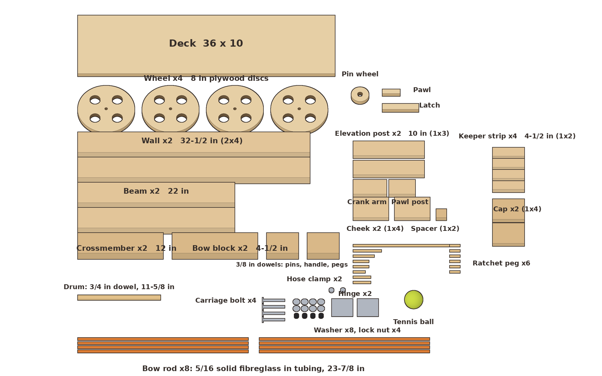 `01-parts.png`

Square one end of each board, then cut every piece on the cut list, following the cutting plan. For each 8 in wheel, mark a 4 in radius, cut just outside the line, and smooth to the line. Drill a 7/16 in hole in the centre of each wheel. Then drill four 1-1/2 in spoke holes, equally spaced, with their centres 2-1/4 in from the middle. Cut the pin wheel as a 2-3/4 in hole-saw plug (about 2-1/2 in across) and drill a 3/4 in hole in its centre. Sand every piece and break the sharp edges.

**Look for:** the parts matching the picture:
- the 36 × 10 in deck and four 8 in discs
- the 2x4 pieces and the 1x2, 1x3 and 1x4 pieces
- the 3/8 in dowels and the 3/4 in drum
- eight sleeved bow rods

### 2. Build the stock
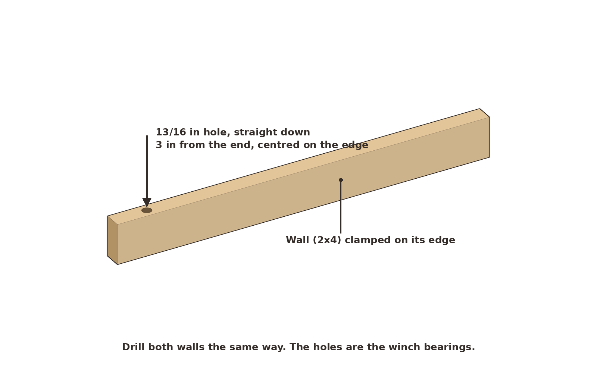 `02-drill-walls.png`
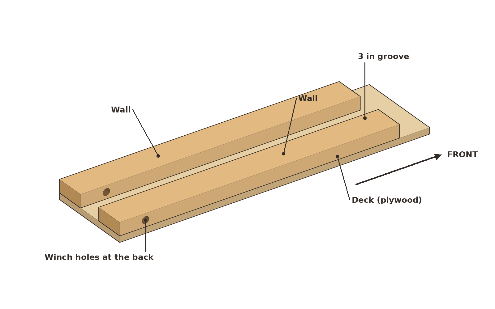 `02-stock.png`

On each 32-1/2 in wall, mark a hole 3 in from one end, centred on a 1-1/2 in edge. Clamp the wall on that edge and drill a 13/16 in hole straight down through the 3-1/2 in width. Drill a 1/8 in pilot first, and finish from both sides so the spade bit does not tear out. Both walls are the same. Those holes are the winch bearings, and that end of each wall is the back end.

Lay the deck flat. Set the walls on it, on the flat, flush with the back end and the outside edges, so a 3 in groove runs down the middle. Glue the walls and drive six #8 × 1-1/4 in screws up through the deck into each wall, spaced along its length.

**Look for:** a 3 in groove open to the front and back, with the two 13/16 in holes facing each other across it. The 3/4 in drum dowel should turn freely in both holes at once.

### 3. Add the bow blocks
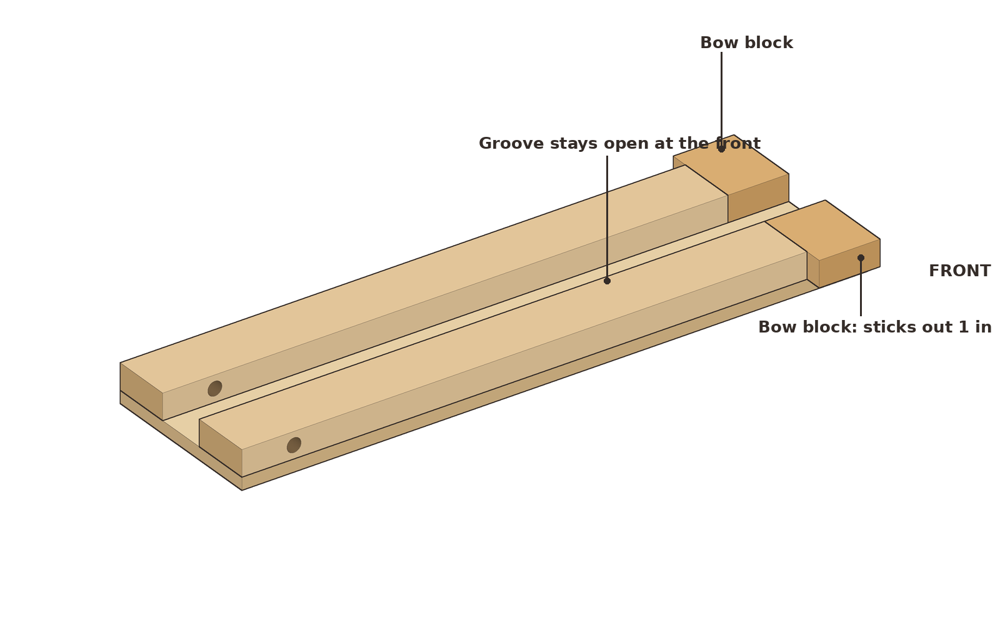 `03-bow-blocks.png`

Set a 4-1/2 in bow block on each side at the front of the deck, on the flat, butted against the end of the wall and flush with the front of the deck. Each block overhangs the deck edge by 1 in. Glue them and drive four #8 × 1-1/4 in screws up through the deck into each block.

**Look for:** the blocks in line with the walls, tops flush, the groove still open at the front, and 1 in of block sticking out on each side.

### 4. Build the carriage frame
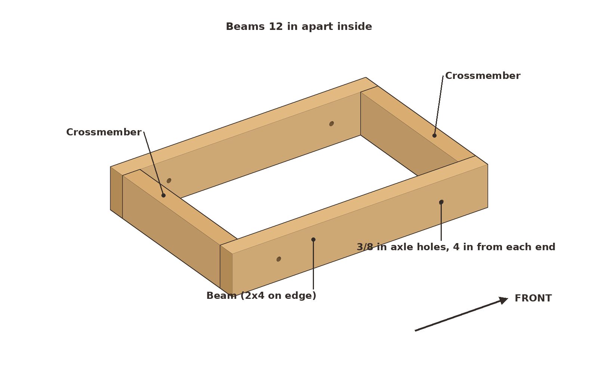 `04-carriage.png`

On each 22 in beam, mark two hole centres on a 3-1/2 in face: 4 in from each end and centred across the face. Drill a 3/8 in hole straight through at each mark. These are the axle holes.

Stand the beams on edge, 12 in apart inside, with the holes in line. Fit a 12 in crossmember between them at each end, also on edge, flush with the beam ends and the top and bottom. Glue the joints and drive two #8 × 3 in screws through each beam into each crossmember end.

**Look for:** a rectangle that sits flat and does not rack, 15 in outside to outside and 22 in long. A 3/8 in bolt should pass through each pair of holes.

### 5. Put on the wheels
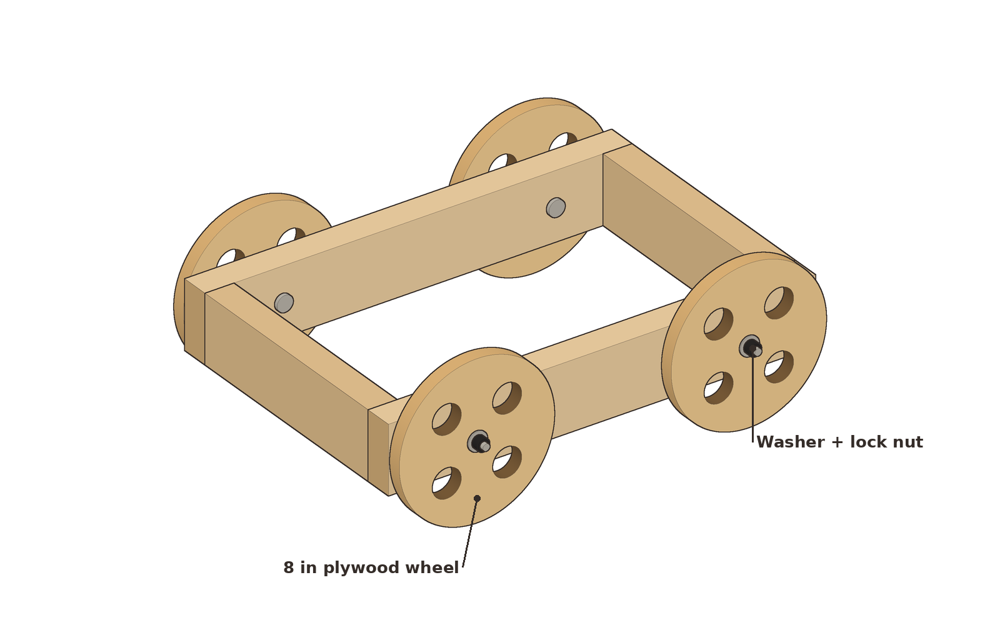 `05-wheels.png`
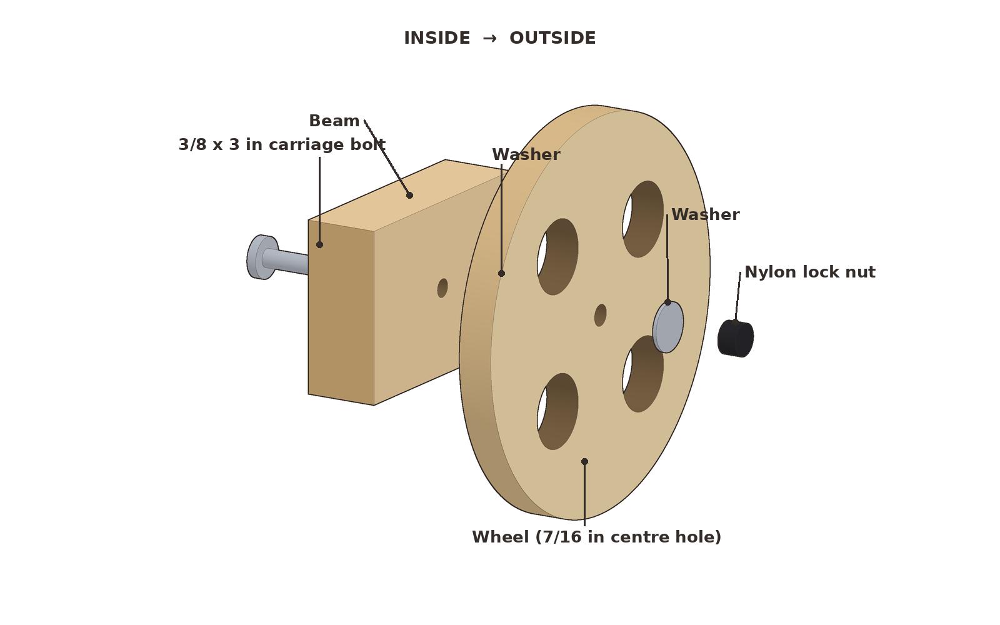 `05-wheel-stack.png`

From the inside of each beam, push a 3/8 × 3 in carriage bolt through the axle hole and tap the head so its square neck bites. On the outside, in this order, fit a washer, a wheel, a washer and a nylon lock nut. Tighten the nut until the wheel is snug, then back it off a little so the wheel spins freely with a hair of play.

**Look for:** all four wheels on the ground, each spinning by hand, with about 1/4 in of bolt past each nut.

### 6. Add the elevation posts
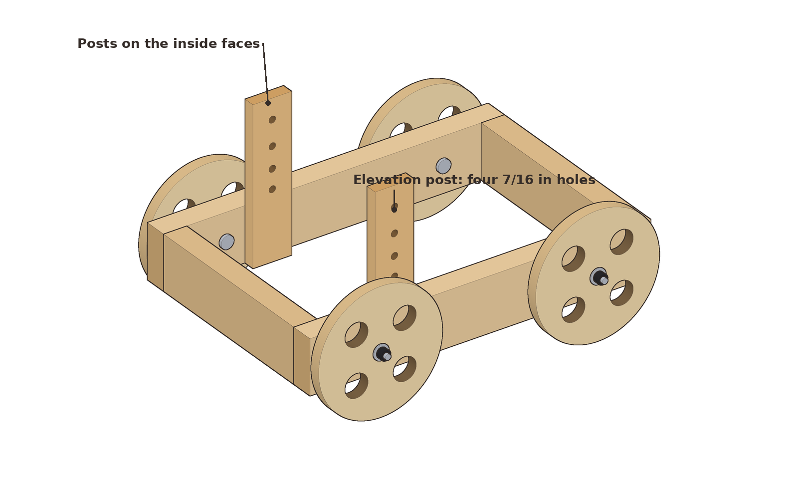 `06-posts.png`

On each 10 in post, mark four hole centres on the 2-1/2 in face, centred across it. Measure from one end, which becomes the bottom:

| Hole | From the bottom | Angle |
|---|---|---|
| 1 | 4-7/16 in | about 10° |
| 2 | 5-11/16 in | about 20° |
| 3 | 7-1/16 in | about 30° |
| 4 | 8-11/16 in | about 40° |

Clamp the two posts together and drill 7/16 in holes through both at once, so the holes line up.

Glue and screw a post to the inside face of each beam, bottom flush with the beam bottom. The post's centre line sits 6-1/2 in from the back end of the carriage. Drive three #8 × 1-1/4 in screws through each post into the beam, between the holes.

**Look for:** the two posts facing each other with their holes in line. The 13-1/2 in elevation pin should slide through any pair at once. The posts sit this far back on purpose: at full draw the string passes in front of them at every angle.

### 7. Hinge the stock onto the carriage
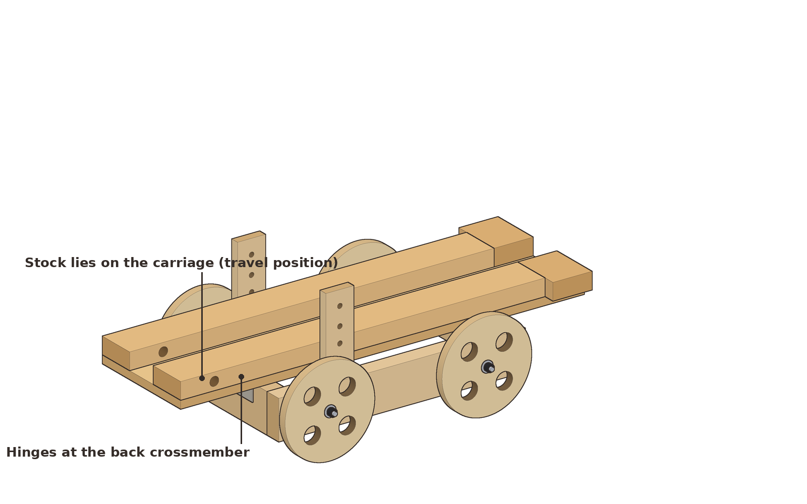 `07-hinge.png`
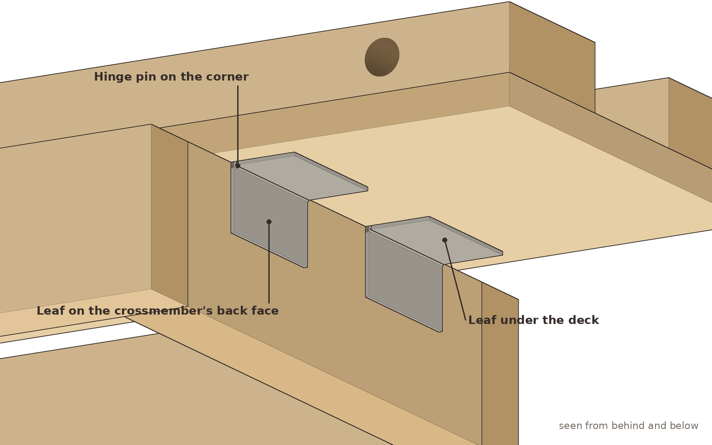 `07-hinge-detail.png`

Lay the stock on the carriage, groove up, with 7 in of the stock hanging off the back. The underside of the deck sits on both crossmembers. Screw two 3 in butt hinges at the top back corner of the rear crossmember: one leaf on its back face, the other under the deck, with the pin on the corner. Place them 2-3/4 in left and right of the centre line.

**Look for:** the stock lifting on the hinges without binding and dropping back onto the front crossmember. With the pin out, the machine rolls with the stock folded flat.

### 8. Build the winch
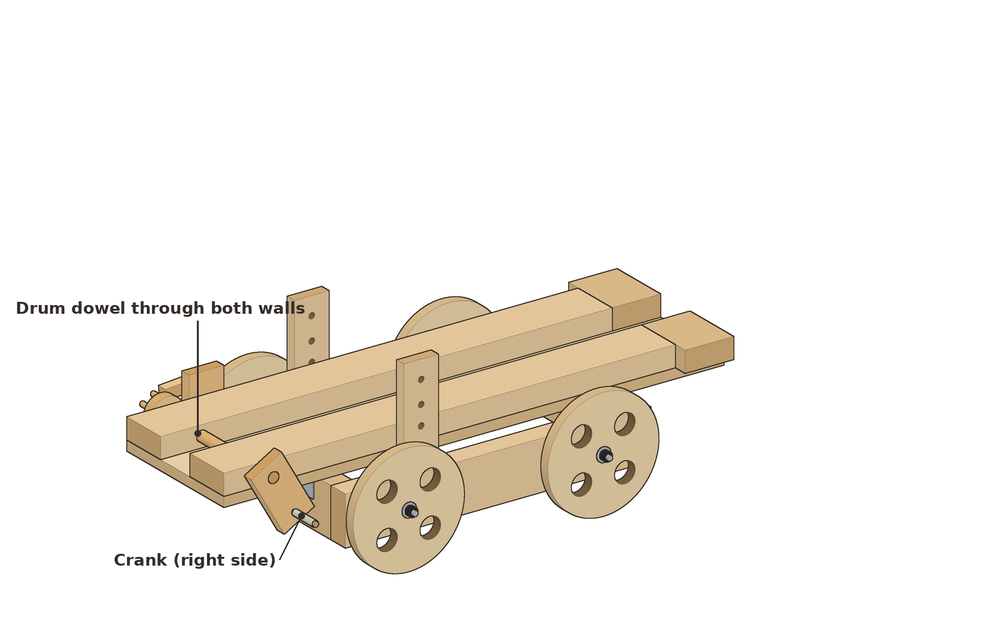 `08-winch.png`
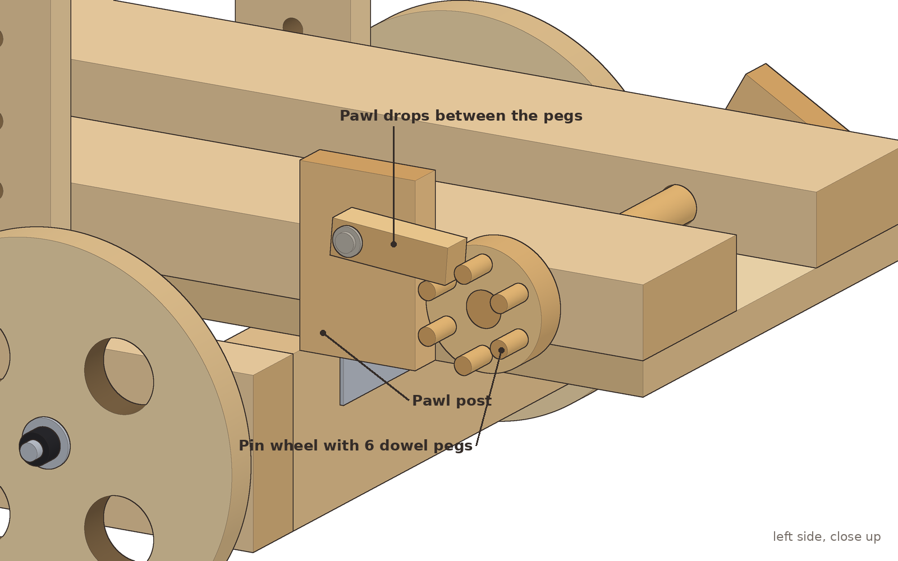 `08-ratchet.png`
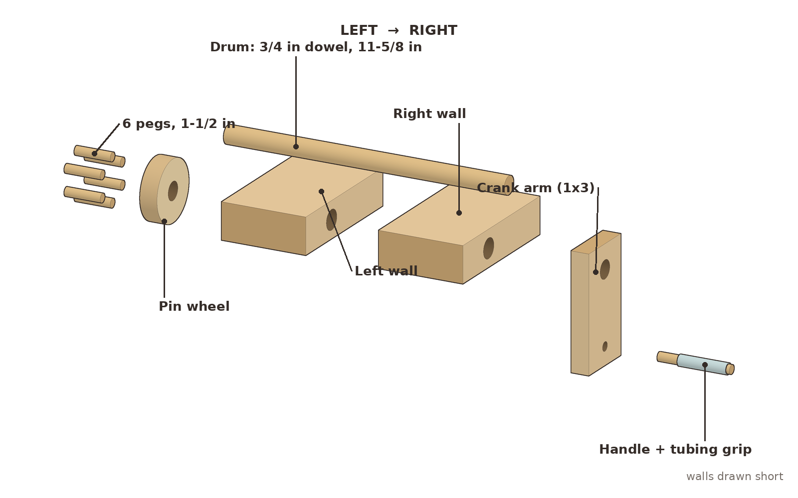 `08-winch-stack.png`

On the 4-3/4 in crank arm, centred on the 2-1/2 in face, drill a 3/4 in hole 1 in from one end (for the drum) and a 3/8 in hole 3/4 in from the other end (for the handle). The centres are 3 in apart. On the pin wheel, mark six peg holes, equally spaced, on a circle 0.9 in from the centre. Drill them 3/8 in and glue in the 1-1/2 in ratchet pegs, flush on the inner face and sticking out on the far side.

Slide the 11-5/8 in drum through both wall holes. On the right end, glue the crank arm onto the drum 1/16 in off the wall. Glue the 3 in handle through the arm's outer hole, with a 2 in sleeve of vinyl tubing as a grip. On the left end, glue the pin wheel onto the drum 1/16 in off the wall, pegs pointing out. The arm, wheel and pegs are glued; the drum turns in the walls.

Screw the 3-3/4 in pawl post to the left side of the stock, just in front of the pin wheel, flush with the deck's underside. Hang the pawl on a round-head screw in the post so it drops under its own weight, with its tip between two pegs.

**Look for:** the drum turning smoothly, the crank clearing the stock, and the pawl clicking as you wind one way and catching if you try to unwind. At full draw the crank takes up to about 6 lb at the handle. The pawl holds the drum every time you let go.

### 9. Build the slider
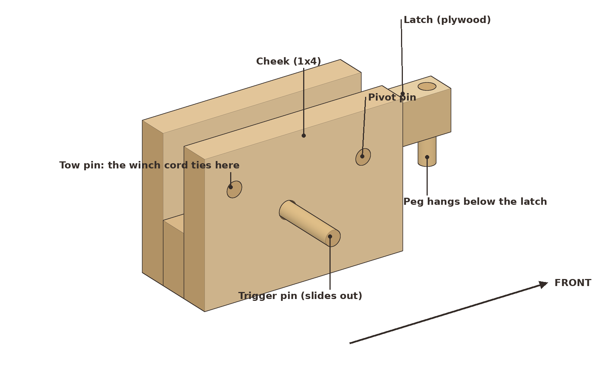 `09-slider.png`
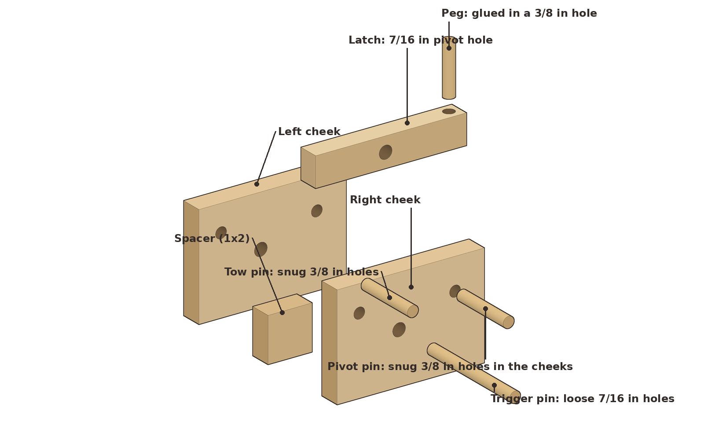 `09-slider-stack.png`

The slider is two 5 in 1x4 cheeks standing on edge, with the 1-1/2 in 1x2 spacer between them at the back, bottoms flush. The spacer is 3/4 in thick, so the gap between the cheeks is 3/4 in, just enough for the plywood latch to swing.

Clamp the cheeks together, bottoms and ends flush, and drill three holes through both:
- **Pivot:** 3/8 in, 4 in from the back end and 2-7/16 in up from the bottom.
- **Trigger pin:** 7/16 in, 2.1 in from the back end and 1-3/4 in up.
- **Tow pin:** 3/8 in, 3/4 in from the back end and 2.6 in up (just above the spacer).

On the latch, drill a 7/16 in pivot hole 2-3/8 in from the back end, and a 3/8 in peg hole a scant 3/8 in from the front end, both centred on the 1 in width. Glue the 1-3/4 in peg in the front hole, flush with the top and hanging below.

Glue the spacer between the cheeks. Slide the latch into the gap and push the 2-1/4 in pivot pin through. Glue the pin in the cheeks only, so the latch still swings. Glue the 2-1/4 in tow pin through the back holes; the winch cord ties to it. The 4 in trigger pin slides through the 7/16 in holes and sticks out farther on the right, where the pull cord ties on.

**Look for:** a slider that sits in the groove with about 3/8 in of play on each side. The latch swings freely and the trigger pin slides out with a tug. With the pin in, the latch lies level and the peg hangs below it.

### 10. Mount the bow arms
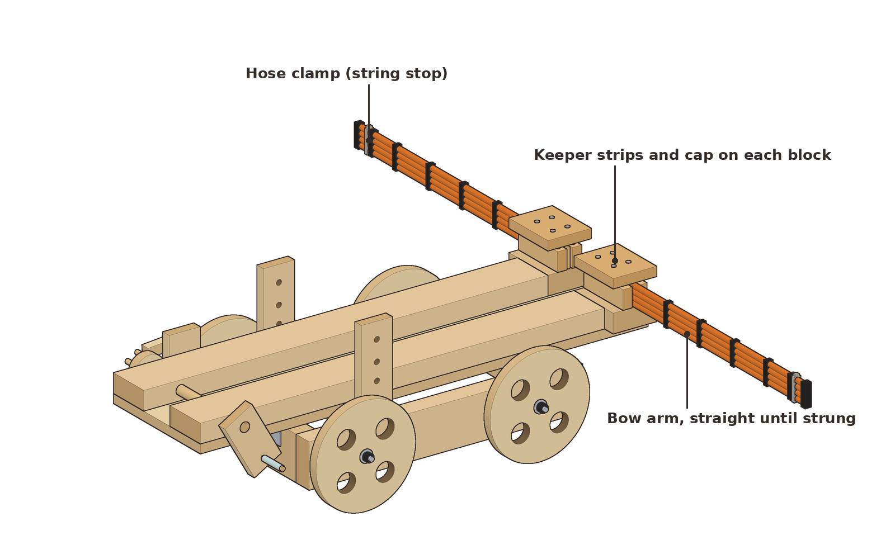 `10-bow-arms.png`
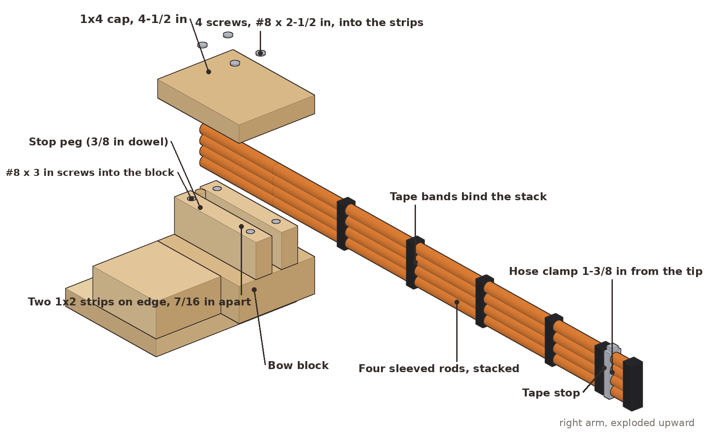 `10-arm-detail.png`
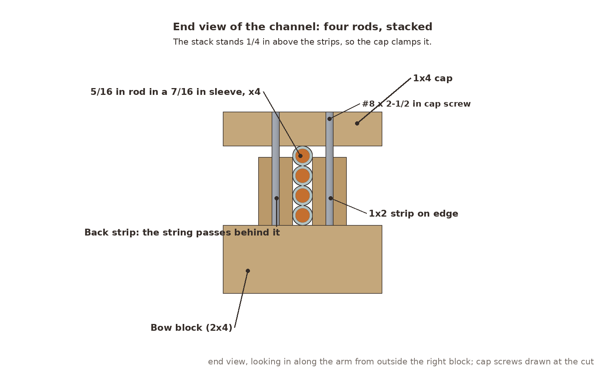 `10-channel-end-view.png`

Each arm is a stack of four sleeved rods in a channel on its bow block. The channel is two 1x2 strips standing on edge, 7/16 in apart, with a 1x4 cap screwed down on the stack. The strips stand on edge so they are only 3/4 in wide: the string sits 2 in behind the rods and has to clear the back strip.

1. **Stop peg.** On top of each bow block, on the centre line of its 3-1/2 in width, drill a 3/8 in hole 1 in deep, about 9/32 in out from the inner end of the block. Glue in a 2-1/2 in stop peg so 1-1/2 in stands up. The inner ends of the rods butt against it.
2. **Keeper strips.** Stand two 4-1/2 in 1x2 strips on edge on each block, ends flush with the block ends, with a 7/16 in gap centred on the block. Each strip ends up about 25/32 in in from its edge of the block. Use a sleeved rod as a spacer. Glue them, then drive two #8 × 3 in screws down through each strip into the block, 1/2 in from the inner end and 3/4 in from the outer end. The stop peg sits in the gap.
3. **Rods.** Lay four sleeved rods in the channel, one on top of another, inner ends against the stop peg, ends lined up. The rods run 19-7/8 in past the outer end of the block. The stack stands 1/4 in above the strips.
4. **Cap.** Set a 4-1/2 in 1x4 cap on top, flush with the block. Drill pilots and drive four #8 × 2-1/2 in screws through the cap into the strips, one centred on each strip, 1-1/8 in and 1-5/8 in in from the inner and outer ends. Snug them evenly until the cap bears down on the stack. Do not glue the cap, so you can take it off to replace a rod.
5. **Tape bands, clamp and tip.** Bind each stack with four tape bands along the free arm, about every 3-3/4 in, so the rods bend together. Fit a hose clamp round the stack 1-3/8 in from the tip and tighten it firmly. Wrap a thick tape stop right behind it, on the block side, so the clamp cannot creep inward. Tape over the tip end of the stack.

**Look for:**
- both arms straight, in line and at the same height, with their inner ends against the stop pegs
- no movement when you push and pull a tip
- the caps bearing on the stacks, with a 1/4 in gap above the strips
- the clamps the same distance from each tip

### 11. String the bow and fit the slider
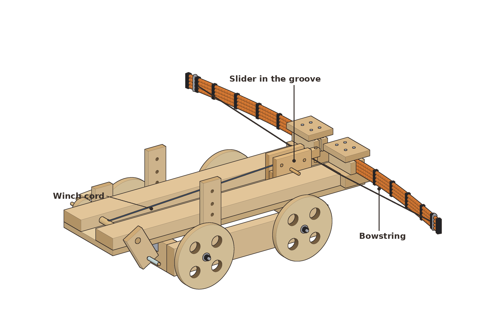 `11-string.png`

Cut about 58 in of the 2 mm UHMWPE cord. At one end, tie a loop (a bowline finished with two half hitches) that fits over the tip and sits between the hose clamp and the tip tape, about 3/4 in from the tip. Pull it tight and tape the tail flat. UHMWPE is slippery and its knots can loosen, so do not skip the tape.

With two adults, bend both tips back toward the stock and loop the other end on the same way. Adjust the knot until, at rest, the middle of the string sits 2 in behind the rod line and lies on the wall tops. Nock to nock, the string is about 50 in. At rest it carries about 57 to 76 lb, so go slowly, wear gloves and eye protection, and keep faces away from the tips.

Set the slider in the groove, peg facing the bow, and hook the string behind the peg. Tie the 1/8 in winch cord to the tow pin, lead it back to the drum, and take a couple of turns so winding the crank pulls the slider back. Mark two positions on a wall, measured to the string's centre from the back end of the deck:
- the 8 in test mark, 24-1/4 in from the back
- the full-draw mark, 14-1/2 in of travel, 17-3/4 in from the back

**Look for:** both arms bent back evenly, the string on the wall tops and clear of the back keeper strips by about 1 in, the knots taped, and the slider running the length of the groove freely.

### 12. Set the elevation
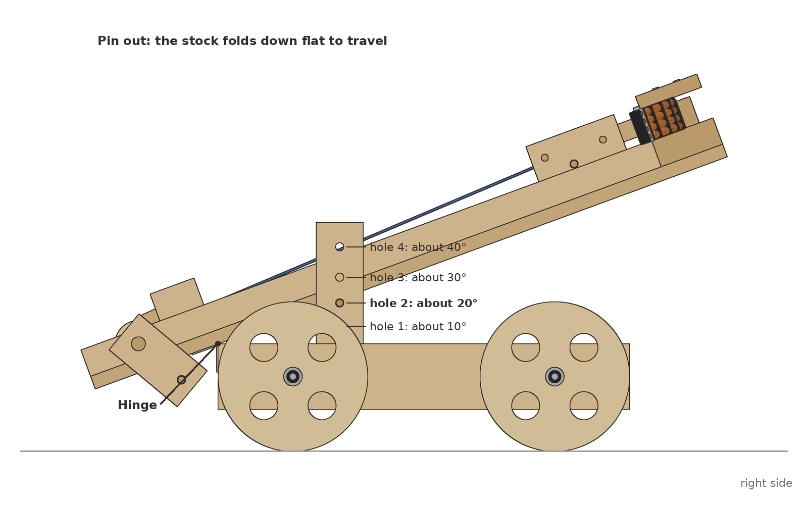 `12-elevation-side.png`

With the bow **not** cocked, lift the front of the stock and push the elevation pin through a matching pair of post holes, so the deck rests on the pin. Hole 1 gives about 10 degrees, hole 2 about 20, hole 3 about 30 and hole 4 about 40. Pull the pin out and the stock folds down for travel.

The back of the stock hangs lower as the angle goes up. At about 40 degrees it is about 1-1/4 in off the ground, and the crank handle about 1-1/4 in, so use hole 4 only on flat ground.

**Look for:** the pin through both posts, the deck resting on it without rocking, and all four wheels on the ground.

### 13. Cock it
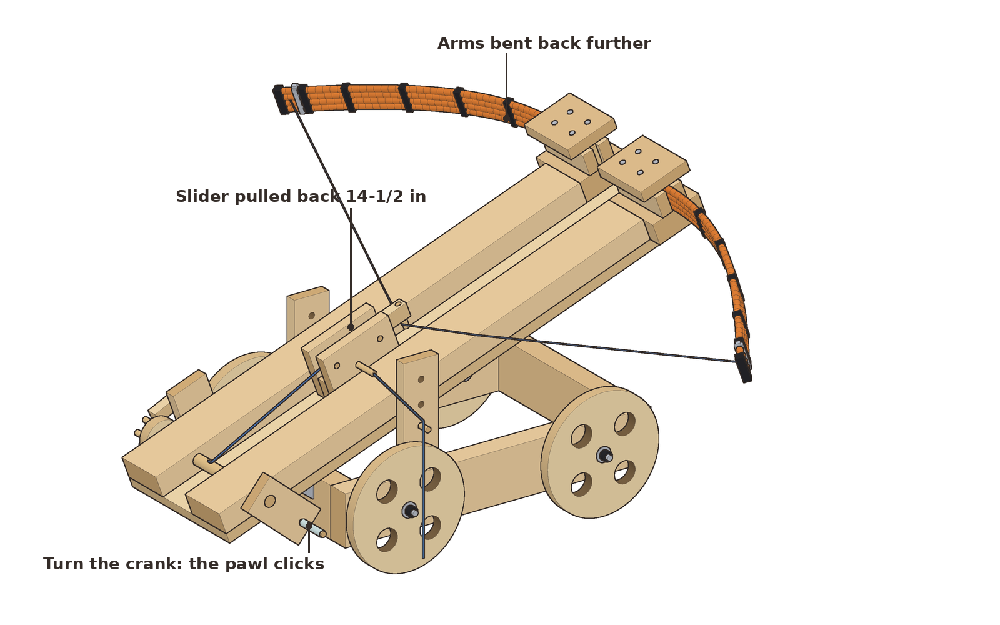 `13-cock.png`
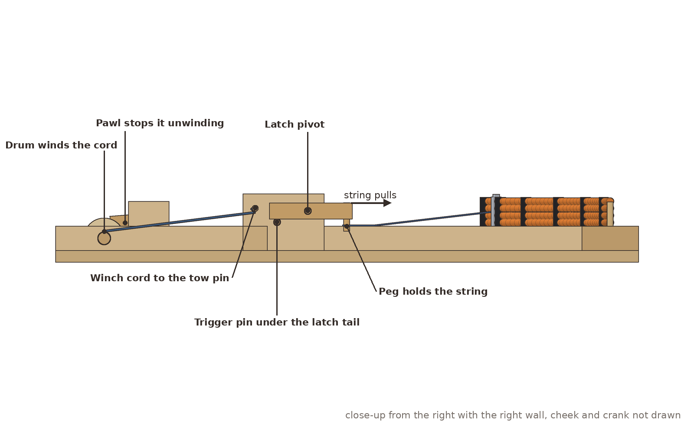 `13-mechanism-side.png`

Do the first-shot test (below) once before the first shot. Set the elevation first. With the string behind the peg and the trigger pin in, turn the crank so the winch pulls the slider back. The pawl clicks over the pegs. Stop when the string reaches the full-draw mark, 14-1/2 in. **Do not draw past it**: that is where the rods reach their strain limit. Tie the 6 ft pull cord to the long end of the trigger pin with a clove hitch and lead it out to the right.

At full draw the crank takes about 4-1/2 to 6 lb at the handle. The trigger pin carries about 13 to 17 lb from the latch.

**Look for:** the slider held back on its own, the pawl seated between two pegs, the latch level, and the string on the peg. If the winch slips, the pawl is not dropping; see step 8.

### 14. Load and fire
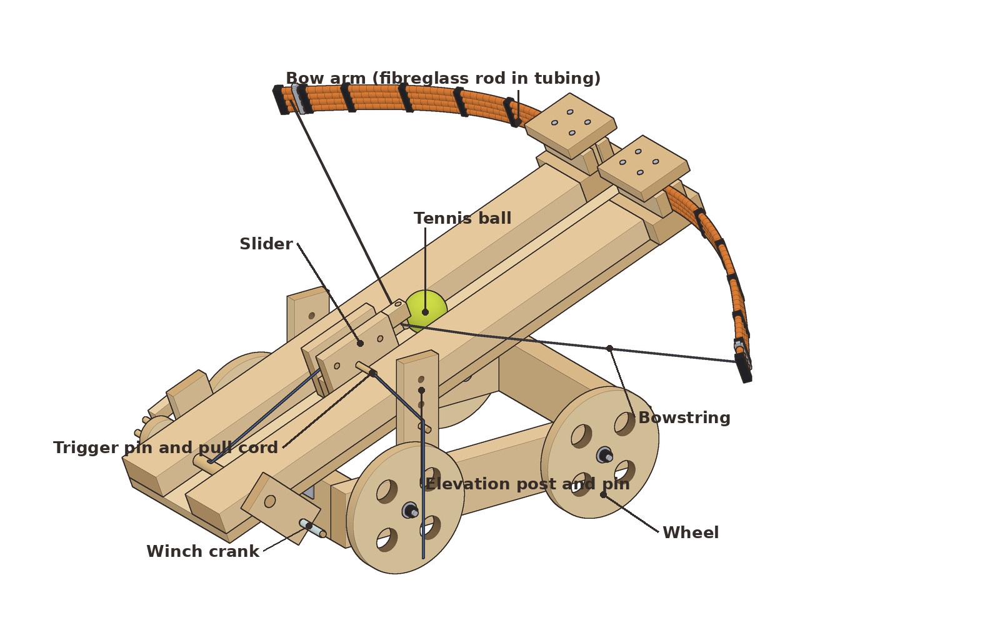 `14-finished-3q.png`
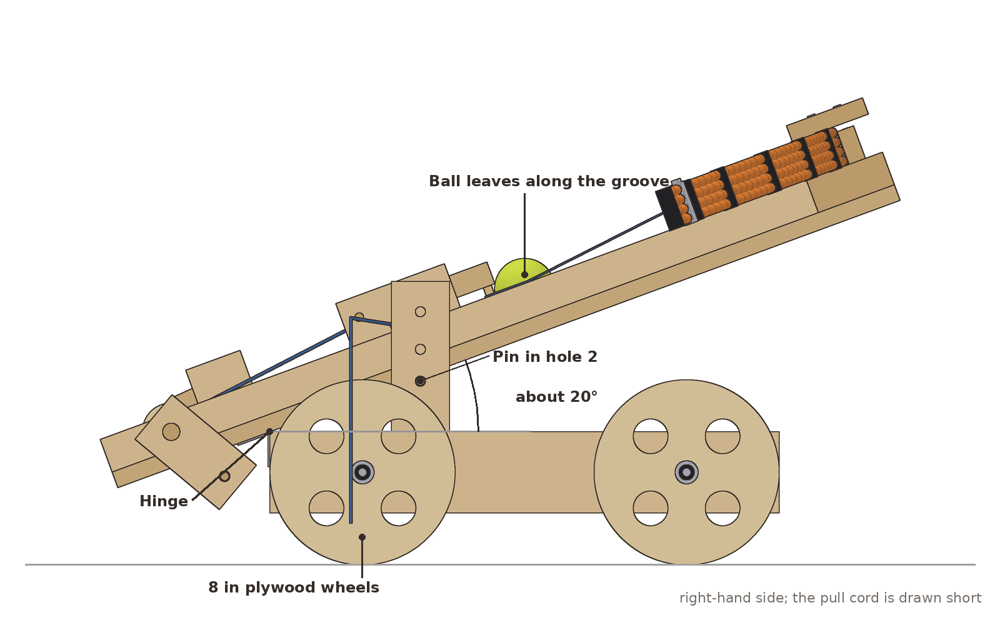 `14-side.png`
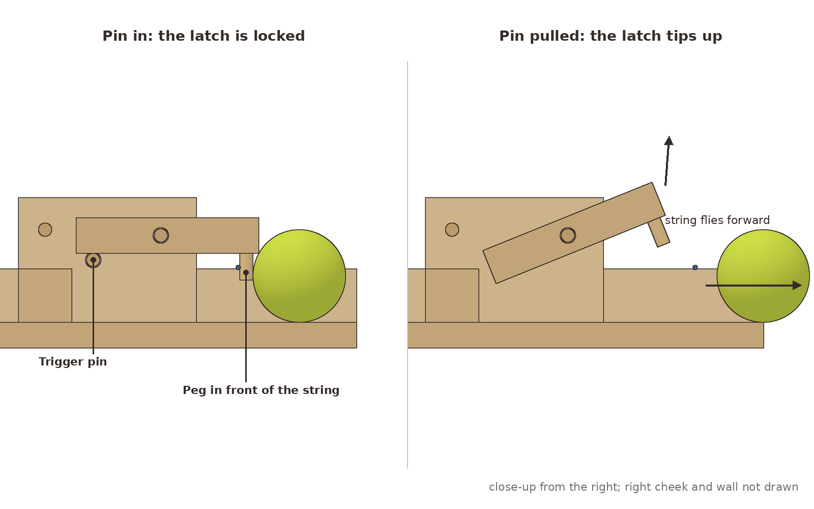 `14-release.png`
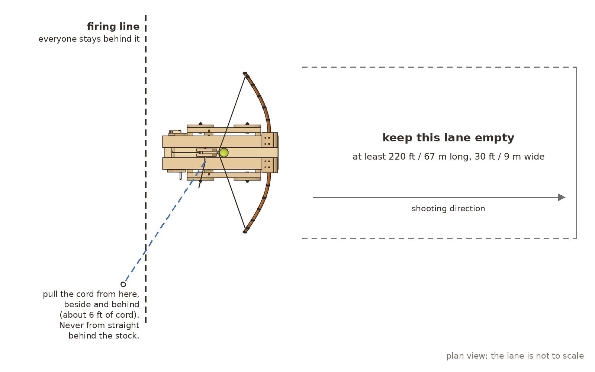 `14-firing-zone.png`

Everyone has eye protection on and stays behind the firing line, and the lane is empty for at least 220 ft. Set one tennis ball in the groove, in front of the peg and touching it. From beside and behind the machine, pull the cord sharply sideways. Expect a pull of about 4 to 8-1/2 lb.

The trigger pin slides out. The string's own pull tips the front of the latch up, the peg rises, and the string flies forward and pushes the ball along the groove.

**Look for:** the ball leaving along the groove, and the arms and string coming to rest in the strung position. To fire again, put the trigger pin back, hook the string behind the peg, and crank to the full-draw mark.

**How far it throws (estimates, untested).** Tennis ball, full 14-1/2 in draw, landing on level ground:

| Elevation | Low | Nominal | High |
|---|---|---|---|
| 10° | 22 ft | 44 ft | 79 ft |
| 20° | 34 ft | 70 ft | 119 ft |
| 30° | 42 ft | 84 ft | 139 ft |
| 40° | 46 ft | **89 ft** | 145 ft |

**What to expect:** about 85 to 90 ft at 30 to 40 degrees, if the rods and string behave like the nominal case.

How the model works:
- **Stored energy** is the area under the modelled draw curve: about 23 / 26.5 / 30 J.
- **Launch:** a fraction of that energy (55 / 70 / 85%) goes to the ball plus the "virtual mass" of the moving arms and string. The virtual mass is worked out from the solved arm shapes, plus a share of the arms' own weight for vibration and string stretch.
- **Flight** is with air drag on a 56 to 59 g, 2.6 in ball.

Nominally about 45% of the stored energy reaches the ball, at about 46 mph. The low case assumes a soft rod, a lossy shot and heavy arm vibration. The high case assumes a stiff rod and an almost loss-free shot; real shots are unlikely to reach it, but the lane is sized to it anyway.

Things that push real shots lower:
- a stretched string, a slipping knot, or a brace above 2 in
- a wet or scuffed ball
- shooting into wind

## First-shot test

Do this before the first shot, and again after any change to the bow. You need the luggage scale, eye protection for everyone, two adults, and the 8 in and full-draw marks from step 11.

1. Set the stock at hole 1 (10 degrees). Take the slider out of the groove so the string is free.
2. Hook the scale on the middle of the string. Standing to the side, pull it slowly straight back along the groove to the 8 in mark and read the scale. Let it forward slowly; do not let it snap.
3. If the 8 in reading is under the stop figure, use the winch instead of your hand for the full draw. Hook the scale between the winch cord and the slider's tow pin, crank to the full-draw mark, and read it. Ease it back down with the pawl.
4. Do each reading three times and write them down.
5. Watch the arms while you pull. They should bend evenly, both the same, with the stacks staying together and staying put in their channels.
6. Put the slider back, crank to the 8 in mark and fire one tennis ball. Then crank to full draw and fire one more. Check the knots, clamps, tape bands and caps after each shot.

| Reading | Expected (model) | **Stop** if it reads over |
|---|---|---|
| At 8 in | about 15 to 20 lb (14.9 to 19.9) | **22 lb** |
| At full draw, 14-1/2 in | about 27 to 36 lb (27.1 to 36.1) | **40 lb** |

**Stop and do not shoot** if any of these happens:
- a reading passes the stop figure
- a rod shows white streaks or lines, creaks, cracks or splinters (whitening means the fibreglass is being damaged)
- an arm moves in its channel, a cap lifts, or a screw loosens
- a hose clamp or tape band creeps, or a knot slips
- the two tips bend unevenly by more than about 1/2 in

A reading higher than expected means stiffer rods than the model assumed. Do not add rods or draw farther. If it is over the stop figure, take one rod out of each stack and test again.

A reading lower than expected is not a safety problem; it just throws shorter. Check that the markers are solid at a cut end, that the brace is 2 in, and that the clamps have not moved.

## Care

- **Never dry-fire.** Always shoot with a tennis ball in the groove.
- **Un-cock with the pawl,** not the trigger.
- **Do not store it cocked**, not even for a few minutes while you fetch balls.
- **Unstring it between sessions** (two adults). Fibreglass left bent takes a set, and UHMWPE cord stretches slowly under constant load.
- Before each session, check:
  - the knot tape
  - the clamps, tape stops and tape bands
  - the cap and strip screws
  - every rod, for white marks. Replace any rod that shows them.
- Keep the machine dry and out of the sun when you are not using it.

## Why it works

**The bow is two stacked cantilevers.** Each arm is clamped in its channel for 4 in and free for about 19 in past the block. Drawing the string back 14-1/2 in bends the free arms and stores energy in them. Stacking four rods multiplies the stiffness, and so the energy, by four, but leaves the bend in each rod the same. The bend is what breaks fibreglass, so the stack is as safe as one rod at the same draw. The tape bands make the four rods bend together. The cap and strips spread the load along the block: at full draw each arm's root pushes on the channel with up to about 160 lb, which the 2x4 carries with a margin of about 3.7.

**Why the draw isn't longer.** A longer draw bends the rods further. With these 24 in arms, 14-1/2 in keeps the worst-case rod under its break strain divided by 1.8. Longer arms would allow a longer draw, at the cost of a wider machine.

**Why a tennis ball.** The bow returns energy fastest into a ball of about 45 to 60 g. The model's sweep at 40 degrees gives these ranges:

| Ball | Range at 40° |
|---|---|
| 30 g | 84 ft |
| 57 g tennis ball | 89 ft |
| 100 g | 77 ft |
| 150 g | 63 ft |

A 5 to 10 g foam ball takes so little of the energy that the shot is close to a dry-fire. A tennis ball is about the best soft ball for this bow.

**Why UHMWPE string.** The 2 mm cord is rated 1,000 lb, 13 times the most the string sees. It stretches very little, so more of the energy reaches the ball. Its weak point is knots, which is why every tail is taped.

**The slider is Leonardo's "device that runs along the string."** The latch is a lever. The peg sits in front of the pivot, and the trigger pin sits behind it, under the tail. While the pin is in, the latch cannot tip, so the peg holds the string. Pull the pin and the string's pull lifts the latch front, and the string is free. At full draw the latch carries about 24 to 32 in-lb.

**The winch lets you draw it slowly.** A 3/4 in drum and a 3 in crank turn up to 36 lb of pull into about 6 lb at the handle. The gravity pawl stops the drum between pulls, slipping at most about 44 degrees before it catches. The drum is 3/4 in because a 3/8 in dowel would bend close to its limit at this pull.

**The carriage aims the shot and carries the machine.** The stock is hinged at the back of the carriage and rests on a pin through the posts, so four hole pairs give four angles. Range still rises between 30 and 40 degrees, but only by about 5 ft nominal, so 30 degrees is nearly as good and keeps the tail higher off the ground.

## A wider bow (not drawn, not checked in detail)

If you want more range and have room for a 5 ft machine, 28 in arms (each rod cut from its own 48 in marker, so eight markers for the bow) would allow a 22 in draw within the same strain limit. The model gives about 28 lb nominal at full draw, about 34 J stored, and about 99 ft nominal at 40 degrees. That is only about 10 ft more than this build, and it needs a longer stock and slider travel, so it is not the standard build.

Torsion engines, with twisted rope skeins like a Roman ballista, store more energy for their size. They also need very high rope tension and metal hardware, which this project avoids. Since the standard build already reaches about 85 to 90 ft nominal, this project does not go there.

## Try this next

- **Change the elevation.** Shoot three times at each hole and measure each throw. Compare with the table in step 14.
- **Change the draw.** Mark 8, 11 and 14-1/2 in, and never go past 14-1/2. How does distance change with draw?
- **Re-measure your lane.** Once you know your longest throw at 40 degrees, the lane is 1.5 times that, but never shorter than 1.5 times the longest throw you have seen.
- Keep to tennis balls and the same firing line for every test.

The ranges here and in `report.json` are estimates from the model and textbook fibreglass properties, not measured throws. `report.json` also has every check under `model_check`.
