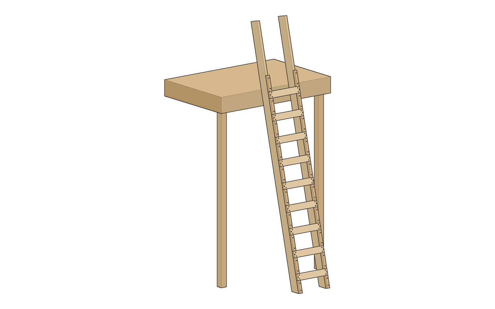
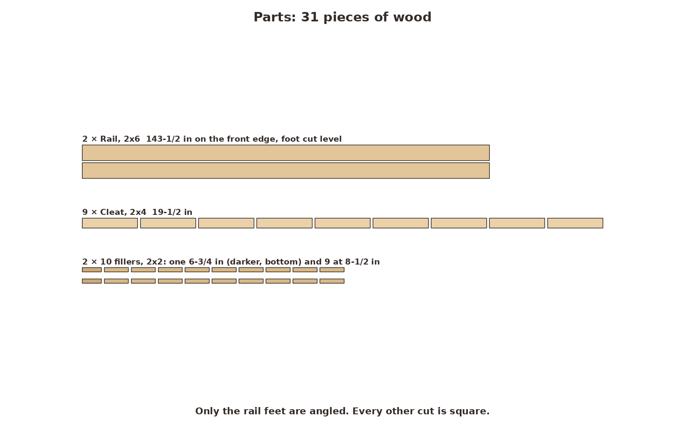
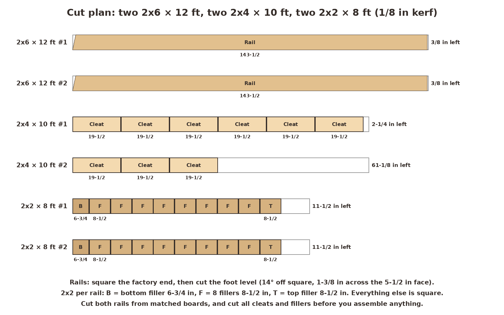
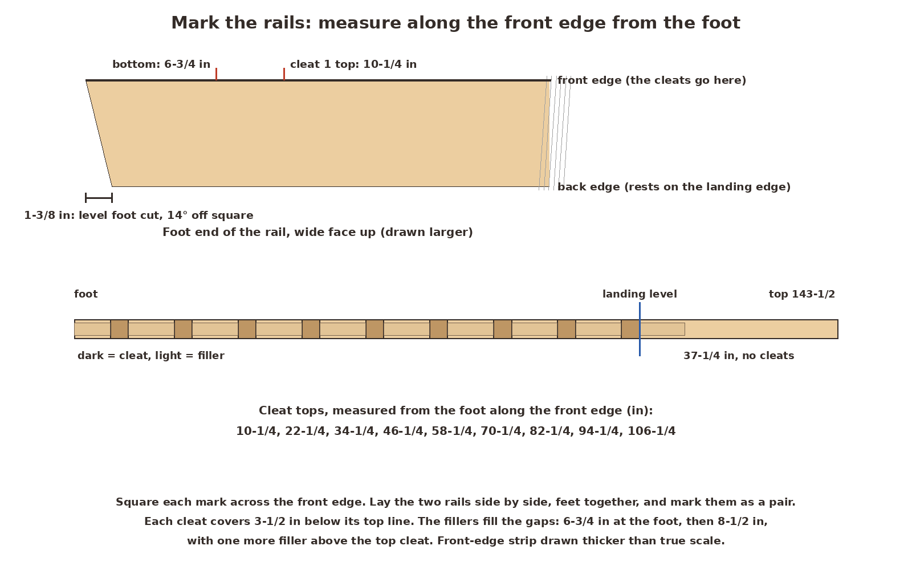
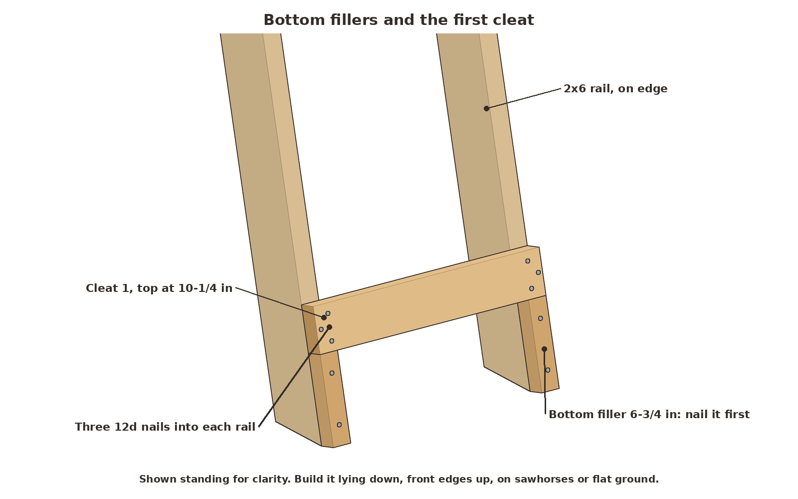
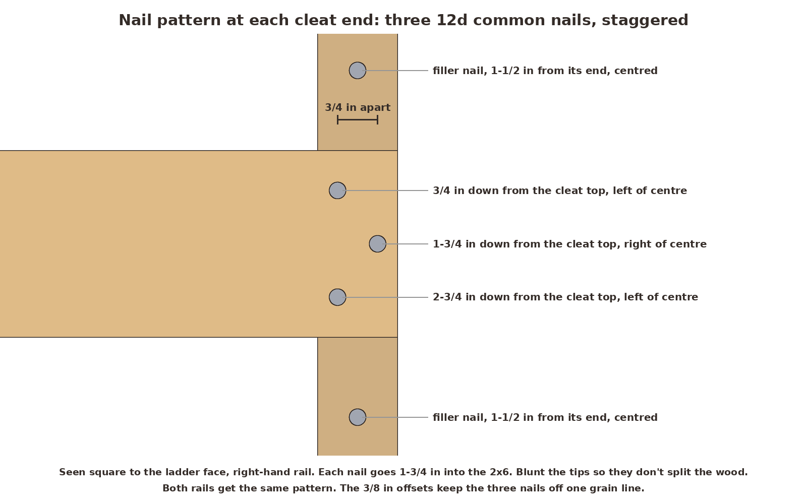
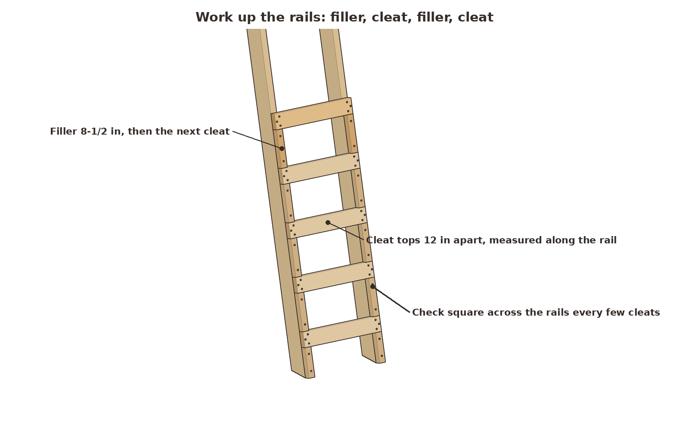
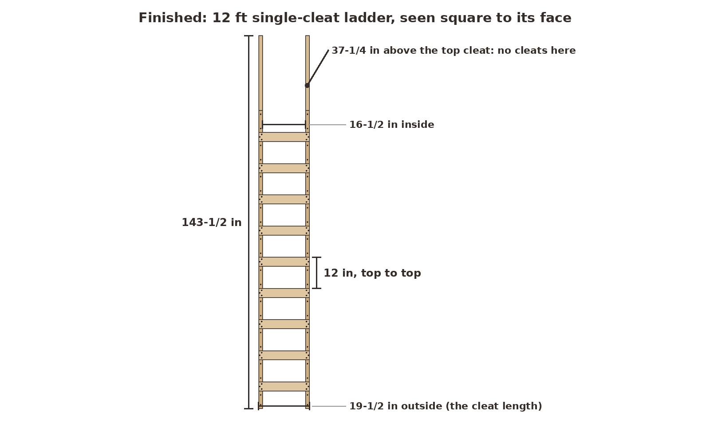
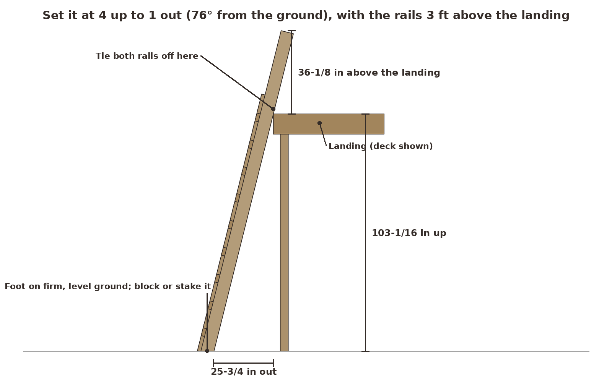
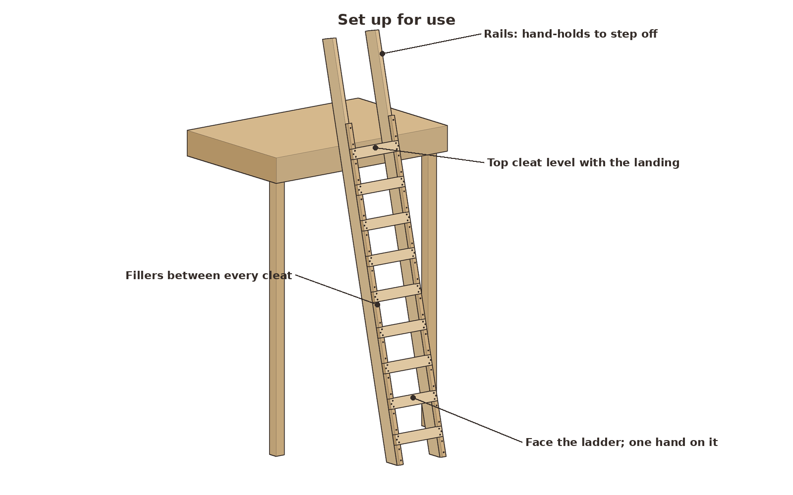

# Job-Built Ladder (12 ft, single cleat)

*A straight wooden ladder of the kind framing crews nail together on site: two 2x6 rails, 2x4 cleats every 12 in and 2x2 filler blocks between them. Built with a handsaw and a hammer.*

| | |
|---|---|
| **Section** | Home & Prep |
| **Ages** | Adults |
| **Time to build** | About 3 hours |
| **Difficulty** | 3 / 5 |
| **Skills taught** | Laying out marks from one reference edge, a level cut, nailing to a pattern, setting a ladder at the right angle |
| **Works without power** | Yes, with a handsaw and a hammer (a hand drill helps for pilot holes near board ends) |

The rails are 2x6s, 143-1/2 in long on the front edge, 16-1/2 in apart inside and 19-1/2 in outside. Nine 2x4 cleats sit on the front edges of the rails, with their tops 12 in apart from 10-1/4 in up to 106-1/4 in. A 2x2 filler block fills each gap between cleats on both rails, so every cleat sits on solid wood as well as on its nails. Set at 4 up to 1 out, the top cleat is level with a landing 103-1/16 in (8 ft 7-1/8 in) up, and the bare rails run on another 36-1/8 in, measured straight up, as hand-holds. It weighs about 57 lb.

**What this is:** a temporary access ladder. It gets you from one level to another, for example onto a deck or a platform under construction. It isn't a work platform or a stepladder. The strength checks below are calculations for a 250 lb person. Build it from straight, clear lumber, inspect it every time, and replace it when the job is done.

## Design spec

These are the numbers the ladder is built to. The drawings, the cut list and the checks all use them.

| Item | Spec |
|---|---|
| Rails | Two one-piece 2x6s, 143-1/2 in on the front edge, parallel, no splices |
| Width | 16-1/2 in clear between the rails, 19-1/2 in outside |
| Cleats | 2x4, 19-1/2 in long, flush with the outside faces of the rails |
| Cleat spacing | 12 in top to top, even within 1/4 in; first cleat top 10-1/4 in up from the foot |
| Clear space above each cleat | 8-1/2 in |
| Filler blocks | 2x2 on the front edge of each rail, filling every gap between cleats, plus one above the top cleat |
| Cleat nails | Three 12d common nails (0.148 × 3-1/4 in) at each cleat end, staggered; no double-head nails |
| Filler nails | Two 12d common nails per filler, 1-1/2 in from each end |
| Rails above the landing | 36-1/8 in, measured straight up, with no cleats |
| Setup angle | 4 up to 1 out (about 76° from the ground) |
| Design load | One 250 lb person; strength checked at 4 × 250 = 1,000 lb |
| Finish | Clear or none, so cracks stay visible; one label on one rail |

## Safety

This ladder needs its own safety steps, on top of the usual shop ones:

- **Set it at 4 up to 1 out.** For every 4 ft of height to the landing, the foot goes 1 ft out. For this ladder that's about 25-3/4 in from the landing edge to the back of the feet. Too steep and it tips back; too shallow and the foot slides.
- **Rails at least 3 ft above the landing**, with no cleats above it. Use the rails to step on and off. If the rails don't reach 3 ft, you need a longer ladder, not a taller step.
- **Secure the top.** Tie or block both rails to something solid at the landing so the top can't slide sideways. Rest both rails evenly on the landing edge.
- **Secure the foot.** Set the feet on firm, level ground. On soil, stake a 2x4 behind the feet; on a slab or deck, nail or clamp a block behind them, or have someone foot the ladder. With a 250 lb person on the top cleat and nothing holding the top, the feet need a friction grip of about 0.23 to stay put. Smooth concrete, frost or a wet deck can give less.
- **One person at a time, facing the ladder**, with one hand on it. Don't carry anything that throws off your balance; hoist tools up separately.
- **Keep it clean and dry.** No mud, oil or ice on the cleats.
- **Keep it away from power lines.** Wood is not a reliable insulator when it's wet or dirty.
- **Inspect before every use:** cracked or split rails, a loose or split cleat or filler, nails backing out, rot. If anything is wrong, tag it DO NOT USE and fix it before anyone climbs.
- **Label it.** Put one label on one face of one rail, at chest height: HOME-BUILT JOB LADDER. One person at a time, 250 lb design load. Set 4 up to 1 out; tie off the top. Leave the rest of the wood bare or clear-finished, so cracks stay visible.
- In the shop: wear safety glasses, and hold the nails with pliers or a magnet for the first taps.

## Parts

**Lumber.** Pick the straightest, clearest boards in the pile. The rails should have no knots on either narrow edge, and no knot wider than about 1/2 in anywhere. The checks assume No. 2 spruce-pine-fir; select-grade Douglas fir is stronger and stiffer if you can get it.
- 2 × 2x6, 12 ft (rails)
- 2 × 2x4, 10 ft (cleats)
- 2 × 2x2, 8 ft (filler blocks; "2x2" here is the 1-1/2 × 1-1/2 in board)

**Fasteners and supplies**
- 2 lb of 12d common nails, 3-1/4 in, bright or hot-dip galvanized (94 used). Not double-head nails and not box nails.
- Sandpaper, 80 grit
- One self-adhesive label or a printed label under clear tape
- Optional: clear finish (boiled linseed oil); a 2x4 offcut and two stakes for a foot block

## Cut list

All sizes are actual dimensions.

| Part | Qty | Material | Size | Ends |
|---|---|---|---|---|
| Rail | 2 | 2x6 | 143-1/2 in on the front edge | Foot cut level (1-3/8 in across the 5-1/2 in face, about 14° off square); top square |
| Cleat | 9 | 2x4 | 19-1/2 in | Square |
| Bottom filler | 2 | 2x2 | 6-3/4 in | Square |
| Filler | 18 | 2x2 | 8-1/2 in | Square (8 between the cleats and 1 above the top cleat, per rail) |

**Leftovers:** about 3/8 in from each 2x6, 2-1/4 and 61-1/8 in of 2x4 (enough for a foot block), and 11-1/2 in from each 2x2.

## Tools

- Handsaw (crosscut)
- Hammer, 16 oz or heavier, and a nail set
- Speed square or combination square, measuring tape, pencil
- Optional: hand drill with a 3/32 in bit for pilot holes near board ends
- Two sawhorses, or a flat clean floor
- Safety glasses

## Assembly

### 1. Cut the parts
 `01-parts.png`
 `01-cut-lumber.png`

Square the factory end of each 2x6. Measure 143-1/2 in along one narrow edge; this is the front edge, and every measurement is taken along it. Cut the top square. At the foot, mark a level cut: from the front edge, measure 1-3/8 in along the back edge and join the two points. That line is about 14° off square, and it makes the foot sit flat when the ladder leans at 4 up to 1 out. Cut the nine cleats and the twenty fillers square. Sand every edge you'll put a hand on.

**Look for:** two rails that match end to end, 9 cleats, 2 short bottom fillers and 18 fillers of 8-1/2 in.

### 2. Mark the rails
 `02-mark-rails.png`

Lay the two rails side by side with their front edges up and their feet together. Measure from the foot along the front edge and square a line across both rails at each cleat top: 10-1/4, 22-1/4, 34-1/4, 46-1/4, 58-1/4, 70-1/4, 82-1/4, 94-1/4, 106-1/4 in. Each cleat covers the 3-1/2 in below its line. Mark an X in each cleat space so you don't put a filler there by mistake. The last 37-1/4 in of rail stays bare.

**Look for:** the same nine lines on both rails, 12 in apart, with a 10-1/4 in first step.

### 3. Nail on the bottom fillers and the first cleat
 `03-first-cleat.png`

Set the rails on edge on sawhorses or the floor, front edges up, 16-1/2 in apart inside. Nail a 6-3/4 in bottom filler onto the front edge of each rail, flush with the rail's sides, starting at the foot. Then lay cleat 1 across both rails, tight against the top of the fillers, with its top on the first line and its ends flush with the outside faces of the rails. Nail each end with three 12d nails.

**Look for:** a cleat square to both rails, resting on the two fillers, with the rails exactly 16-1/2 in apart.

### 4. Follow the nail pattern
 `04-nail-pattern.png`

At every cleat end, the three nails go on the rail's center line, staggered 3/8 in left and right: 3/4, 1-3/4 and 2-3/4 in down from the cleat top. Each filler gets two nails on the center line, 1-1/2 in from each end. The nails pass through the 1-1/2 in cleat or filler and go 1-3/4 in into the rail. Blunt each nail tip with a hammer tap so it crushes the fibres instead of splitting them, and drill a 3/32 in pilot hole for any nail within 1-1/2 in of a board end. Drive the heads flush, without crushing the wood.

**Look for:** no splits at the cleat ends and no nail points coming out the sides of the rails.

### 5. Work up the ladder
 `05-work-up.png`

Add a 8-1/2 in filler to each rail, tight against the cleat below, then the next cleat tight against the fillers, on its line. Keep going: filler, cleat, filler, cleat. Every few cleats, measure the diagonals of the last rectangle; they should match within 1/8 in. Finish with one more filler on each rail above the top cleat.

**Look for:** cleat tops 12 in apart within 1/4 in, with no gaps between any cleat and the filler under it.

### 6. Check it
 `06-finished-front.png`

Sight down each rail for twist. Lay the ladder flat and stand on cleat 1 with it supported near the ends, then on the middle cleat, and listen for cracks. Set every nail flush, sand any splinters, and put the label on.

**Look for:** 16-1/2 in inside and 19-1/2 in outside all the way up, nine cleats, and 37-1/4 in of bare rail at the top.

### 7. Set it up and secure it
 `07-setup-side.png`
 `07-in-use.png`

Two people carry it and walk it up. Stand it with the top cleat level with the landing and the feet about 25-3/4 in out from the landing edge, which is 4 up to 1 out. A quick check: stand at the foot with your toes touching the rails and your arms straight out; your hands should just reach a cleat. Tie both rails off at the landing, and block or stake the feet. Climb facing the ladder, one person at a time.

**Look for:** both rails bearing evenly on the landing edge, both feet flat, and the rails 36-1/8 in above the landing.

## Checks

The numbers come from the model in `ladder_model.py`. `report.json` has all of them.

- **Fit:** no parts overlap. All 76 nailed and bearing contacts touch, including both rails on the landing edge. All 94 nails stay in wood, at least 3/8 in from any edge, and go 1.73 in into the rails. Both feet sit flat.
- **Cleats at 4 × 250 = 1,000 lb at mid-span:** 2,257 psi in the 2x4, against an approximate short-term strength of 2,756 psi (No. 2 SPF). That's a margin of 1.22 at the 4× load, or about 4.9 times one 250 lb person. The span is taken center to center of the rails, which is conservative. A 1x4 cleat would reach 6,177 psi in this check (margin 0.45), which is why this ladder uses 2x4s.
- **Cleat nails:** 500 lb per cleat end at 4×. Three 12d nails yield at roughly 660 lb (margin 1.32). Counting the filler under the cleat and its two nails, it's about 1,100 lb (margin 2.2).
- **Rails at 4 × 250 lb at mid-length:** 499 psi, bending plus compression, against 2,389 psi (margin 4.79). One 250 lb person bends each rail about 0.03 in.
- **Footing:** with a 250 lb person on the top cleat and a free top, the feet need a friction grip of about 0.23. That is why the top gets tied and the foot gets blocked.

These are calculations with textbook wood values, not a load test, and lumber varies from board to board.

## Scaling to other lengths

The same layout works for any rail length: cleats 12 in apart, a 10-1/4 in first step, and 37-1/4 in of bare rail at the top. This project stops at 20 ft. Rail margins are for 4 × 250 lb at mid-length; deflection is for one 250 lb person.

| Board | Rail (front edge) | Cleats | Fillers | 12d nails | Landing height | Rail margin at 4× | Rail deflection | Notes |
|---|---|---|---|---|---|---|---|---|
| 10 ft | 119-1/2 in | 7 | 8 per rail (66-1/4 in of 2x2) | 74 | 79-13/16 in (6 ft 7-3/4 in) | 6.0 | 0.01 in |  |
| 12 ft | 143-1/2 in | 9 | 10 per rail (83-1/4 in of 2x2) | 94 | 103-1/16 in (8 ft 7-1/8 in) | 4.79 | 0.03 in | This build |
| 14 ft | 167-1/2 in | 11 | 12 per rail (100-1/4 in of 2x2) | 114 | 126-3/8 in (10 ft 6-3/8 in) | 3.97 | 0.05 in |  |
| 16 ft | 191-1/2 in | 13 | 14 per rail (117-1/4 in of 2x2) | 134 | 149-5/8 in (12 ft 5-5/8 in) | 3.37 | 0.08 in |  |
| 18 ft | 215-1/2 in | 15 | 16 per rail (134-1/4 in of 2x2) | 154 | 172-15/16 in (14 ft 4-7/8 in) | 2.91 | 0.13 in | 18 and 20 ft 2x6s are often special order; pick the straightest you can find |
| 20 ft | 239-1/2 in | 17 | 18 per rail (151-1/4 in of 2x2) | 174 | 196-3/16 in (16 ft 4-1/4 in) | 2.55 | 0.18 in | 18 and 20 ft 2x6s are often special order; pick the straightest you can find |

Cleats stay 19-1/2 in long 2x4s and fillers stay 8-1/2 in at every length, so the cleat and nail checks don't change. Every length uses one-piece rails: don't splice them. The 2x6 rail check passes at 20 ft, but a long ladder is heavy and bouncy, so it takes two people to set up. 3x6 rails make a stiffer ladder above 16 ft. For two-way traffic, build a double-cleat ladder with a center rail instead.

## Why it works

**Fillers do the job of a notch.** A cleat nailed only to the edge of a rail hangs on its nails. With a filler block tight under it, the cleat also bears on solid wood, and that filler is nailed to the rail too. You get the support of a 1/2 in notch without cutting into the rail.

**Nails in shear, staggered.** Your weight pushes each cleat straight down along the rail, so the nails work sideways across their shanks, their strong direction. Staggering them 3/8 in keeps all three off one grain line, so the cleat end doesn't split.

**The 2x6 rails are deep in the right direction.** Leaning at 4 up to 1 out, the ladder bends across the rails' 5-1/2 in depth, their stiff way. That's why a 12 ft ladder hardly moves under a heavy person.

**The angle does the rest.** At 4 up to 1 out, most of your weight goes straight down the rails into the ground. The top only has to stop the ladder sliding back, and tying it off and blocking the foot keeps that from depending on luck.
