# Leonardo’s Bridge, 2x4 Version

*A backyard arch made from 15 straight-cut 2x4s. No notches, no dowels, no hardware.*

**Ages:** 10 and up, with two builders
**Time to build:** About 45 minutes to cut and mark, then 30 to 45 minutes to assemble the first time
**Difficulty:** 2 out of 5
**Skills:** measuring, marking square lines, straight crosscuts, and following a repeating pattern

This is the same 10-and-5 weave as the dowel bridge, scaled up for the yard. Every cut is a plain square crosscut, so a handsaw, circular saw, or miter saw is all you need. Flat boards don't roll like round dowels, so the notches aren't needed. Pencil lines show where each board rests, and friction between the rough faces holds the joints.

The tabletop option, cut from dowels, is [Leonardo’s Self-Supporting Bridge](../leonardo-bridge/).

The finished arch is about 8 feet between the feet, 3 feet tall, and a little over 3 feet wide. It weighs about 70 pounds. It is a build-it, look-at-it, take-it-apart project. It is not for walking, standing, sitting, or climbing on.

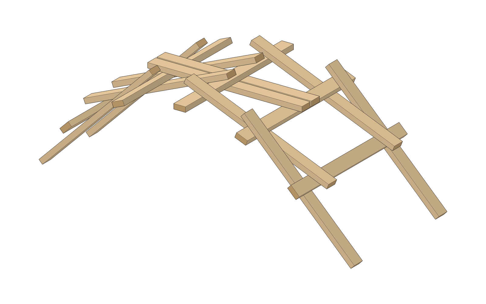

---

## Safety

- Wear eye protection when cutting, and gloves when carrying the boards.
- Sand the cut ends so there are no splinters.
- A 2x4 this long weighs about 4-1/2 pounds. Lift rails and slide beams with two people, and keep feet out from under the boards.
- Keep fingers out of the gap when you lower a lifted rail.
- Do not walk, stand, sit, or climb on this bridge, and do not test it with anyone’s weight.

---

## Parts

All 15 pieces are the same lumber: standard 2x4 (actual size 1-1/2 by 3-1/2 inches), each cut to 46 inches. Buy 8 boards, 8 feet long, or 8 precut 92-5/8 inch studs. Each board gives two pieces, and you end up with one spare. Pick straight, dry, unfinished boards. Rough, dry wood grips better than painted, sealed, or wet wood.

- 10 × Beam A, with pencil marks
- 5 × Beam B, left plain

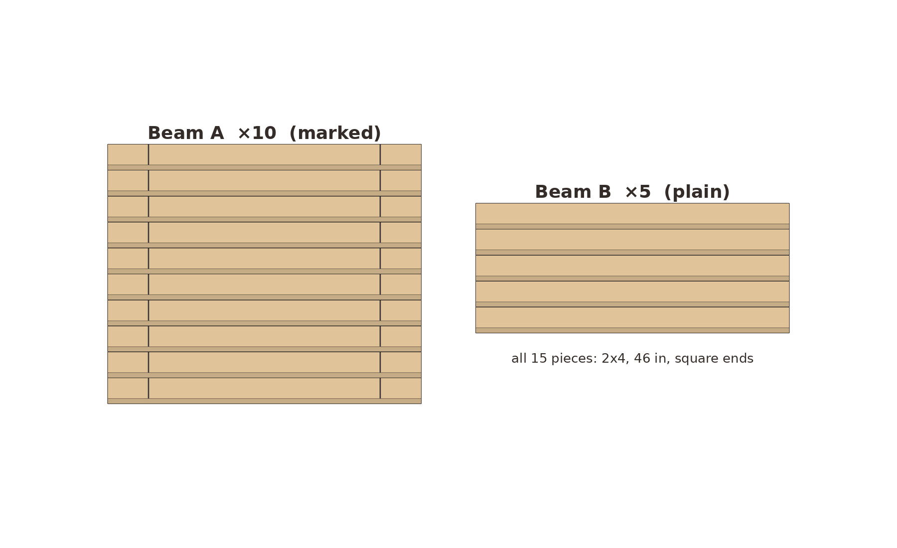
`01-parts.png`

## Cut list

| Part | Qty | Length | Stock |
|---|---|---|---|
| Beam A | 10 | 46 in | 2x4 |
| Beam B | 5 | 46 in | 2x4 |

Cut all 15 pieces to 46 inches with square ends, and sand the ends. Set 5 aside as Beam B.

Mark each Beam A on its two wide faces. On face 1, draw a line square across the board 6 inches from each end. Flip the board over. On face 2, draw two lines 3-1/2 inches apart, centered on the board: one at 21-1/4 inches and one at 24-3/4 inches from an end. This makes a box exactly as wide as a 2x4. Carry every line around onto both narrow edges with the square, so you can see it from the side during assembly. Write "1" on face 1 so you can tell the faces apart.

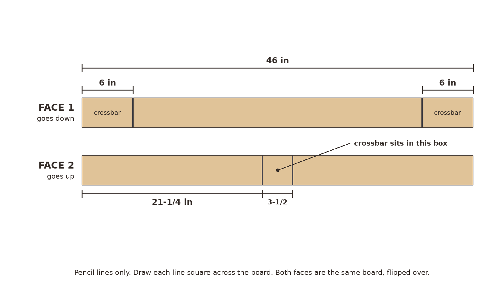
`00-marks.png`

**Look for:** Every Beam A has two end lines on face 1 and a centered 3-1/2 inch box on face 2, all carried onto the edges. The 5 Beam B pieces have no marks.

## Tools

Tape measure, pencil, speed square or combination square, a saw for straight crosscuts (handsaw, circular saw, or miter saw), sandpaper, safety glasses, and work gloves. A pair of sawhorses makes cutting easier.

## The repeating rule

Every Beam A lies face 1 down. Each end rests on a rail, with the rail's inner edge right on that end's 6 inch line. The rail sits on the end side of the line. A rail lies flat across the middle of the beam, inside the centre box.

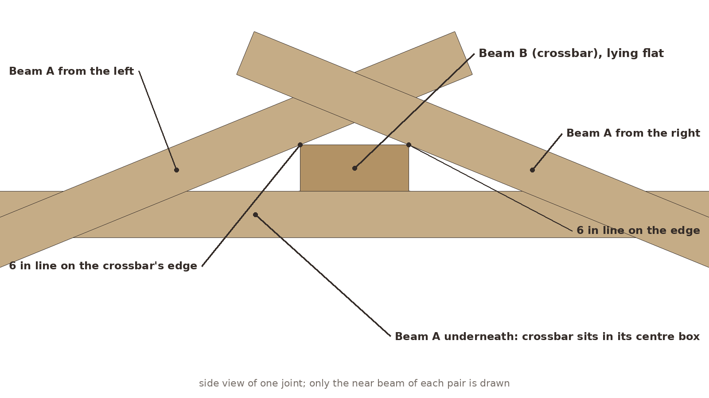
`02a-joint.png`

---

## Assembly

Work on flat, level ground. Grass, dirt, or a patio all work. Keep new pieces snug against the ones already in place, and line up the marks each time you set a piece down. The weave tilts as you build. One end stays on the ground and the other end rises; that is normal. Later overhead views make the newer beams look shorter because they tilt as the arch rises. All 15 pieces are the same length.

### 1. Sort the parts

Make two piles: 10 Beam A and 5 Beam B, as in the parts layout above.

`01-parts.png`

**Look for:** Two piles, and every Beam A with its "1" on the face that will go down.

### 2. Build the first lock

Lay two Beam B pieces flat on the ground as rails, about 18 inches apart, running toward and away from you. Lay two Beam A pieces across them, face 1 down, about 20 inches apart, so they form a hash sign. Each Beam A goes under the left rail and over the right rail. The left rail lies flat inside its centre box, and the right rail's inner edge sits on its right-hand 6 inch line. Most of each A sticks out to the left.

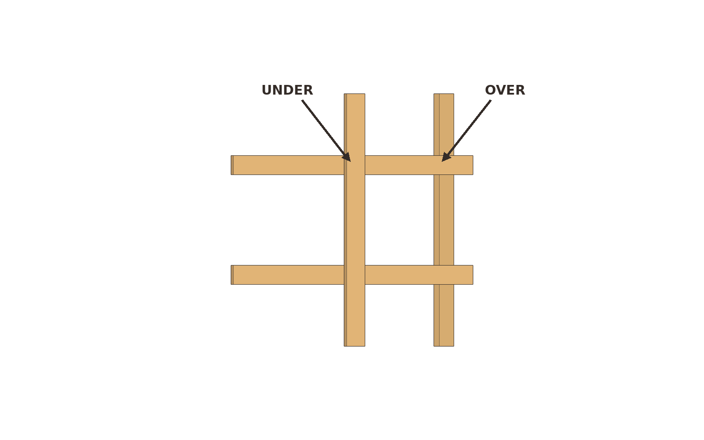
`02-first-lock.png`

**Look for:** A hash of four pieces. The left rail sits inside both centre boxes, and the right rail's inner edge sits on both right-hand end lines.

### 3. Add the next pair of Beam A, to the inside

Lift the right rail. Slide two more Beam A pieces in, face 1 down, just inside the first pair, about 12 inches apart. Each new beam goes over the left rail and under the lifted right rail. The left rail's inner edge goes on its left end line. Lower the right rail into its centre box. These two stick out to the right.

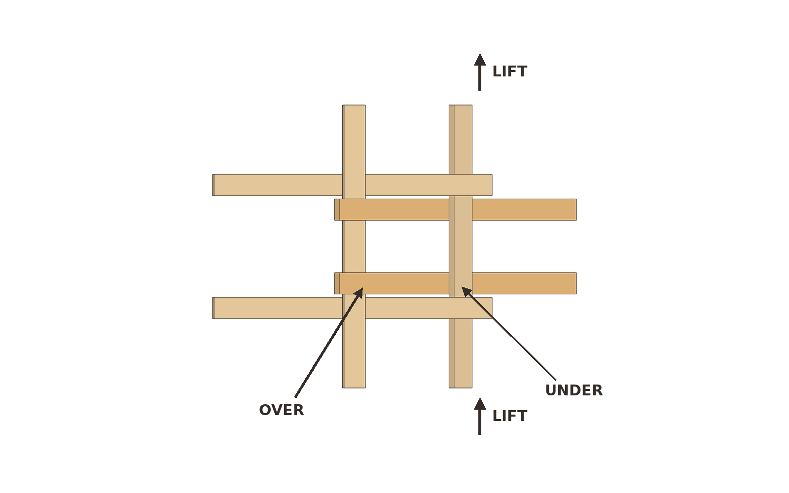
`03-inside-pair.png`

**Look for:** Six pieces in a tighter weave. The newest beams are closer to the middle than the first pair, and they stick out the other way.

### 4. Slide a Beam B under the new ends

Slide one Beam B under the right-hand ends of the pair you just added. Its inner edge goes on their right-hand end lines. It goes to the right of the other rails, not between them.

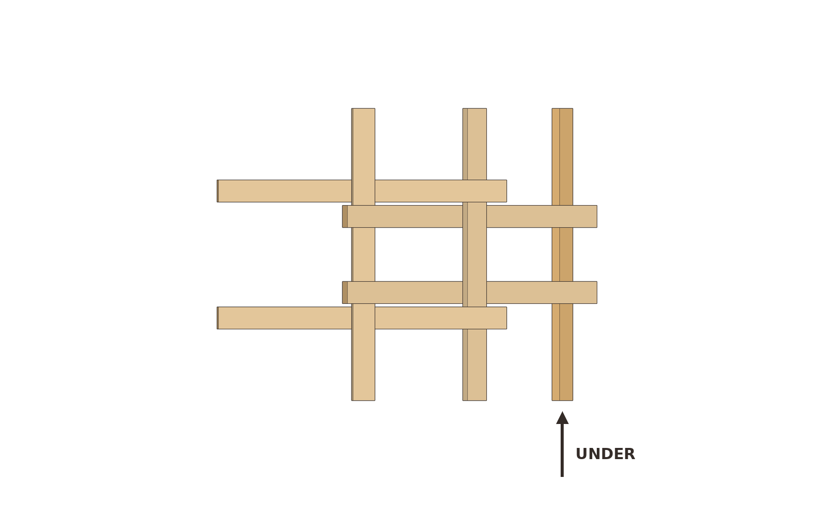
`04-beam-b-under.png`

**Look for:** Three plain beams running the same direction. The newest one is out on the right, under the ends that were sticking out.

### 5. Add another inside pair of Beam A

Lift the rightmost rail. Add two Beam A pieces inside the last pair, about 4 inches apart: over the middle rail, under the lifted one. Line up the end line and the centre box as before.

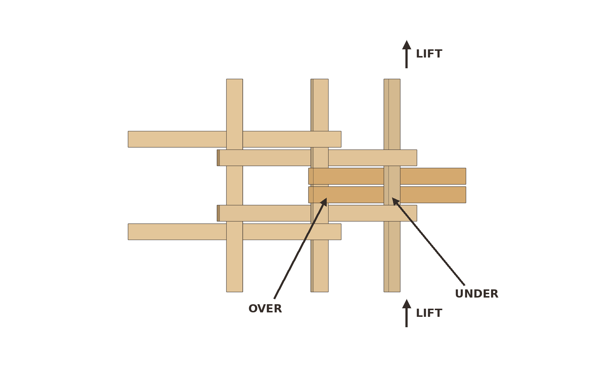
`05-inside-pair-2.png`

**Look for:** The same weave, one bay longer, with the newest pair in the middle.

### 6. Slide another Beam B under the new ends

Same as step 4: slide a Beam B under the right-hand ends of the pair you just added, with its inner edge on their end lines.

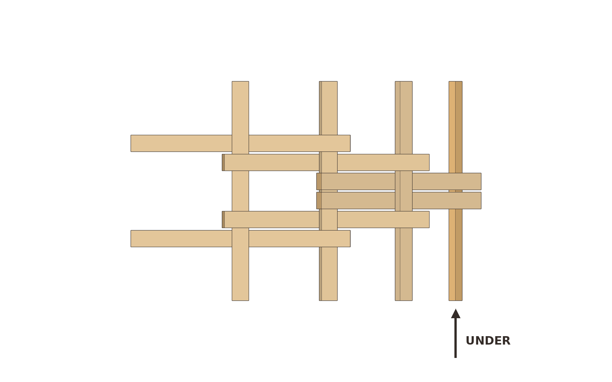
`06-beam-b-under-2.png`

**Look for:** Four plain beams in the stack, the newest one again out on the right.

### 7. Add a pair of Beam A to the outside

Lift the rightmost rail. Add two Beam A pieces outside all the others, about 28 inches apart: over the second-from-right rail, under the lifted one. The weave starts to rise.

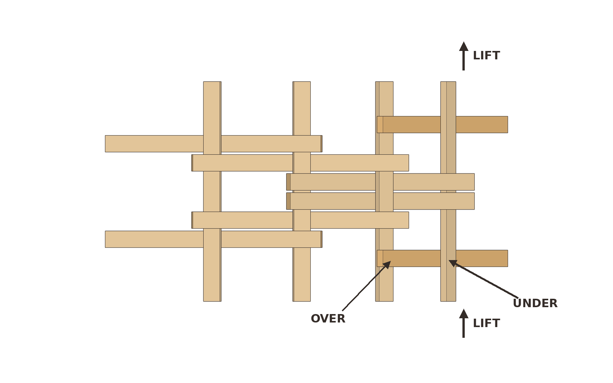
`07-outside-pair.png`
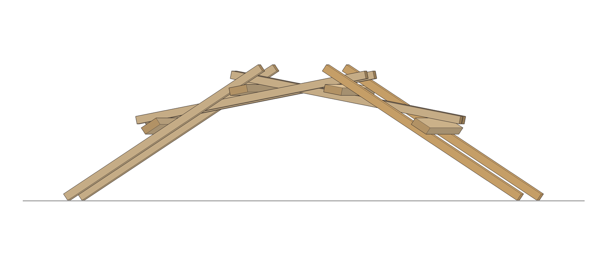
`07-outside-pair-side.png`

**Look for:** The newest pair sitting outside the earlier ones, with about 1/2 inch of air between neighbouring beams. If the new beams bump into pieces already in place, they went inside instead of outside.

### 8. Slide in the last Beam B

Slide the fifth and last plain beam under the right-hand ends of the outside pair, with its inner edge on their end lines.

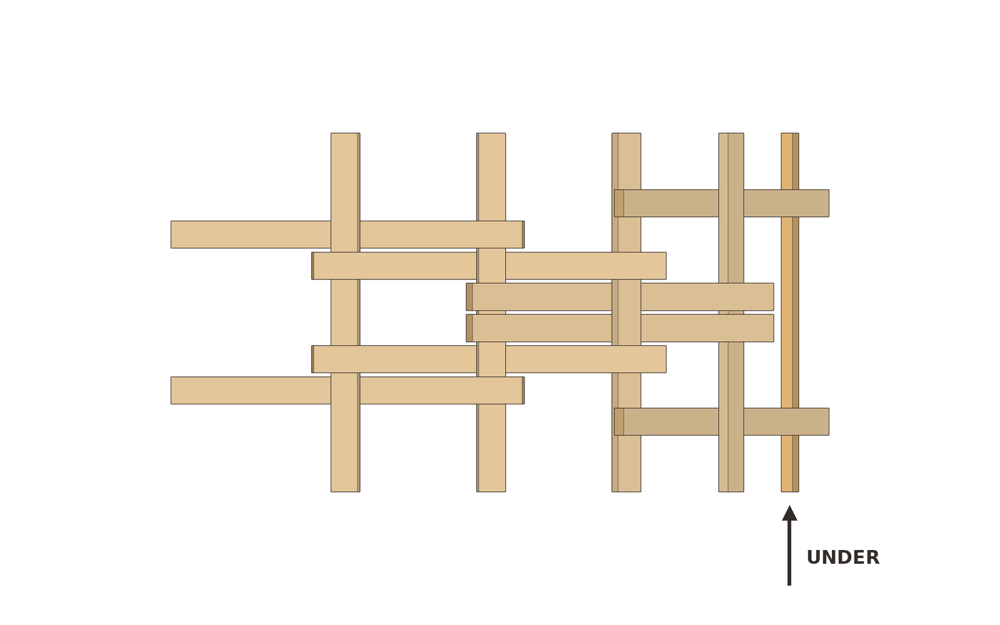
`08-last-beam-b.png`
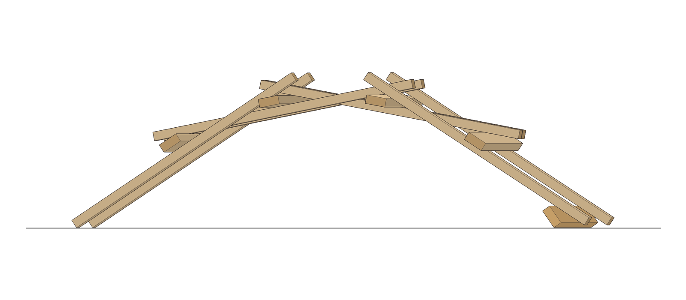
`08-last-beam-b-side.png`

**Look for:** All 5 Beam B pieces are in. Only two Beam A pieces are left in the pile.

### 9. Lock the ends

Lift the last rail. Add the final two Beam A pieces outside the last pair, about 36 inches apart: over the fourth rail, under the fifth. With one person at each end, ease the weave over until both outside pairs stand on the ground, then let go.

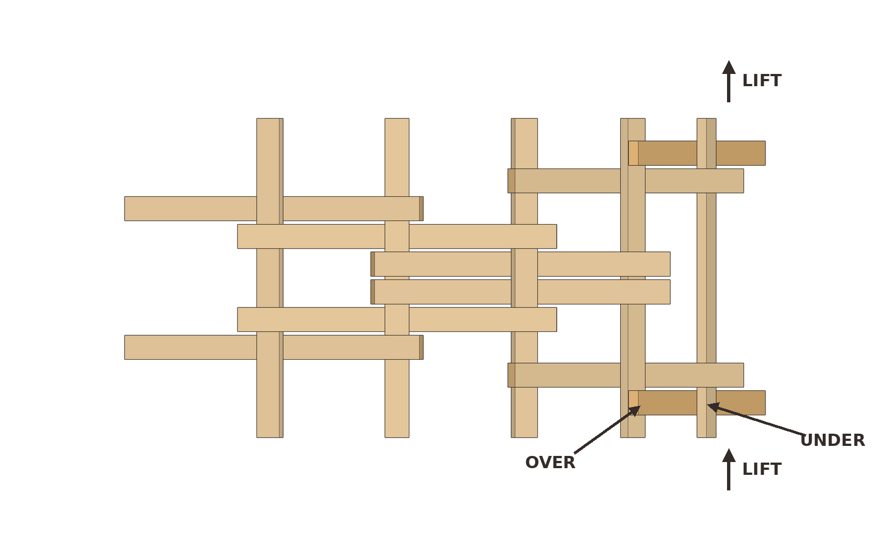
`09a-lock-ends-overhead.png`

`09-finished-3q.png`
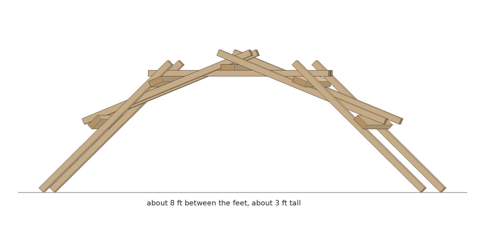
`09-finished-side.png`
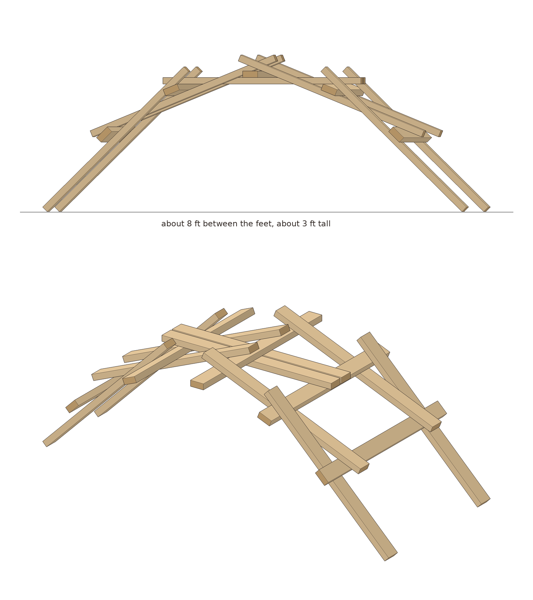
`09-finished.png`

**Look for:** An arch that stays up when you let go, with about 8 feet between the feet and the top rail about 3 feet up. Every rail edge should sit on its end line, and every rail across a middle should sit inside the box. If a joint creeps, push the pieces back to the marks. The usual cause is a beam that went over when it should have gone under, or a rail that slid off its line.

## Why it works

This is a reciprocal structure. Each beam is both holding and being held, so there is no single keystone to pop out. Every beam rests on two rails near its ends and carries a third rail on its middle. Because a rail is 1-1/2 inches thick, each pair tilts about 22 degrees from the one before it, and five pairs step around into an arch.

The dowel version needs notches to stop round wood from rolling. A flat 2x4 can't roll, and its rough face grips the board it rests on. We checked the finished arch with a computer model of the boards and their contacts. The joints need a friction coefficient of about 0.22 to hold under the bridge's own weight. Dry, unfinished lumber is usually about 0.4 to 0.6, so there is roughly twice the grip the model asks for. That margin is an untested estimate, so treat it as a reason to try it, not a promise. The pencil marks matter. They put every contact in the place the model checked.

## Try this next

Time yourselves on the rebuild; the second time is much faster. Set a light, soft load such as a 25 pound bag of mulch on the top rail and watch the joints. The model says that load needs no more friction than the empty bridge (untested estimate), and the bridge is still not for people. To put it away, take it apart in reverse order and keep the boards dry so they stay rough and straight.
