# Leonardo’s Self-Supporting Bridge

*A wooden arch that locks together with no nails, glue, or rope.*

**Ages:** 8 and up
**Time to build:** About an hour to cut and sand, then 20 to 30 minutes to assemble the first time
**Difficulty:** 2 out of 5 once the pieces are ready
**Skills:** measuring, marking, sawing, filing, and following a repeating pattern

Leonardo da Vinci sketched this as a portable military bridge: something soldiers could throw together quickly, then take apart again, with no hardware to lose. The pieces hold each other up. Each beam leans on the next, and the whole arch gets tighter under its own weight.

This version is a tabletop or picnic-table model. It is not for walking or standing on.

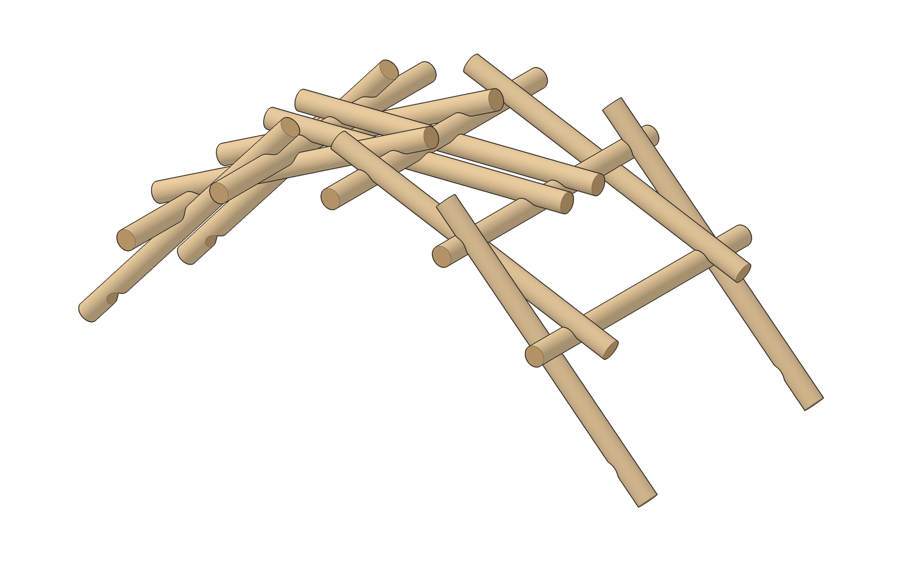

---

## Safety

- Wear eye protection when cutting or filing.
- Sand every notch and cut end so there are no splinters.
- Keep fingers clear when seating a beam; if a piece fights you, lift and start that step again instead of forcing it.
- Do not walk on this bridge, and do not test it with anyone’s weight.

---

## Parts

All 15 pieces are the same lumber: 1-inch hardwood or pine dowel, each cut 16 inches long.

- 10 × Beam A, the notched beams
- 5 × Beam B, left plain

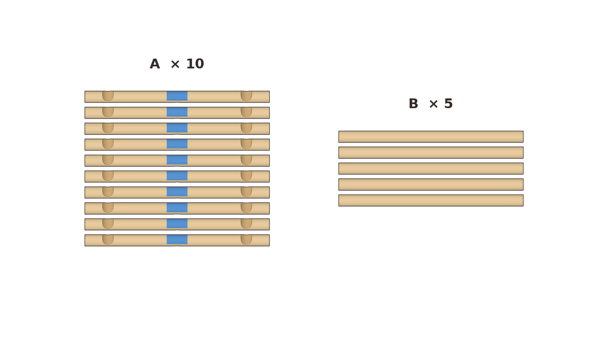
`01-parts.png`

## Cut list

Cut all 15 dowels to 16 inches and sand the ends. Set 5 aside as Beam B.

On each Beam A, treat the dowel as having two opposite faces. On face 1, mark a 1-inch-wide notch centered 2 inches from each end. Roll the dowel halfway over (180 degrees). On face 2, mark one 1-inch-wide notch at the midpoint, 8 inches from either end. Each notch should be about 3/8 inch deep, just enough for another 1-inch dowel to sit in the saddle.

To cut a notch, saw the two sides of the mark, then rasp out the waste until a spare dowel nests cleanly without wobbling. Do this for all three marks on all 10 Beam A pieces. Mark face 1 (the face with two notches) with a strip of tape. During assembly, that face goes down.

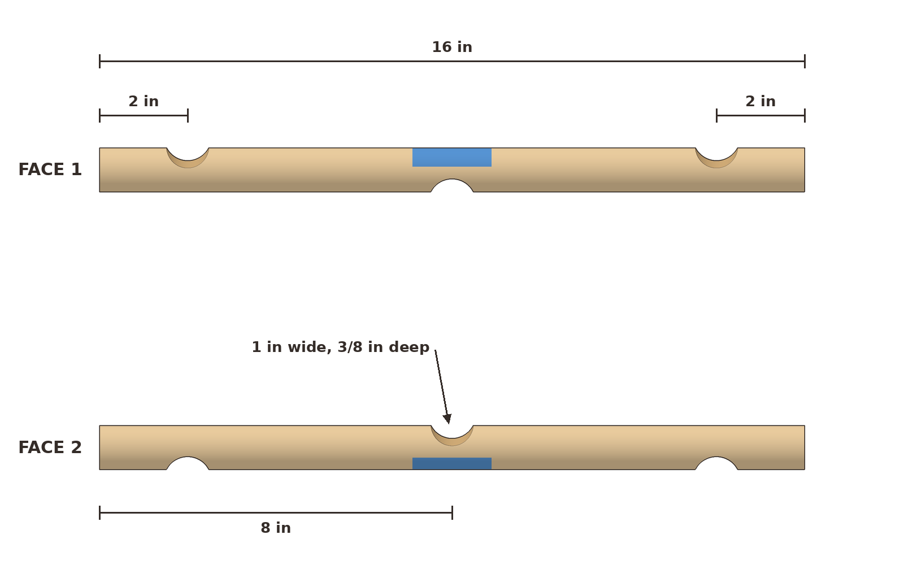
`00-notches.png`

**Look for:** Every Beam A has two notches on one side, near the ends, and one notch on the opposite side, dead center. The 5 Beam B pieces have no notches at all.

## Tools

You will also need a pencil, tape measure or ruler, handsaw, round rasp or half-round file, sandpaper, and safety glasses. Painter’s tape or a crayon helps mark the notched faces. A 1-inch hole saw and a drill can replace the rasp.

## The repeating rule

Every Beam A rests on a rail at each end notch and passes under a rail at its middle notch.

---

## Assembly

Work on a clear table. Keep new pieces snug against the ones already in place. If the pile starts to spread, gently squeeze it back together before the next step. Later overhead views make the newer beams look a bit shorter because they tilt as the arch rises; all 15 pieces are the same length.

### 1. Sort the parts

Make two piles: 10 Beam A and 5 Beam B, as in the parts layout above.

`01-parts.png`

**Look for:** Two clear piles, and every notched beam showing its tape on face 1.

### 2. Build the first lock

Lay two Beam B pieces down as rails, a few inches apart, running toward and away from you. Lay two Beam A pieces across them, two-notch side down, so they form a hash sign. Each Beam A goes under the left rail, which sits in its middle notch, and over the right rail, which sits in the notch near its right end. Most of each A sticks out to the left.

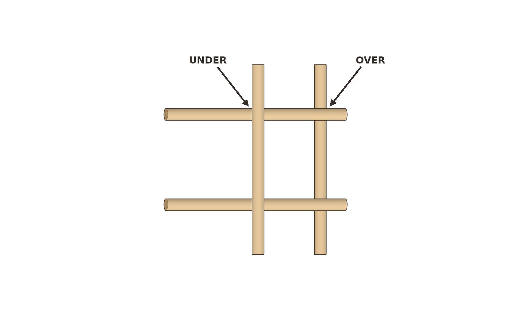
`02-first-lock.png`

**Look for:** A flat hash of four pieces, with every crossing sitting in a groove rather than balancing on round wood.

### 3. Add the next pair of Beam A, to the inside

Lift the right rail. Slide two more Beam A pieces in, just inside the first pair. Each new beam goes over the left rail, sitting on it with its left end notch, and under the lifted right rail, which drops into its middle notch. These two stick out to the right.

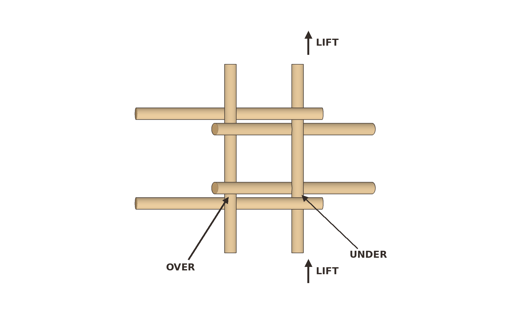
`03-inside-pair.png`

**Look for:** Six pieces in a tighter weave, with the newest beams closer to the middle than the first pair, and sticking out the other way.

### 4. Slide a Beam B under the new ends

Take one Beam B and slide it under the right-hand ends of the pair you just added, so their end notches sit on it. It goes to the right of the other rails, not between them.

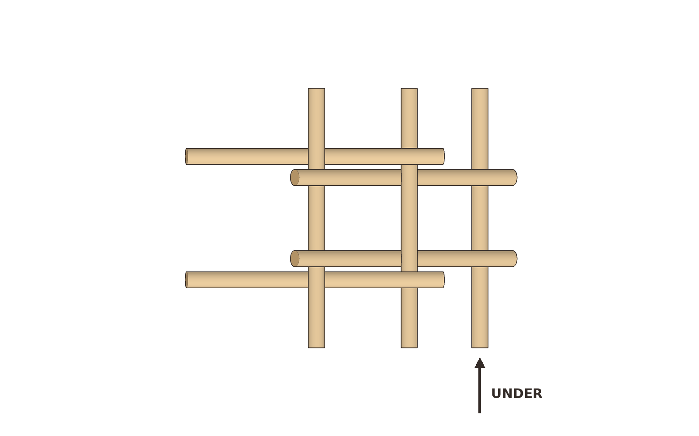
`04-beam-b-under.png`

**Look for:** Three plain beams now running the same direction. The newest one is out on the right, under the ends that were sticking out.

### 5. Add another inside pair of Beam A

Lift the rightmost rail. Add two Beam A pieces inside the last pair: over the middle rail, under the lifted one.

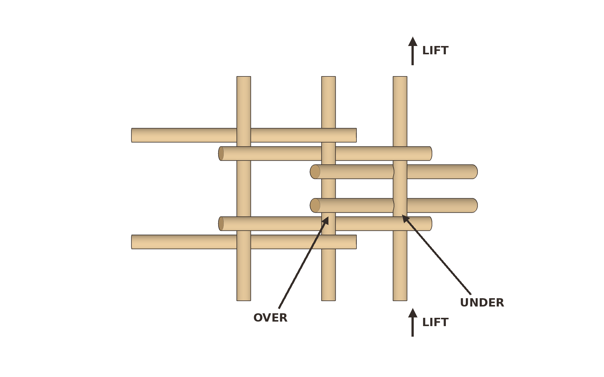
`05-inside-pair-2.png`

**Look for:** The same weave, one bay longer, still fairly low to the table.

### 6. Slide another Beam B under the new ends

Same as step 4: slide a Beam B under the right-hand ends of the pair you just added.

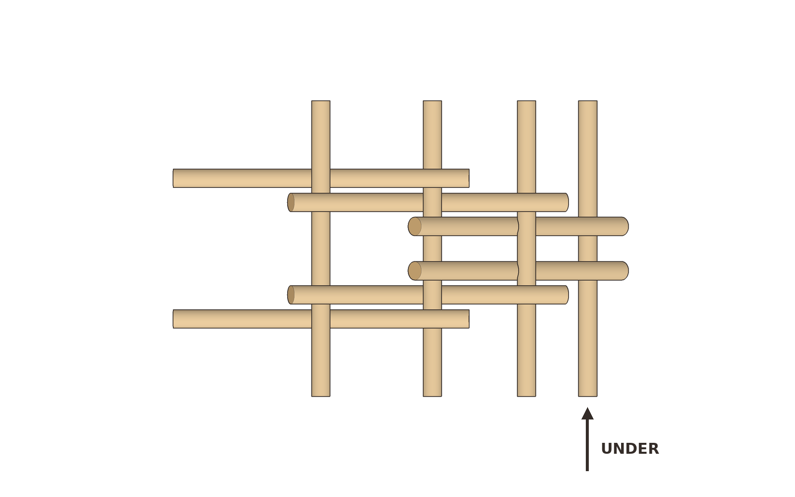
`06-beam-b-under-2.png`

**Look for:** Four plain beams in the stack, the newest one again out on the right.

### 7. Add a pair of Beam A to the outside

Lift the rightmost rail. Add two Beam A pieces outside all the others: over the second-from-right rail, under the lifted one. The bridge starts to rise as the notches seat.

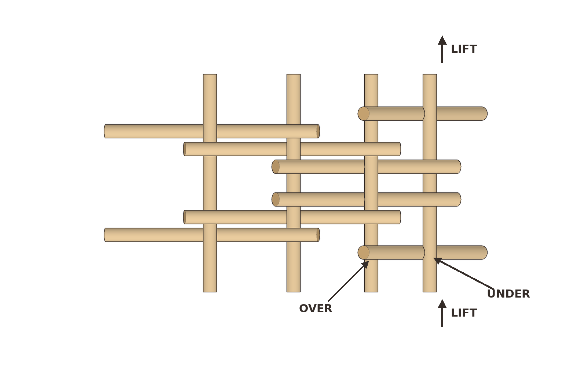
`07-outside-pair.png`
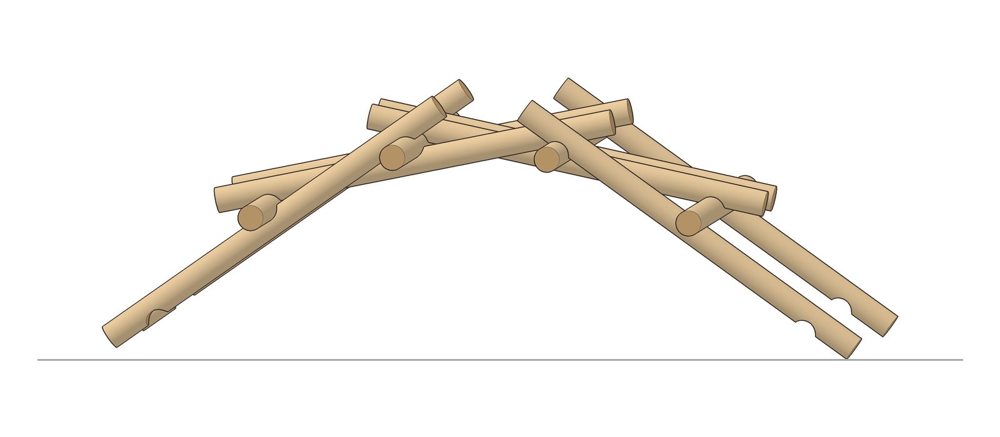
`07-outside-pair-side.png`

**Look for:** The newest pair sitting outside the earlier ones. If the new beams bump into pieces already in place, they went inside instead of outside.

### 8. Slide in the last Beam B

Put the fifth and final plain beam under the right-hand ends of the outside pair you just added.

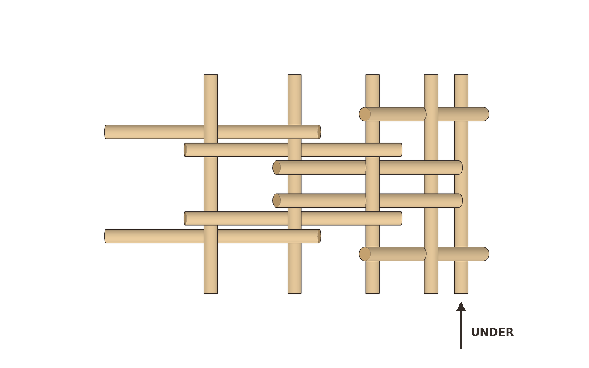
`08-last-beam-b.png`
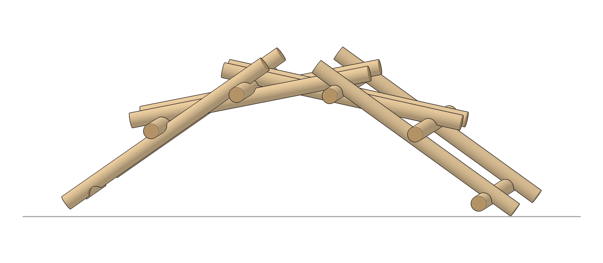
`08-last-beam-b-side.png`

**Look for:** All 5 Beam B pieces are in. Only two Beam A pieces should be left in the pile.

### 9. Lock the ends

Lift the last rail. Add the final two Beam A pieces outside the last pair: over the fourth rail, under the fifth. Ease your hands away and stand the bridge on its two ends.

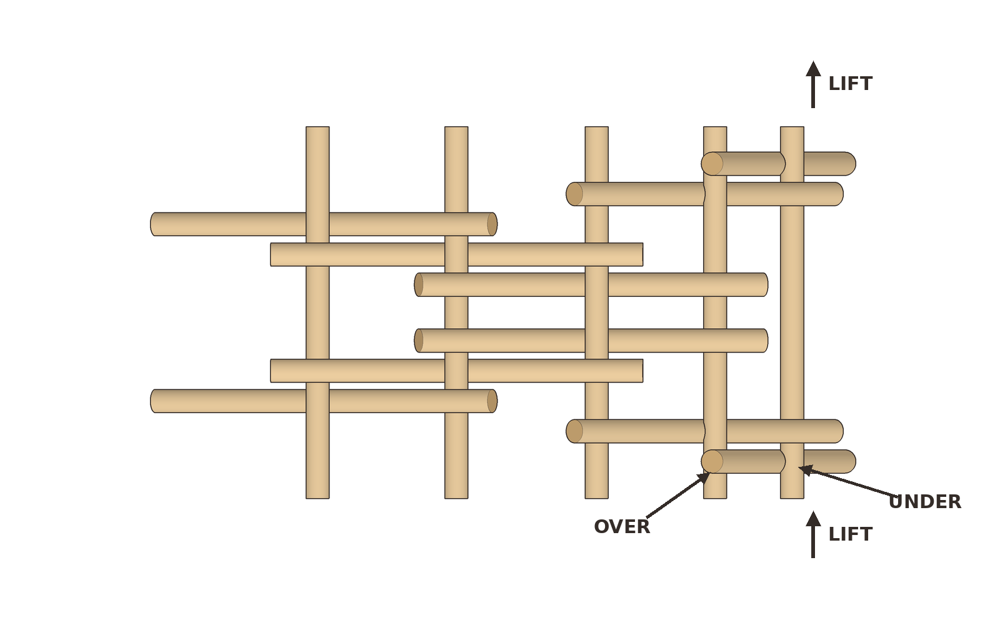
`09a-lock-ends-overhead.png`

`09-finished-3q.png`
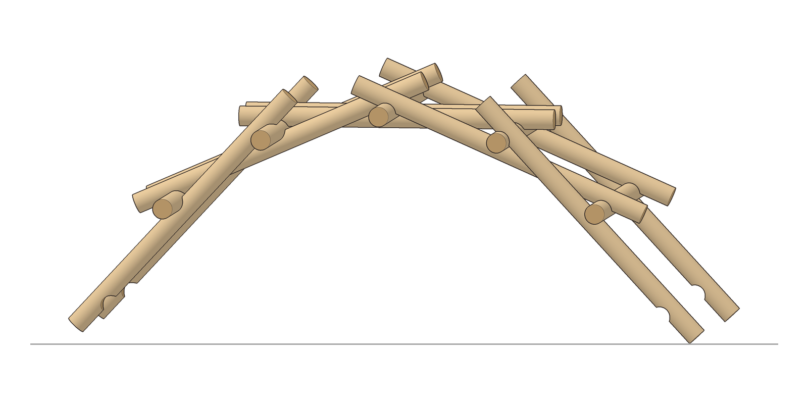
`09-finished-side.png`
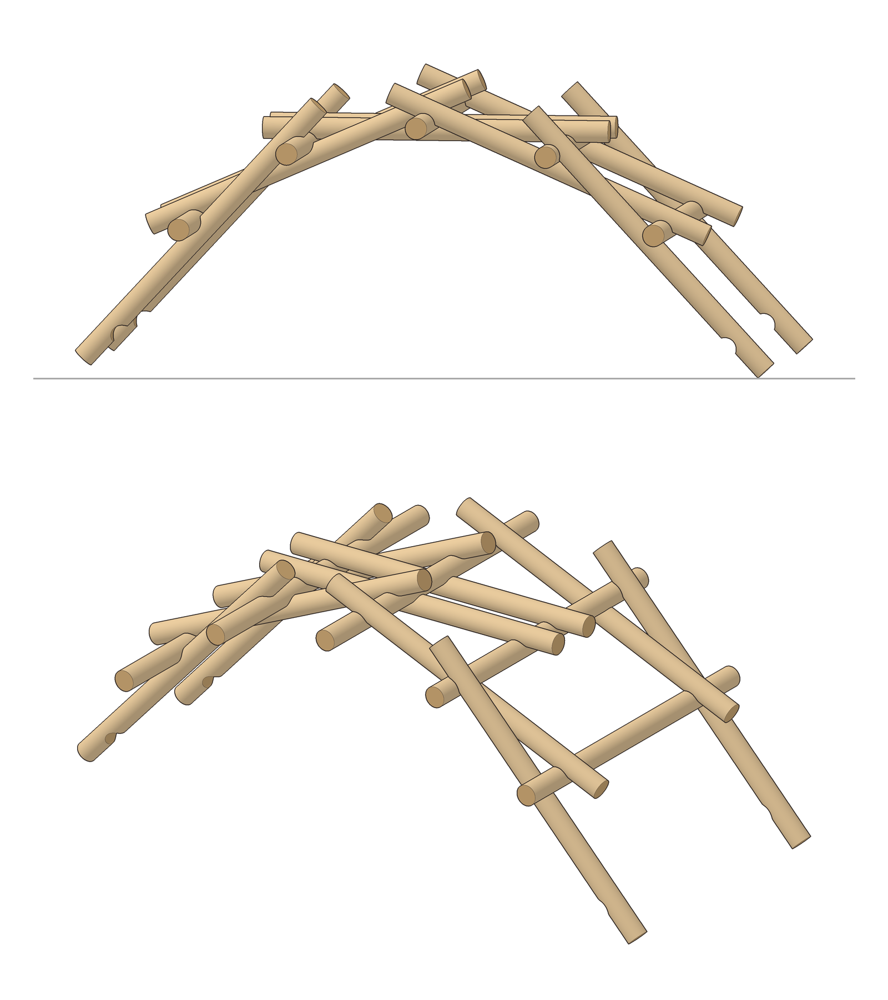
`09-finished.png`

**Look for:** A self-supporting arch that stays up when you let go. Give the table a tiny bump. The bridge should settle tighter, not slump apart. If it collapses, the usual culprits are a notch that is too shallow, or a beam that went over when it should have gone under.

## Why it works

This is a reciprocal structure. Each beam is both holding and being held, so there is no single keystone to pop out. The notches keep the pieces from rolling, and the arch shape turns weight into compression along the beams. That is why a little extra weight can make a good build feel more solid, and why a sloppy notch makes the whole thing unravel.

## Try this next

Stack a few books on the center and watch the joints tighten. Then take it apart and time yourselves on the rebuild; the second time is much faster. When you are ready for a bigger yard version, use the same 10-and-5 pattern with thicker, longer poles. That larger build is still not for walking on unless it is specifically designed for that purpose.
