# A Pair of Sawhorses

*Two sturdy trestles at standing height, built from 2x4s and screws, ready for a saw or a folding table.*

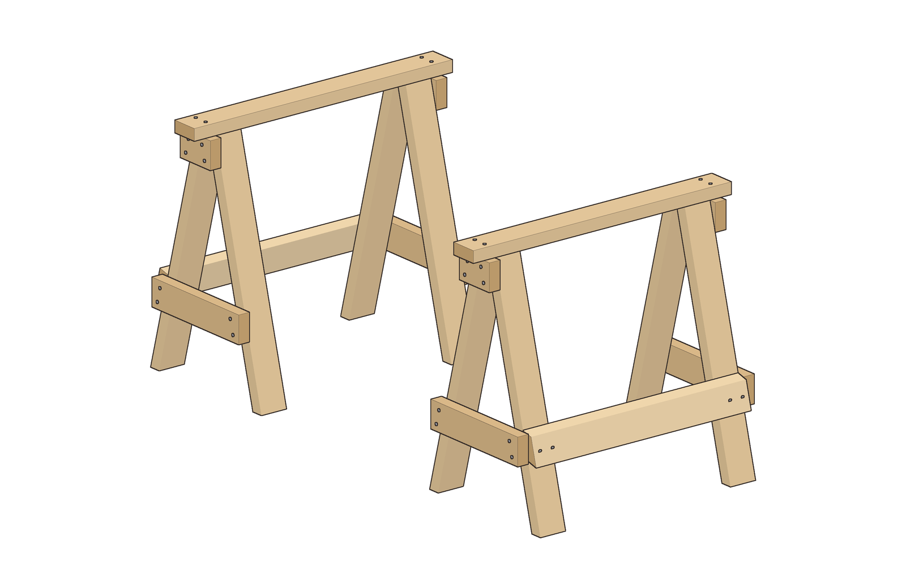

| | |
|---|---|
| **Section** | Home & Prep |
| **Ages** | Adults and families |
| **Time to build** | About 2 hours for the pair |
| **Difficulty** | 2 / 5 |
| **Skills taught** | Measuring and square cuts, one simple 15° cut, pilot holes and screws, building four matching assemblies |
| **Works without power** | Yes, with a handsaw and a hand screwdriver |

This pair is the first build in the workspace set. Each horse is 31-15/16 in tall (call it 32) and 36 in long, with a flat 3-1/2 in top that the next project, a folding camp table, will rest on. They are made only from 2x4s and construction screws, and every cut can be made with a handsaw.

**What this version is:** two identical A-frame trestles. The legs splay 15° in one plane, so the only angled cuts are simple 15° cuts on the legs. Everything else (the beam, the cleats and the stretchers) has square ends. Every cross piece is screwed to the outside of the legs, so the screws work in shear. The legs carry the beam by bearing straight up against it. These horses are not scaffolding, and they are not meant to be stood on.

## Safety

- Wear safety glasses for every cut and every hole.
- Clamp a board before you saw or drill it.
- Drill a pilot hole for every screw, especially near the end of a board, so the 2x4 does not split.
- Set the pair on firm, level ground before you put weight on it.
- Don't stand on the beams, and don't use them as scaffolding.

## Parts

**Lumber**
- 5 × 2x4, 8 ft (construction or #2 spruce/pine/fir, as straight as you can pick. The cut plan uses all five; a sixth board is handy if you miscut a leg.)

**Fasteners and supplies**
- 50 × #10 × 3 in construction screws (40 used, plus spares)
- 12 × #10 × 2-1/2 in construction screws (8 used, plus spares)
- Sandpaper, 80 and 120 grit
- Optional: exterior paint or sealer, if the pair will live outside

## Cut list

All sizes are actual dimensions. A 2x4 really measures 1-1/2 × 3-1/2 in.

| Part | Qty | Material | Size |
|---|---|---|---|
| Top beam | 2 | 2x4 | 36 in, square ends |
| Leg | 8 | 2x4 | 31-1/2 in long point to long point, 15° at both ends, same slant, cut across the 1-1/2 in edge |
| Top cleat | 4 | 2x4 | 5-3/8 in, square ends |
| End stretcher | 4 | 2x4 | 15-1/2 in, square ends |
| Long stretcher | 2 | 2x4 | 30 in, square ends |

## Tools

- Handsaw (a miter box helps, but is not required)
- Drill/driver, or a hand screwdriver
- Bits: 1/8 in or 5/32 in for pilot holes, and the driver bit that matches your screws
- Measuring tape, speed square or combination square, pencil
- 2 clamps
- Sandpaper
- Safety glasses

## Assembly

### 1. Cut the parts
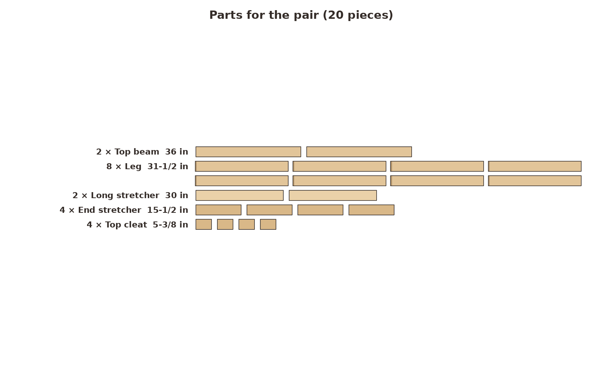 `01-parts.png`
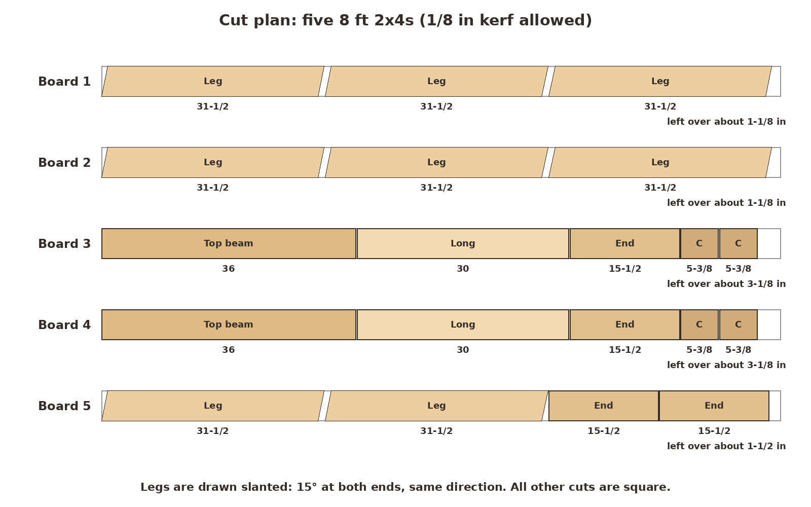 `01-cut-diagram.png`

Square one end of each 8 ft 2x4, then cut the pieces following the cut diagram. It already leaves a 1/8 in kerf between pieces. Boards 1, 2 and 5 are tight, with only about 1-1/8 to 1-1/2 in left over, so measure twice. Sand each piece and break the sharp edges.

**Look for:** 20 pieces: 2 beams, 8 legs, 4 top cleats, 4 end stretchers and 2 long stretchers.

### 2. Mark and cut the 15-degree leg ends
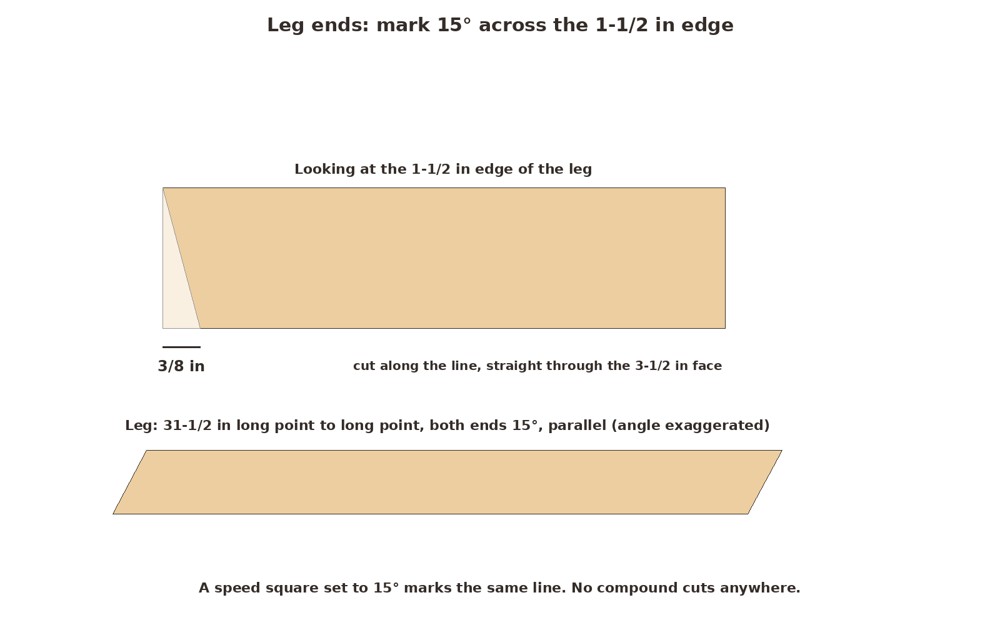 `02-mark-angle.png`

The legs are the only pieces with angled ends. Mark the angle on the narrow 1-1/2 in edge: from a squared end, measure 3/8 in back along one edge and draw a line to the opposite corner. That line is 15°, and a speed square set to 15° marks the same line. Carry the cut square across the 3-1/2 in face, so it is a simple cut, not a compound one. Cut both ends of every leg with the same slant, so the leg is a parallelogram 31-1/2 in long point to long point.

**Look for:** eight legs that match when you stack them.

### 3. Build an end frame
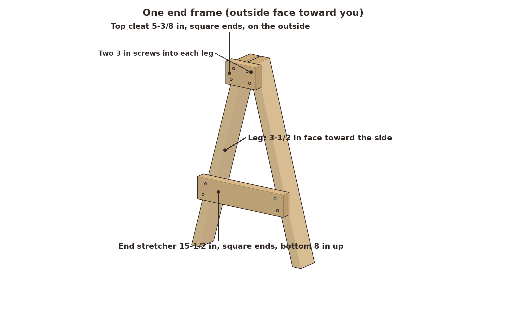 `03-end-frame.png`
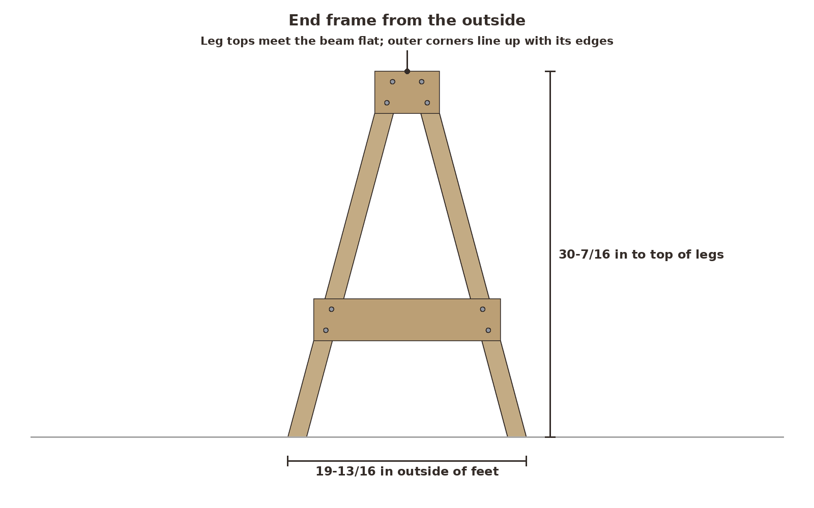 `03-end-frame-front.png`

Lay two legs flat on the bench, wide face down, with their top cuts lined up on a straight edge. Their top inner corners should be about 3/8 in apart, and their outer top corners 3-1/2 in apart, the width of the beam. The feet splay out to 19-13/16 in outside to outside.

Lay a 5-3/8 in top cleat across the legs right at the top, with its bottom corners flush with the outer edges of the legs. Its top corners stick out about 15/16 in past the legs; saw them off along the leg if you like. Drill pilot holes and drive two #10 × 3 in screws through the cleat into each leg. Then lay a 15-1/2 in end stretcher across the legs with its bottom edge 8 in up from the feet and its bottom corners flush with the outer edges. Fasten it with two #10 × 3 in screws per leg. The screws go 1-1/2 in into each leg, about 3/4 in from every edge.

**Look for:** the frame stands without a rock, the leg tops are level, and the feet measure 19-13/16 in outside to outside.

### 4. Build the other three end frames
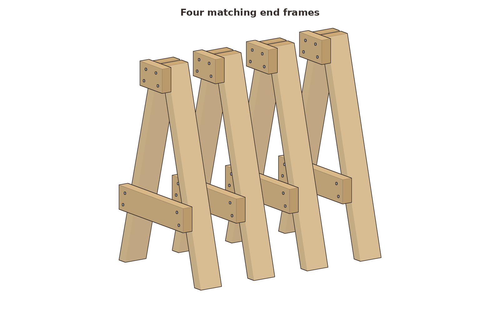 `04-end-frames.png`

Build three more frames the same way. Stand all four in a line and sight across the tops.

**Look for:** four frames that match in height and stance.

### 5. Screw on the flat top beam
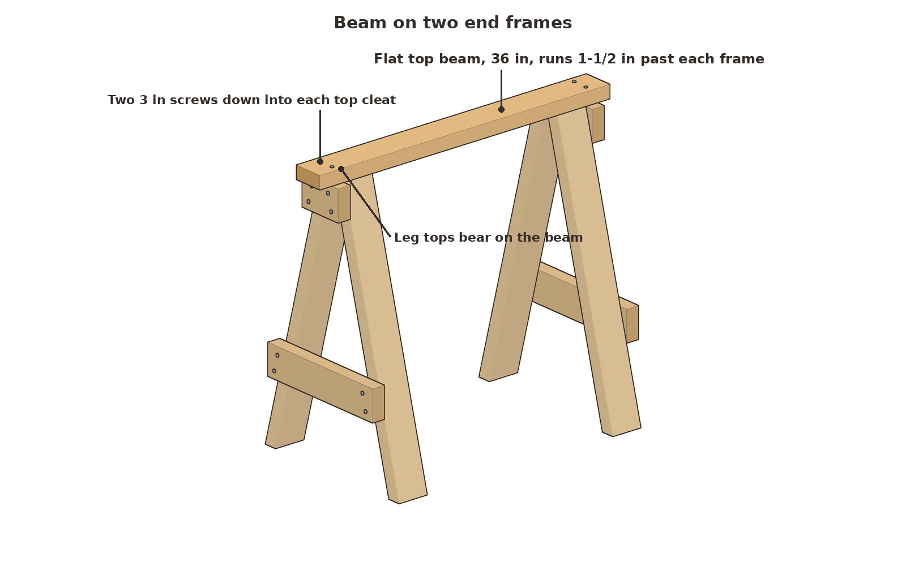 `05-beam-on.png`

Stand two end frames with their cleats facing out. Lay a 36 in beam flat across the leg tops, so it runs 1-1/2 in past the outside of each cleat and its edges line up with the outer leg corners. The leg tops carry the load by bearing against the beam. Drill pilot holes and drive two #10 × 3 in screws down through the beam into the top edge of each cleat.

**Look for:** the top 31-15/16 in off the floor at both ends, and the horse standing without a rock.

### 6. Add the long stretcher, then build the second horse
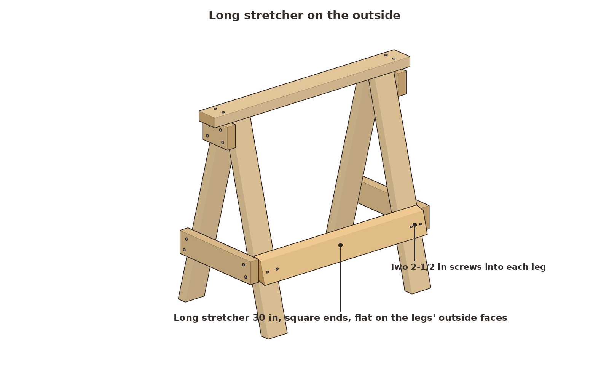 `06-long-stretcher.png`

Lay a 30 in long stretcher flat against the outside faces of the two legs on one side, centered about 10 in up, with its ends flush with the outer faces of the legs. Drive two #10 × 2-1/2 in screws through it into each leg. The 2-1/2 in screws go 1 in into the 1-1/2 in leg and won't come out the other side.

Repeat steps 5 and 6 for the second horse.

**Look for:** the horse no longer racks when you push along the beam.

### 7. Check the pair
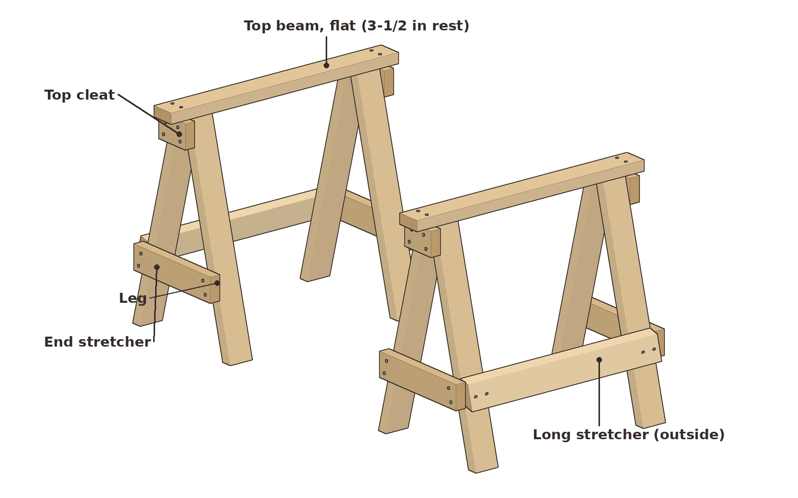 `07-finished-3q.png`
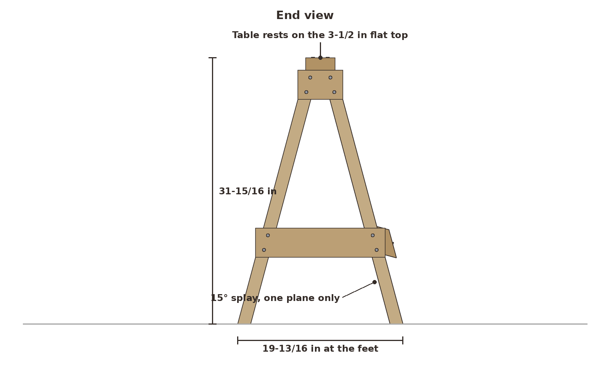 `07-finished-end.png`
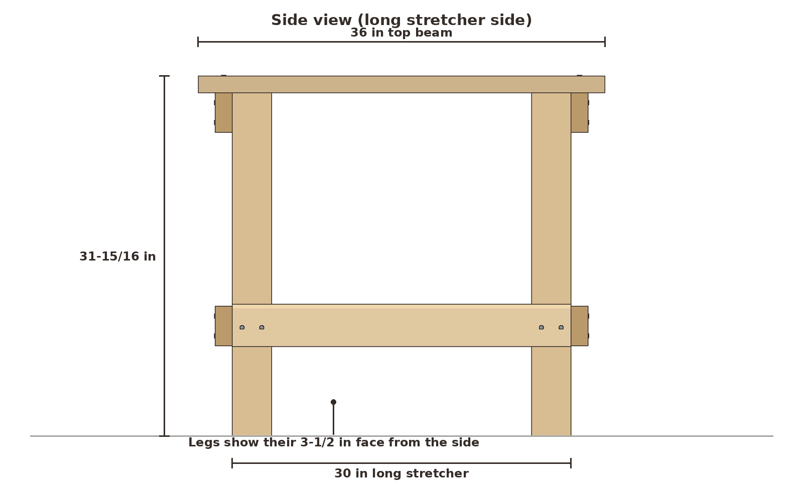 `07-finished-side.png`
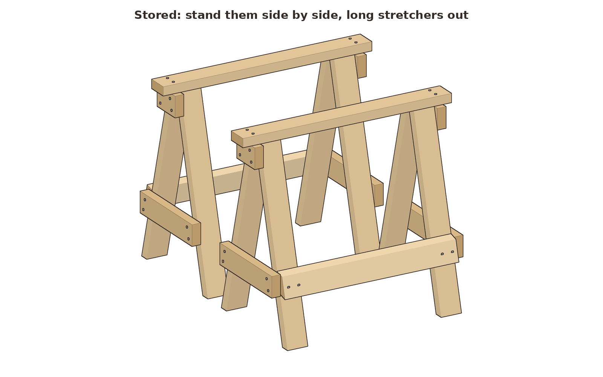 `07-store.png`

Stand both horses on firm, level ground. A folding camp table sits on the two flat 36 in beams, each 3-1/2 in wide.

**Look for:** both tops at 31-15/16 in and feet 19-13/16 in outside to outside. To store them, stand them side by side with the long stretchers facing out. They take about 36 × 44 × 32 in.

**Untested estimate:** a pair should carry a few hundred pounds of distributed weight, such as a stiff table with two people working at it, or a miter saw and some boards. That figure comes from the size of the parts and the joints, not from a load test. Don't stand on the beams.

## Why it works

**Screws in shear.** Every cleat and stretcher lies flat against the outside of the legs. A sideways push tries to slide one board across the other, and a screw resists that across its whole shank. A screw pulling straight out of end grain is much weaker, and this design avoids that.

**The legs bear on the beam.** Downward load goes straight from the beam into the leg tops, wood on wood. The screws only keep the parts in place.

**One-plane splay.** The 15° lean is only across the width, so each angled cut is a simple cut on the narrow edge. The legs' 3-1/2 in faces point along the beam, which makes the horse stiff lengthwise. The A shape and the end stretcher keep it from racking across its width.
