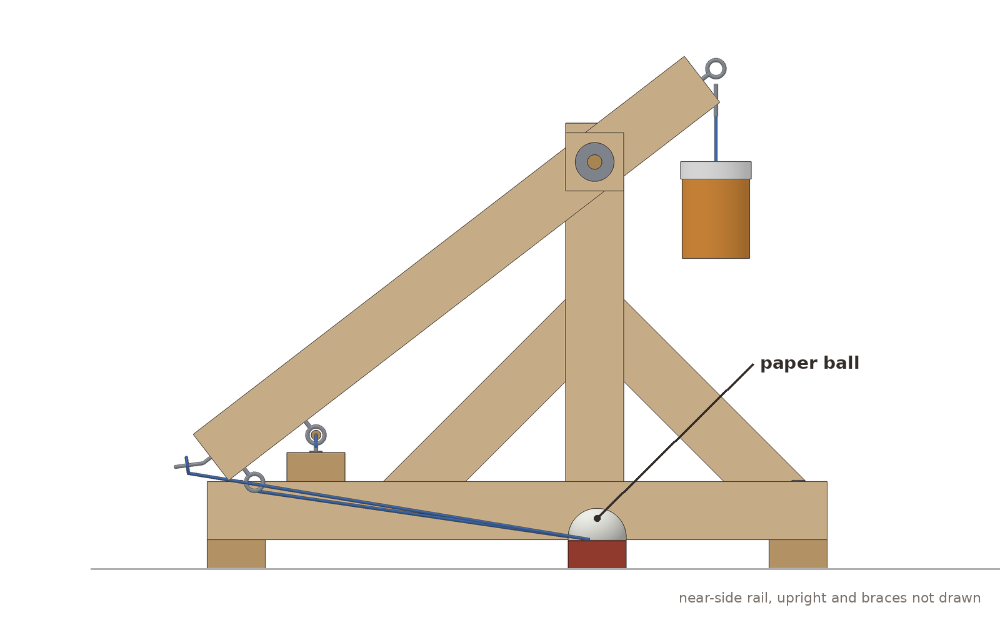
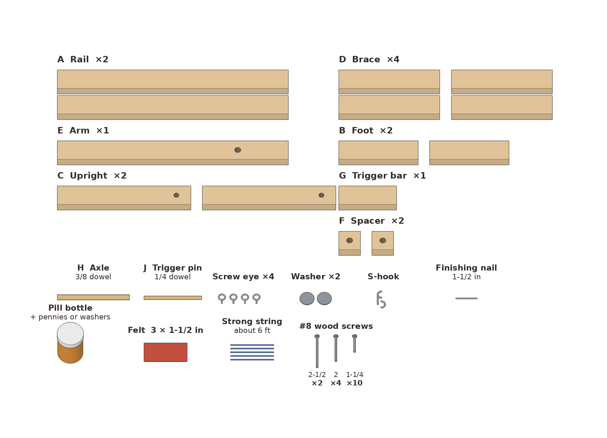

# Tabletop Trebuchet

*A small counterweight thrower that lobs a paper ball across the yard.*

**Ages:** 8+ (the cuts are all straight and square, the holes are drilled with a hand drill, and nothing needs a power saw)
**Time to build:** about 3 hours
**Difficulty:** 3 / 5
**Skills:** measuring and marking, straight handsaw cuts, drilling holes that line up, screwing a frame together, levers and stored energy, testing and adjusting one thing at a time

Leonardo filled his notebooks with throwing machines: catapults, slings, and arms driven by springs and falling weights. He kept coming back to one question: how do you turn a slow, heavy push into a fast, light throw? The counterweight trebuchet was already centuries old by his time, and it answers that question very well. A heavy weight falls a short distance and swings a long arm, and a sling on the end of the arm whips around even faster.

This version is a classroom-sized trebuchet in that spirit. It is not a copy of any one of Leonardo's drawings. The frame is 16 inches long and about a foot tall, made from 1x2 pine, a dowel axle and a few screw eyes. A small bottle of pennies is the counterweight. A felt pouch on two strings is the sling. To fire it, you pull a pin out of two screw eyes. It throws soft things only: a crumpled paper ball, a pom-pom, or a foam craft ball.

---

## Safety

- **Eye protection** while sawing, drilling, and bending the nail. Clamp the wood every time you saw or drill.
- **Firing line:** pick a line behind the trebuchet. Everyone stands behind it whenever the arm is pinned. The lane in front, about 20 ft (6 m), stays empty until the shot lands. See `12-firing-zone.png`.
- **Pull the pin from the side** with the pull cord, never by hand over the machine. Once the pin is in, keep hands and faces out of the arm's path. The arm swings up and over the top fast.
- **Soft projectiles only:** paper balls, pom-poms, or foam craft balls about 1-1/2 in across. No rocks, marbles, toys, or anything hard.
- **Never aim at people or animals.** That includes "just a test."
- To un-cock without firing, hold the long end of the arm, pull the pin, and let the arm up slowly.

---

## Parts

**Lumber and dowels**

| | Item | Buy |
|---|---|---|
| | 1x2 pine (actual 3/4 × 1-1/2 in) | 2 boards, 8 ft (one is mostly spare) |
| | 3/8 in hardwood dowel | 1, 36 in (you use 5 in) |
| | 1/4 in hardwood dowel | 1, 36 in (you use 4 in) |

**Hardware**

| Qty | Item | Used for |
|---|---|---|
| 2 | #8 × 2-1/2 in wood screws | uprights to rails |
| 4 | #8 × 2 in wood screws | rails to feet |
| 10 | #8 × 1-1/4 in wood screws | braces (8), trigger bar (2) |
| 4 | small screw eyes with at least a 3/8 in opening | counterweight, sling, trigger on the arm, trigger on the bar |
| 2 | flat washers for a 3/8 in bolt | axle stack |
| 1 | 1-1/2 in S-hook | counterweight hanger |
| 1 | 1-1/2 in finishing nail | sling release |
| 1 | pill bottle about 1-3/4 in across and 2-1/2 in tall, or a similar small jar | counterweight |
| | pennies or steel washers to fill it (a full bottle is roughly 3/4 to 1 lb) | counterweight |
| 1 | felt or sturdy cloth, 3 × 1-1/2 in | sling pouch |
| | strong string (mason line or kite string), about 6 ft | sling (2 × 12 in), counterweight hanger, 3 ft pull cord |
| | wood glue (optional) | stiffer joints |

`00-parts.png`

## Cut list

All from 1x2 pine unless noted. Cut every end square.

| Part | Name | Qty | Length |
|---|---|---|---|
| A | Rail | 2 | 16 in |
| B | Foot | 2 | 5-1/2 in |
| C | Upright | 2 | 9-1/4 in |
| D | Brace | 4 | 7 in |
| E | Arm | 1 | 16 in |
| F | Spacer | 2 | 1-1/2 in |
| G | Trigger bar | 1 | 4 in |
| H | Axle (3/8 in dowel) | 1 | 5 in |
| J | Trigger pin (1/4 in dowel) | 1 | 4 in |

The 1x2 adds up to 112-1/2 in. Board 1: both rails, the arm, both uprights, and two braces (80-1/2 in plus saw cuts). Board 2: the other two braces, both feet, the trigger bar, and both spacers (32 in). The rest is spare for practice cuts.

## Tools

- Handsaw (a miter box helps keep cuts square)
- Hand drill with 1/16, 1/8, 3/8, and 7/16 in bits
- Screwdriver
- Pliers (to bend the nail and turn the screw eyes)
- Two clamps
- Measuring tape, pencil, and a square
- Sandpaper
- Safety glasses
- Scissors and a hole punch or nail (for the felt)

Drill a 1/8 in pilot hole before every screw, and a 1/16 in pilot before every screw eye.

---

## Assembly

### 1. Drill the axle holes
Drill a **7/16 in** hole through the arm, 3-1/2 in from one end. That end is now the counterweight end. Drill a **3/8 in** hole through each upright, 1 in from the top. Drill a **7/16 in** hole through the center of each spacer. Center every hole across the 1-1/2 in face and drill straight through the 3/4 in thickness.

`01-drill.png`

**Look for:** The axle dowel is snug in the upright holes and loose in the arm and spacer holes. The arm should spin on the dowel with a flick. If you have no 7/16 bit, drill 3/8 and wiggle the bit until the arm spins freely.

### 2. Stand an upright on each rail
Stand one upright on each rail, 10 in from the back end to the upright's center (a little forward of the middle), with the hole at the top. Drive a 2-1/2 in screw up through the bottom of the rail into the end of the upright. Use glue too if you have it.

`02-side-frames.png`

**Look for:** Two matching side frames, each shaped like an upside-down T. Both uprights are square to their rails and flush with the rails' faces. Lay the two frames face to face: their axle holes should line up.

### 3. Brace both sides
On the outside face of each side frame, lay one brace behind the upright and one in front, each at 45 degrees. The top end sits on the upright about 4 in above the rail. The bottom end sits on the rail. Drive one 1-1/4 in screw through each end. The square ends overlap the edges a little, which is fine.

`03-braces.png`

**Look for:** Each side frame is now a stiff triangle that does not rack when you push the top of the upright. The braces are only on the outsides. The inside faces stay flat so the arm has room.

### 4. Screw three eyes into the arm
Pick one narrow edge of the arm as the **lower edge**. Screw one eye into it 1/2 in from the throwing tip (the **sling eye**). Screw a second eye into the same edge 10 in from the axle hole (the **trigger eye**). Screw the third eye into the end grain of the short end (the **counterweight eye**). Turn each eye so its ring lines up with the length of the arm, the way it does in the drawing.

`04-arm-eyes.png`

**Look for:** Both edge eyes are on the same edge, and the ring openings face sideways, so you can see through them from the side of the arm.

### 5. Drive and bend the release nail
Drive the finishing nail straight into the end grain of the throwing tip, centered, leaving about 1 in sticking out. Bend the last 3/4 in about 30 degrees toward the **top edge**, away from the eyes.

`05-release-nail.png`

**Look for:** The nail points out of the end of the arm and tilts up toward the top edge. A common mistake is bending it toward the eyes. Then the sling lets go far too early or never catches at all.

### 6. Hang the arm on the axle between the side frames
Stand the two side frames up, braces facing out, with their uprights across from each other. Push the axle through the first upright. Then thread on, in order: washer, spacer, arm, spacer, washer. Push the axle into the second upright until about 1/2 in sticks out on each side. The eyes on the arm's lower edge face down toward the table. Let the long end rest toward the back.

`06-axle.png` · `06-axle-front.png`

**Look for:** The order in the front view is upright, washer, spacer, arm, spacer, washer, upright. The gap between the uprights is 2-1/2 in. The arm swings all the way around without touching either upright.

### 7. Screw on the feet
Set the frame on the two feet, one under each end of the rails. The feet stick out 3/4 in past each rail. Drive one 2 in screw down through the top of each rail into each foot.

`07-feet.png`

**Look for:** The rails are parallel, the feet are square to them, and the machine sits flat without rocking. Give the arm a spin. If it rubs, loosen a foot, nudge the side frame, and screw it down again.

### 8. Fit the trigger bar and pin
Lay the trigger bar flat across the rails near the back, about 2-3/4 in from the back ends of the rails to its center. Pull the long end of the arm down until the arm's trigger eye sits about 1/2 in above the bar. Slide the bar until it is right under that eye. Screw it to both rails with 1-1/4 in screws. Screw the last eye into the top of the bar, just beside where the arm's eye comes down, so the two rings sit side by side. Tie a 3 ft pull cord to one end of the 1/4 in dowel and slide the dowel through both rings.

`08-trigger-bar.png` · `08-trigger-bar-side.png`

**Look for:** With the pin in, the arm stays down at a slant on its own, its tip just above the back of the rails. The pin slides out with an easy tug on the cord. If the rings don't line up, turn the bar's eye a little deeper or shallower until the pin goes straight through both.

### 9. Hang the counterweight
With the arm pinned, fill the bottle with pennies or washers and close the lid. Tie a short string loop tightly around the bottle's neck under the cap. Hook the S-hook through the counterweight eye, then hang the loop on the S-hook. The top of the bottle should hang about 2-1/2 in below the eye.

`09-counterweight.png` · `09-counterweight-side.png`

**Look for:** The bottle hangs straight down in front of the uprights. There is at least a finger's width between the bottle and the underside of the arm. The bottle fits between the side frames with room on both sides. Hang it shorter if it would touch the arm, and narrower if it would touch the uprights.

### 10. Tie on the sling
Punch a hole near each short end of the felt. Tie a 12 in string to each hole. Tie the first string to the sling eye so the cord is 9 in from eye to felt. Tie a small loop, about 1/2 in across, in the end of the second string, also 9 in from the felt. Slip that loop over the release nail. Lay the pouch on the table between the rails, under the arm, with both strings straight.

`10-sling.png`

**Look for:** Both strings are the same length. The pouch lies flat between the rails under the axle, and the loop sits loosely on the nail. If the strings cross over the trigger bar, re-lay them under it.

### 11. Load
Put one paper ball, about 1-1/2 in across, in the middle of the pouch. Fold the felt up around it and lay the strings straight back to the tip.

`11-load.png`

**Look for:** The ball sits in the pouch with the felt cupped around it, and nothing is caught on the trigger bar, the feet, or the rails. Everyone is behind the firing line, and the lane in front is empty.

### 12. Fire
From beside and behind the trebuchet, pull the cord sharply sideways.

`12-fire-side.png` · `12-firing-zone.png`

**Look for:** The counterweight drops, the arm swings up and over the top, and the sling whips around past the tip. Near the top of the swing, the loop slides off the nail and the ball flies forward. Then the arm rocks back and forth and settles with the long end up. To fire again, pull the long end down (the counterweight rises), slide the pin back through both eyes, and reload.

If the ball goes straight up or flies backward, the sling let go too early: bend the nail a little more. If it slams into the ground in front, it let go too late: bend the nail a little less.

---

## Why it works

**The counterweight is the battery.** When you pull the long end down, you lift the counterweight and store energy in it. Pulling the pin lets gravity spend that energy all at once.

**The arm is a lever.** The counterweight hangs about 4 in from the axle and the tip is 12-1/2 in away, roughly 1 to 3. While the weight falls a little, the tip travels about three times as far in the same moment, so it moves about three times as fast.

**The sling makes the arm longer without making it heavier.** The string and pouch trail behind the tip and then whip around it, like cracking a towel. The ball ends up moving faster than the tip itself. The bent nail decides when the sling lets go: the loop slides off once the sling has swung far enough around to pull straight along the nail.

---

## Try this next

- **Change the counterweight.** Take out a quarter of the pennies at a time and measure each throw. Write it down. How does distance change as the weight goes down?
- **Change the sling length.** Retie both strings at 7 in, then 11 in. Longer slings tend to throw flatter and shorter ones higher, though the nail bend also matters.
- **Change the nail bend.** Try about 20 degrees, then about 45. Change only one thing per round of shots so you know what made the difference.
- **Change the projectile.** Compare a pom-pom, a paper ball, and a foam ball of the same size. Which goes farthest, and why might the lightest one not win?
- Keep to soft projectiles and the same firing line for every test.
